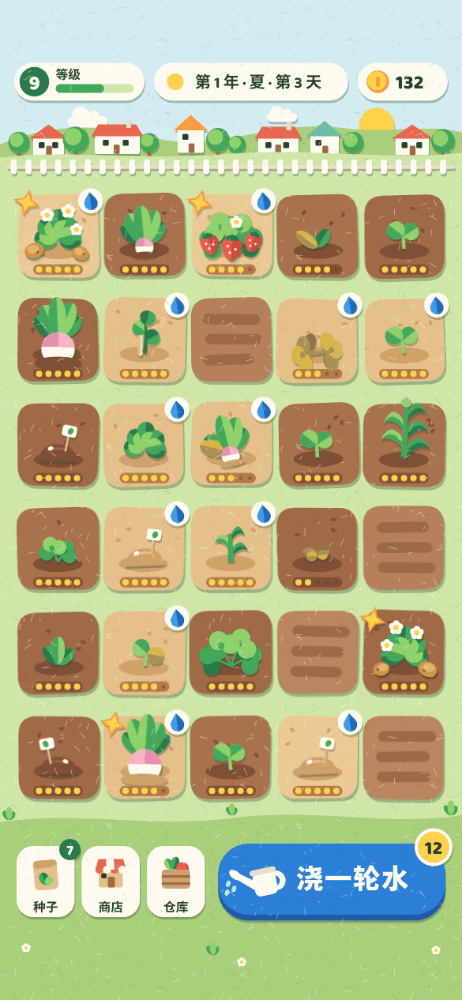
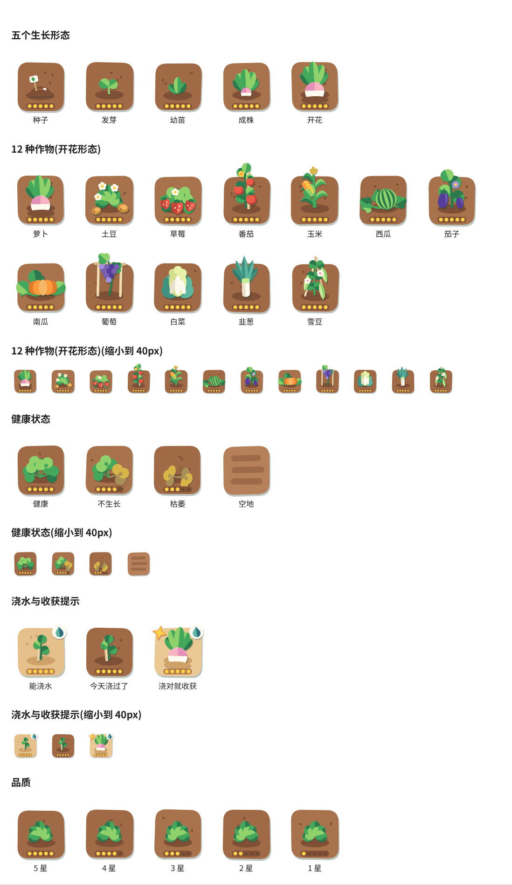

# 美术规范

本文是灵谷小镇视觉风格的唯一依据:农场界面、每一张对外发布的图、以后的小镇,都按它来做。

- **方向:彩纸拼贴。** 2026-11-19 由项目负责人选定,背景和没选的方向见[决策记录 0015](../decisions/0015-art-direction-paper-collage.md)。
- **参考实现:** [`art-exploration/style-paper.js`](art-exploration/style-paper.js)。本文的尺寸和色值都取自它,
  打开[探索稿页面](art-exploration/index.html)可以看到实际画面。
- **现在的成熟度:** 只画过农场这一屏,而且是代码画的示意稿。本文把已经定下来的写成规则,
  把没画过、没验证过的列在[还没定的](#还没定的)里,不假装它们已经有答案。
- **矿洞还没画。** 本文定稿之后游戏加入了矿洞([决策记录 0016](../decisions/0016-mine-screens-farm-teaches.md)):
  新词和复习都在矿里,田里只种答错的词。玩家开局第一件事是挖矿,而矿洞、矿石、词袋、商店都还没有美术设计。
  农场的画法不受影响;受影响的几处已在文中改正并注明。

*参考图:第 1 年夏季第 3 天的示意存档,30 块地。代码绘制的示意稿,不是成品。*

## 一句话

**用彩色纸片剪出来、一层层贴起来的田园小镇。**

## 五条原则

每一个画面决定都要对得上至少一条。它们按优先级排列,冲突时靠前的赢。

1. **先认得出,再好看。** 玩家扫一眼农场,就要看出哪些能浇水、哪些蔫了、哪些快收获
   ([设计支柱](01-vision.md#设计支柱) 2)。任何让画面更好看但让状态更难认的改动,都不做。
2. **状态靠变换,不靠重画。** 生长、不生长、枯萎都由同一组纸片换颜色、转角度、挪位置得到。
   这是一个人能长期做下去的前提,也是选这个方向的主要理由。
3. **一切都是纸片。** 纯色、没有描边、没有渐变、没有模糊。形体靠浅色纸叠在深色纸上区分。
4. **日常的田园,不是仙境。** 画的是蔬菜、木栅栏、水壶、红屋顶的小房子。
   "灵谷"这个名字容易被当成修仙题材([决策记录 0011](../decisions/0011-name.md)),画面负责把预期拉回来。
5. **蔫了,不是坏了。** 枯萎看得出来,但不吓人、不让人愧疚([设计支柱](01-vision.md#设计支柱) 5)。

## 配色

色值是定下来的。新增颜色要先说明现有的哪一个不够用。

### 色板

| 名称 | 色值 | 暗部 | 用在哪 |
|---|---|---|---|
| 草地 | `#cfe6a6` | `#a9cf7c` | 画面底色;深的那档用于远山和底部操作区 |
| 天空 | `#d3ecf2` | | 封面和远景的天 |
| 干土 | `#e6c08a` | `#cfa26a` | **能浇水**的地块 |
| 湿土 | `#a06a47` | `#7f5036` | **今天浇过了**或今天刚种下的地块 |
| 空地 | `#b5805a` | `#9c6a49` | 没有作物的地块,明度在干土和湿土之间 |
| 嫩叶 | `#8fd16a` | | 叶片亮面、发芽 |
| 叶绿 | `#43a85c` | | 叶片主色 |
| 深叶 | `#2b7a4d` | | 叶片暗面、茎;压白字的绿色底 |
| 蓝绿 | `#5fb7a0` | `#3f927f` | 韭葱、白菜外叶 |
| 芥末黄 | `#d8b548` | `#a89058`、`#86733f` | **枯萎和发黄**的叶子,三档:芥末黄、卡其、深卡其 |
| 番茄红 | `#ee5b4b` | `#c9433a` | 番茄、草莓 |
| 屋顶红 | `#e8684f` | | 小镇的屋顶 |
| 南瓜橙 | `#ff9a3d` | `#e87a22` | 南瓜、收获标记的底层 |
| 玉米黄 | `#ffd24a` | | 星、收获标记、角标、金币、标题的强调底 |
| 茄紫 | `#7b5cc4` | `#553c9a` | 茄子、葡萄 |
| 淡粉 | `#f7b3c2` | `#e58fb9` | 萝卜的根肩 |
| 水蓝 | `#3d9be9` | `#2468b8` | **水滴标记,别处不用** |
| 按钮蓝 | `#2b7fd6` | `#1f5ba6` | "浇一轮水"主按钮的底 |
| 纸白 | `#fffaf0` | `#e9dfc8` | 界面纸片、花、白菜帮、标记的底 |
| 墨绿 | `#27402f` | | 文字 |
| 投影 | `#1f3d2b`,不透明度 30% | | 所有硬边投影 |

### 用色规则

- **蓝色只表示水。** 整个农场画面里,蓝色只出现在水滴标记和"浇一轮水"按钮上,所以"蓝色在哪,哪里就能浇水"。
  环境、图标、装饰都不用蓝色。
- **黄色表示得到的东西。** 星、收获标记、金币、计数角标。
- **红色只是果实和屋顶,不当警告色。** 这个游戏里没有红色的感叹号。
- **不用纯黑和纯白。** 最深的是墨绿,最浅的是纸白。
- **每种颜色最多三档明度**,暗部是一块硬边的深色纸片,不是渐变。

### 明暗对比,实测值

按 WCAG 的相对亮度公式算出的对比度。它衡量的是"去掉颜色只看明暗时还分不分得开",色觉异常的玩家主要靠这个。

| 一对颜色 | 对比度 | 说明 |
|---|---|---|
| 干土和湿土 | 2.64 | 能浇和不能浇的地块,靠明暗就分得开 |
| 湿土和草地 | 3.34 | 浇过的地块在底色上清楚 |
| 干土和草地 | 1.26 | 干土地块靠投影和水滴从底色上分出来,不靠明暗 |
| 空地和干土 / 空地和湿土 | 1.98 / 1.33 | 空地另有三道垄,并且没有星带,不单靠颜色 |
| 水蓝和纸白 | 2.86 | 水滴画在纸白圆片上 |
| 纸白和湿土 / 纸白和干土 | 4.34 / 1.64 | 水滴的白底只会出现在干土上,对比弱,靠投影和探出地块来补 |
| 墨绿和纸白 | 10.85 | 正文 |
| 纸白和按钮蓝 | 3.95 | 主按钮上的白字,23pt 粗体 |
| 纸白和深叶 | 5.05 | 等级、种子数这些绿底上的白字 |
| 墨绿和玉米黄 | 7.83 | 角标上的数字 |
| 芥末黄 / 卡其 / 深卡其,在干土上 | 1.16 / 1.81 / 2.70 | 枯萎的叶子在干土上,只有最深的一档立得住 |
| 芥末黄 / 卡其 / 深卡其,在湿土上 | 2.29 / 1.46 / 1.02 | 在湿土上反过来,只有最浅的一档立得住 |
| 番茄红和叶绿 | 1.12 | 红果和绿叶明暗几乎一样,只靠色相区分 |

从这张表得出三条规则:

1. **白字只压在按钮蓝、深叶、墨绿上。** 不压在水蓝(2.86)和叶绿(2.89)上。
   探索稿最初用的是水蓝和叶绿,选定后已经在参考实现里改掉。
2. **枯萎不能靠叶子和土的颜色对比来认。** 它靠姿态(整株下垂),颜色只是辅助。
   枯萎的叶子必须同时用到三档颜色,保证不管落在干土还是湿土上,都有一档看得见。
3. **红色的果实要有形状上的提示**:白色的高光或籽、浅色的果蒂。红绿色觉异常的玩家看不出红果和绿叶的色差。

## 字体

| 用途 | 字体 | 字重 | 规则 |
|---|---|---|---|
| 名称、封面和卡片的大标题 | 站酷快乐体 | 400 | 只用于 28pt 以上的短句。不排正文,不排英文长词 |
| 界面的中文 | 思源黑体(Noto Sans SC) | 700 | |
| 界面的英文和数字 | Baloo 2 | 700、800 | 数字用等宽数字 |
| 单词、音标、释义 | Baloo 2 配思源黑体 | 单词 700,其余 500 | 这是产品的正文,可读性优先于风格 |

- 界面文字不小于 11pt(390pt 宽的画布上)。探索稿里有 10.5pt 的标签,正式做时放大。
- 单词卡片和答题界面还没有设计。届时单词不小于 24pt,释义不小于 16pt。
- **不用书法体、毛笔字、印章。** 那是修仙和国风的字体语言。
- 这些字体在 Google Fonts 上都标注为 SIL 开源字体许可。**正式使用前要逐个核对许可原文**,这一步还没做。
- Baloo 2 是否覆盖全部音标符号没有核实。答题界面开工时先查这一条。

## 形状

- **基本形:** 圆、半圆、水滴形的叶片、圆角矩形。作物由这几种拼出来。
- **圆胖。** 叶片比真实的更圆更宽,果实比例放大。宁可夸张,不要写实。
- **没有描边、渐变、模糊、发光。**
- **叶子是一张对折的纸:** 左半边浅,右半边深。这是整套画面里表现体积的唯一办法。
- **硬边投影:** 一个不模糊的偏移副本,颜色见色板。只加在主要层级上,一片叶子、一个果实不单独加。

  | 层级 | 偏移(390pt 画布) |
  |---|---|
  | 地块 | 向右 1.2pt,向下 2.6pt |
  | 作物整体、标记、界面纸片 | 向右 0.9pt,向下 1.7pt |
  | 封面上的大纸片(1080 宽) | 向右 7px,向下 12px |

- **手剪的不整齐:** 地块的四个角各自偏移不超过 2.4pt,整块旋转不超过 ±1.1 度。作物整体可以有几度的随机倾斜。
  不整齐只加在大形上,不要让每条边都抖。
- **纸的质感:** 整屏叠一层很轻的纸纤维颗粒,只叠一次。颗粒要轻,不能显脏。

## 地块和农场

| 项目 | 值(390×844pt 的画布) |
|---|---|
| 地块 | 68×70pt,圆角 16pt |
| 列距 / 行距 | 73pt / 88pt |
| 每行列数 | 5 |
| 左右边距 | 15pt |
| 农场区域 | 约从 y=150 到 y=680,30 块地一屏放下 |

- 行距比地块高 18pt,留给高的作物向上探出去,同时不挡住上一行地块下沿的星带。
- 每块地中间有一个比土色深一档的椭圆"土坑",作物立在上面。
- **空地**是三道横向的垄,没有星带,没有任何提示符号。它只是一块翻好的土。
- 一块地上从下到上是四层:地块、作物、星带、标记。星带和标记永远在作物之上。

### 120 块地怎么放

规则允许地块从 30 块扩到 120 块。下面是建议,**没有做过交互验证**,在农场切片里定:

- 每 30 块地是一片田,和现在的一屏相同。最多四片,上下排列,纵向滚动。
- 全景视图把地块缩到约 28pt。探索稿检验过这个尺寸:干土和湿土、水滴、收获标记仍然清楚;
  作物只剩轮廓和主色;品质星带变成一条线;"不生长"基本看不出。

所以细节按大小分级显示:

| 地块在屏幕上的宽度 | 看得清的 |
|---|---|
| 60pt 以上 | 全部 |
| 约 40pt | 干湿、水滴、收获标记、作物种类、枯萎;星带勉强;不生长很难 |
| 约 28pt | 干湿、水滴、收获标记、作物的轮廓和主色、枯萎的颜色 |

全景只承担"哪里需要我"这一个问题,其余细节回到单片田里看。

## 作物

*参考图:五个生长形态、12 种作物的开花形态、健康状态、浇水和收获提示、品质。代码绘制的示意稿。*

### 五个生长形态

形态的定义以[玩法规则](02-gameplay.md#生长形态)为准,这里只规定怎么画。

| 形态 | 画法 |
|---|---|
| 种子 | 一个小土堆,旁边插一块白色的小标签牌。所有作物相同 |
| 发芽 | 两片圆圆的子叶。所有作物相同 |
| 幼苗 | 小株,开始有这种作物的叶形和颜色 |
| 成株 | 长满的株型,没有花和果,或只有青涩的小果 |
| 开花 | 有花,能看到成熟的果实或可食用的部分。**这是每种作物最容易认出来的形态** |

- 作物相对地块放大到 1.18 倍,可以高出地块上沿,但不能盖住自己的星带。
- 五个形态在田里出现的机会差不多,而且波动很大。模拟里每周抽查一次(模拟数据,默认参数,30 块地,
  第 7 到 365 天,每天晚上那次打开之后):种子形态占 7% 到 48%,发芽 7% 到 39%,幼苗 4% 到 43%,
  成株 3% 到 39%,开花 7% 到 38%。所以每个形态都要认真画,种子的标签牌和土堆也要画得讨喜,不能敷衍。

### 12 种作物

小尺寸下靠**株型轮廓**和**一个点睛的颜色**区分。作物表以[玩法规则](02-gameplay.md#作物与季节)为准。

| 季节 | 作物 | 株型 | 点睛 |
|---|---|---|---|
| 春 | 萝卜 | 低矮的一丛直立长叶,根从土里露出肩膀 | 白色带淡粉的根肩 |
| 春 | 土豆 | 蓬松的圆灌丛 | 小白花,土堆边露出一两个黄褐色的土豆 |
| 春 | 草莓 | 贴地的三出叶 | 红色的草莓,小白花 |
| 夏 | 番茄 | 沿着一根支架向上长 | 红色的圆果 |
| 夏 | 玉米 | 最高,一根直秆,长叶向两边弯 | 黄色的玉米棒,顶上有穗 |
| 夏 | 西瓜 | 贴地的藤和裂叶 | 深浅绿条纹的大圆瓜 |
| 秋 | 茄子 | 中等高的灌丛,大叶 | 垂下来的深紫色长果,紫花 |
| 秋 | 南瓜 | 贴地的藤和大圆叶 | 橙色带棱的扁圆南瓜 |
| 秋 | 葡萄 | 攀在小木架上 | 一串紫色的葡萄 |
| 冬 | 白菜 | 一整颗包起来的菜头 | 白色的菜帮,淡黄绿的叶 |
| 冬 | 韭葱 | 直立的扇形蓝绿色扁叶 | 白色的葱白 |
| 冬 | 雪豆 | 沿着细杆攀爬,有卷须 | 扁平的浅绿豆荚,小白花 |

**已知分不开的地方**,正式画的时候要解决:

- 萝卜、土豆、草莓的幼苗都是一小团绿。
- 雪豆和番茄都是"沿着杆子往上长",轮廓相近,现在只靠果色区分。
- 茄子、南瓜、葡萄、白菜、韭葱、雪豆这六种,探索稿只认真画了开花形态,幼苗和成株是把开花形态缩小去果,还要重画。

## 状态

状态的定义以[玩法规则](02-gameplay.md#品质与健康)为准。

| 状态 | 画法 | 备注 |
|---|---|---|
| 能浇水 | 干土色的地块,加右上角的**水滴标记** | 玩家扫一眼最先要看到的东西 |
| 今天浇过了,或今天刚种下 | 湿土色的地块,没有标记 | |
| 不生长(上次答错) | 整株向一侧歪 9 度,一片叶子换成芥末黄 | 不加任何警告图标 |
| 枯萎(连错两次) | 茎的顶端弯成钩,叶片转到下垂,颜色整体换成芥末黄、卡其、深卡其 | 果实换成同色相的灰调 |
| 品质 | 地块下沿一条**星带**:5 个位置,剩下的星是大的玉米黄圆点,扣掉的是小的暗点 | 大小和明度都不同,不只靠颜色 |
| 浇对就收获 | 左上角的**收获标记**:一个四角星,橙色底上叠一层黄色 | 是两层纸,不是光晕 |
| 空地 | 三道垄,见上文 | |

说明:

- **状态不只靠色相。** 能浇水有水滴的形状,枯萎有姿态,品质有大小。这是硬性要求。
- **枯萎和不生长由变换得到**,不为每种作物另画一套。但高秆的(玉米、番茄)和贴地的(草莓、西瓜)要两套下垂规则,
  贴地作物的下垂幅度很小,主要靠颜色,这一点还要改进。
- **收获标记要不要保留,待定。** 加它的时候,旧词回到田里只要浇对 1 到 3 次就收获,会跳过后面的形态,
  "开花"不等于"快收获",所以"就差一步"需要独立的标记。加入矿洞之后田里没有复习作物,所有作物都浇对 5 次才收获,
  开花形态就是只差最后一次,标记和形态说的是同一件事。留着是双重提示,去掉画面更干净,由负责人决定。
  参考图里还画着它。
- **死亡没有画过。** 规则是连错三次作物消失、这个词去休息。画面上的基调是"它去休息了,以后还会回来",
  地块变回空地。具体的动画在[路线图](06-roadmap.md)第 4 步设计。

### 标记

| 标记 | 位置 | 画法 |
|---|---|---|
| 水滴 | 地块右上角,圆心在地块边缘附近,探出地块 | 半径 10.6pt 的纸白圆片,上面一个水蓝的水滴,左半浅右半深,整体转 -8 度 |
| 收获 | 地块左上角,探出地块 | 半径 11.4pt 的橙色四角星,上面叠一个 8.2pt 的黄色四角星,整体转 14 度 |
| 星带 | 地块下沿,宽 42pt,高 8.6pt | 一条比土色深的圆角纸带,亮点半径 2.7pt,暗点 1.5pt。不加投影,保持安静 |

## 界面

农场这一屏的界面元素。其他界面(答题、单词卡片、商店、仓库)还没有设计,沿用这里的做法。

- **界面元素都是纸片:** 纸白色的圆角形,加一道硬边投影。
- **顶部信息**是三个高 32pt 的药丸形纸片:等级和经验条、日期、金币。上方留出 47pt 的系统安全区。
- **"浇一轮水"是整屏唯一的大块饱和色。** 按钮蓝的底,下面垫一层深蓝像一张厚纸,白色 23pt 粗体字,
  右上角一个玉米黄的圆形角标,里面是墨绿色的数字(现在能浇水的作物数)。
- 主按钮放在屏幕下方、拇指够得着的位置:参考实现里是 y=712 到 777,右侧。下方留出 34pt 的系统安全区。
- **次要按钮**(种子、商店、仓库)是 49×60pt 的小纸片,图标加一行小字,不和主按钮抢注意力。
  参考图画的是加入矿洞之前的三个按钮。现在还需要矿洞的入口和词袋,仓库里除了作物还有矿石,底部怎么排要重新设计。

## 环境

- 农场上方一条窄窄的远景:几座小房子(红屋顶、白墙、深色的方窗)、圆圆的树、一个圆太阳、一排白色的矮栅栏。
- 农场周围贴几丛草叶和小白花。
- **克制。** 农场是主角,环境只负责建立"这是一个小镇边上的菜园"。远景的高度不超过屏幕的 8%。
- 探索稿里的房子和按钮图标偏通用,正式画的时候要有这个项目自己的样子。

## 动效

**这一节是方向,没有做过演示,也没有验证过。** 在[路线图](06-roadmap.md)第 4 步落实,那一步决定了答题是享受还是忍受。

- 动效的词汇是纸的词汇:**贴上去、翻起来、弹一下、转过去。**
- 生长是新的纸片弹出来。浇水是地块从干土色换成湿土色,水滴标记落下去。
- 枯萎是叶片慢慢转下去。恢复是它们弹回来。
- 收获时星星一颗一颗贴上去。这是最值得截图的瞬间,要当成功能来设计。
- 全部用位移、旋转、缩放和换色完成,不画逐帧动画。
- **没有发光、光晕、飘浮的粒子、拖尾。** 那是修仙题材的动效语言。

## 社交媒体画面

每一篇对外内容都用同一套版式,观众才认得出是同一个项目。平台和流程见[内容策略](../marketing/01-content-strategy.md)。

*参考图:3:4 封面的示意。标题借用了第一篇选题。*

### 尺寸

| 用途 | 尺寸 |
|---|---|
| 小红书封面和图文组 | 1080×1440(3:4),一组 6 到 9 张,全部同一尺寸 |
| 竖屏短视频 | 1080×1920(9:16) |

### 版式

第一组按这套版式做出来的图在 [`docs/marketing/assets/art-directions/`](../marketing/assets/art-directions/),
源文件是 [`art-exploration/cards.html`](art-exploration/cards.html)。下面的数值都以 1080px 宽为准。

- **底:** 草地色。
- **纸片:** 纸白色的圆角矩形(圆角 28 到 48px),硬边投影。大纸片可以歪 1 度左右,像贴上去的。
- **标题:** 站酷快乐体,墨绿色。封面标题不小于 130px,每行不超过 7 个字;内页标题不小于 90px。
- **强调:** 给关键词垫一条玉米黄的纸条。一张图里只强调一处。
- **正文:** Baloo 2 配思源黑体,700,不小于 36px。一张图只讲一件事,文字越少越好。
- **编号角标:** 玉米黄的圆,里面是墨绿色的字母或数字。
- **游戏画面:** 放在圆角 46px 的框里,加硬边投影。画面本身不裁切、不加滤镜。
- **边距:** 四周 64px。
- **页脚:** 左边"灵谷小镇 Lingdale · 栏目名",右边页码,26px。
- 封面在 420px 宽的缩略图下检查过,标题读得出来。

### 竖屏视频

还没有做过。原则是和图文同一套纸片、同一套字体。上方约 220px 和下方约 420px 会被平台的界面盖住,关键内容不放在那里
(这两个数是估计,发第一条之前按各平台当时的界面核对)。

### 诚实

和[内容策略](../marketing/01-content-strategy.md#什么是高质量)的要求相同,落到画面上是:

- **示意稿要写明是示意稿。** 在成品美术做出来之前,每张图的页脚都带"示意稿,不是成品"。
- **没做出来的不画成已有的。** 不为了封面好看,画一个游戏里不存在的界面。
- **图里的数据必须是真的。** 数据图用模拟器或真实日志的数字画,模拟的注明是模拟的。
- **AI 协助产出的画面,发布时按平台规定声明。** 用到图像生成工具的,在
  [探索稿目录的登记表](art-exploration/README.md#ai-生成素材登记)里记下工具和日期。

## 不做什么

- **不模仿任何具体的已有游戏。** 不使用、不仿造任何具体游戏的画面、角色、图标和配色方案。
  给图像生成工具的提示词里也不写任何游戏或画师的名字。
- **不出现修仙和国风的视觉元素:** 发光的灵气、符文、祥云纹、仙山云雾、水墨山水、书法字、印章、玉石、紫金配色、飘浮的粒子。
- **不吓人,不催人:** 没有骷髅、裂痕、黑色的枯枝、红色警告、感叹号、倒计时。
- **不用表情符号当图形。**

## 素材怎么做

- **源文件是矢量的**,用代码或矢量工具画,存进仓库。导出成位图给引擎用,导出的倍率和图集的切法在建 Cocos 工程时定。
- **每种作物是一组挂在骨架上的纸片**,而不是一张画好的图。这样不生长、枯萎、生长动画才能用变换得到。
  在引擎里换色怎么实现(换图还是着色)也在建工程时定。
- **AI 协助的方式是帮忙写出和修改图形**,由创作者看着画面调,审美由创作者把关。
  这样产出的每一张,线条、颜色、比例天然一致。它们属于 AI 协助产出的内容。
- 如果以后某些画面(比如宣传用的主视觉)要用图像生成工具,先得到负责人同意,生成后登记,发布时声明。
- **AI 协助产出的美术能否用于正式上架,版权归属和各平台的披露要求都没有核实**,见[路线图](06-roadmap.md#未决问题)。

## 还没定的

没画过,或者画了但没验证的。做到的时候回来更新本文。

| 事项 | 现状 |
|---|---|
| 答题界面、单词卡片 | 没画。这是玩家停留最久的界面 |
| 矿洞 | 没画。矿脉、挖矿时的答题、爆出矿石、运气好多升一级、还能答错几次、因为田满而关门时的样子和引导。这是玩家开局看到的第一个画面 |
| 矿石 | 没画。七个品级要一眼分得出高低,名称(铜、铁、银、金、翡翠、红宝石、钻石)还是占位 |
| 词袋和商店 | 没画。词袋里是等着被种下的词;商店按品种卖三种种子 |
| 农场底部的按钮 | 要加矿洞的入口和词袋,重新排 |
| 收获标记 | 留还是去掉,待定,见[状态](#状态) |
| 收获和星级揭晓、升级、死亡的画面和动画 | 没画 |
| 所有动效 | 只有方向,没有演示 |
| 未解锁的地块 | 没画 |
| 四季 | 只画了一种底色。换季时环境怎么变没有设计。规则上季节只换作物,不改任何别的 |
| 小镇 | 只有远景里的几座小房子。小镇本身的玩法也还没有设计 |
| 120 块地的布局和全景 | 有建议,没有交互验证 |
| 贴地作物的枯萎 | 姿态变化太小,主要靠颜色 |
| "不生长"在小尺寸下 | 40pt 以下基本看不出。要不要在全景里表达它,待定 |
| 六种作物的幼苗和成株 | 只是开花形态的缩小,要重画 |
| 色觉异常的检查 | 只算了明暗对比,没有做色觉模拟 |
| 治愈感够不够 | 这个方向的主要风险是显得像一个应用而不是游戏。要靠真机上的画面和目标用户的反应来判断 |
| 目标用户喜不喜欢 | 没问过。见选题库里"这几种画风,你更喜欢哪个" |
| 字体许可、音标字符的覆盖 | 没核实 |
