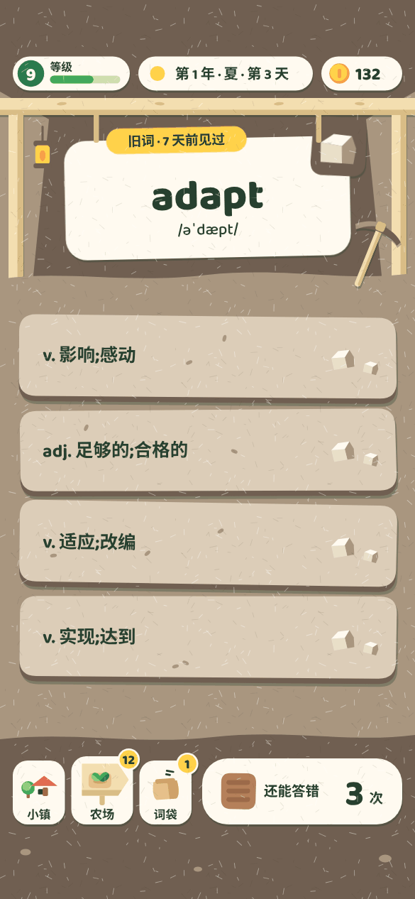
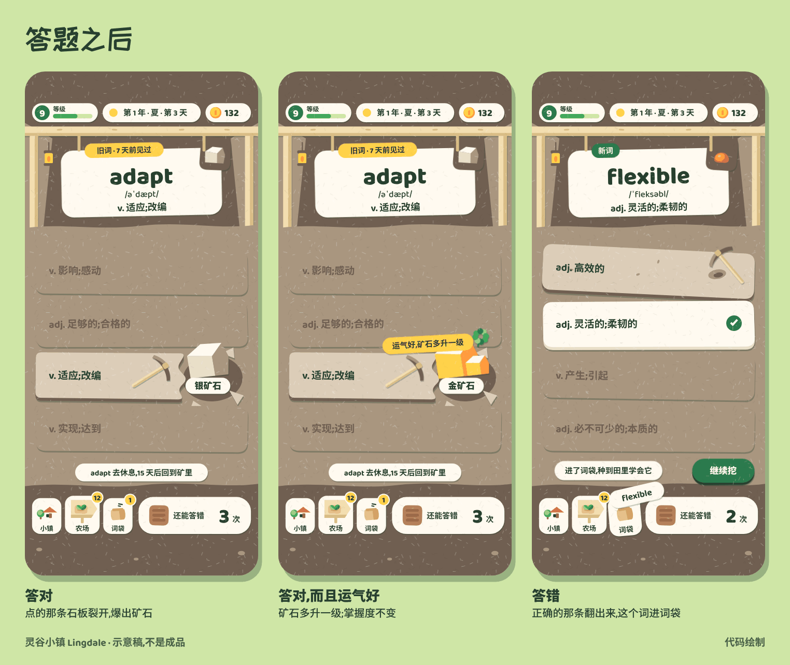
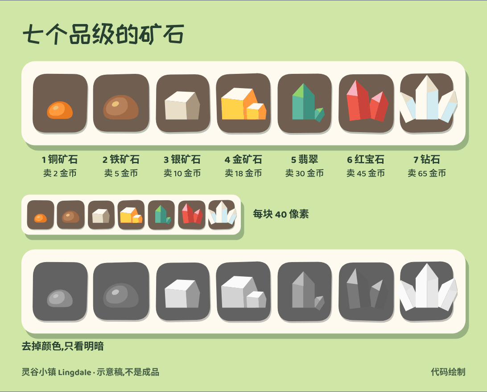
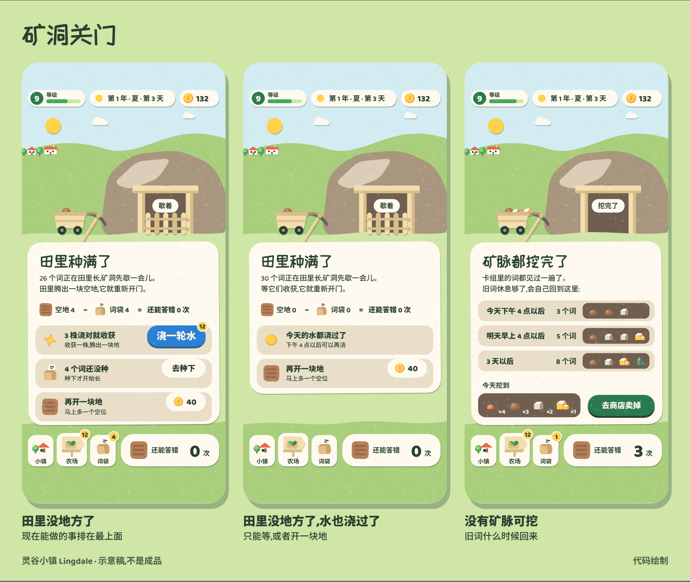
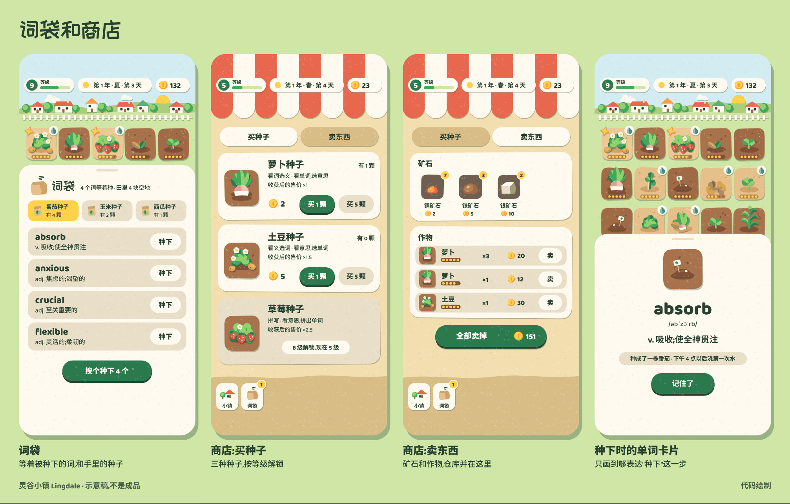
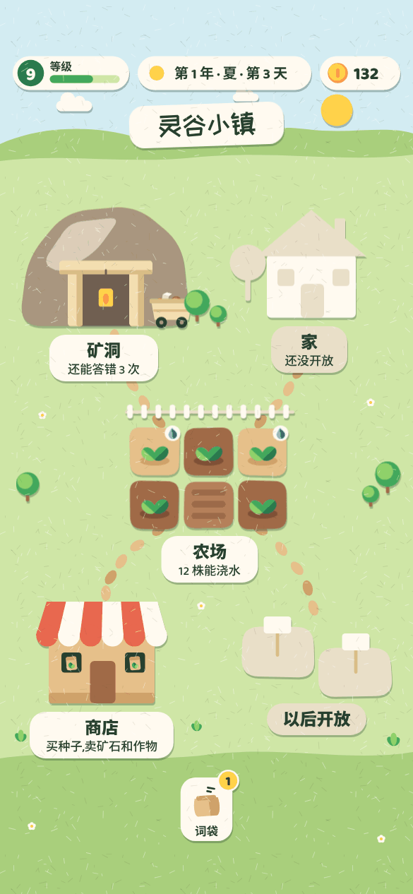
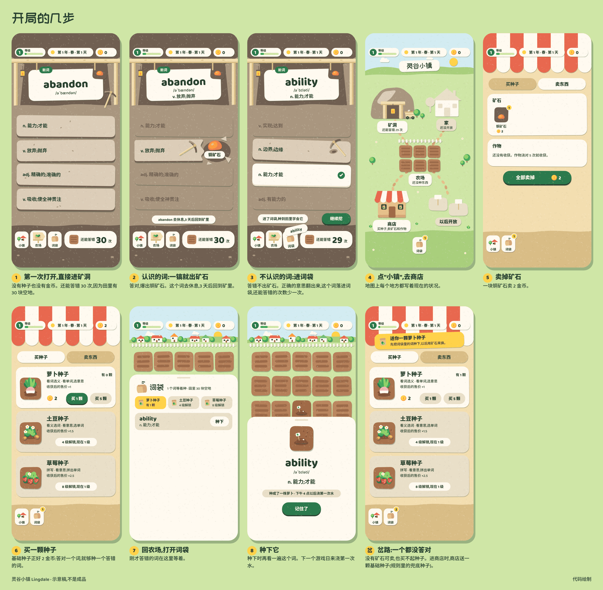
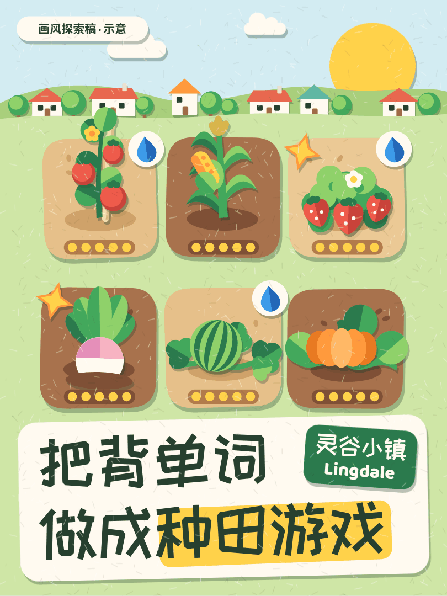

# 美术规范

本文是灵谷小镇视觉风格的唯一依据:农场和矿洞的界面、每一张对外发布的图、以后的小镇,都按它来做。

- **方向:彩纸拼贴。** 2026-11-19 由项目负责人选定,背景和没选的方向见[决策记录 0015](../decisions/0015-art-direction-paper-collage.md)。
- **参考实现:** 农场是 [`art-exploration/style-paper.js`](art-exploration/style-paper.js),
  矿洞这一边是 [`mine-screens/mine-paper.js`](mine-screens/mine-paper.js) 和 [`mine-screens/screens.js`](mine-screens/screens.js)。
  本文的尺寸和色值都取自它们。实际画面见[农场的探索稿页面](art-exploration/index.html)和[矿洞画面的页面](mine-screens/index.html)。
- **现在的成熟度:** 画过农场、矿洞、矿洞关门、词袋、商店、小镇地图这几屏,全部是代码画的示意稿,没有动效,没有上过真机。
  本文把已经定下来的写成规则,把没画过、没验证过的列在[还没定的](#还没定的)里,不假装它们已经有答案。
- **矿洞这一边是 2026-11-20 补上的。** 构图、矿石的画法、用色的两处例外、小镇地图和底部按钮由项目负责人选定,
  背景见[决策记录 0017](../decisions/0017-mine-screens-art.md) 和 [0018](../decisions/0018-town-map-as-hub.md),
  当时比较过的方案在[方案比较页](mine-screens/options.html)。

*参考图:第 1 年夏季第 3 天的示意存档,30 块地。底部是加入矿洞和小镇地图之后的按钮。代码绘制的示意稿,不是成品。*

## 一句话

**用彩色纸片剪出来、一层层贴起来的田园小镇。**

## 五条原则

每一个画面决定都要对得上至少一条。它们按优先级排列,冲突时靠前的赢。

1. **先认得出,再好看。** 玩家扫一眼农场,就要看出哪些能浇水、哪些蔫了、哪些快收获
   ([设计支柱](01-vision.md#设计支柱) 2)。任何让画面更好看但让状态更难认的改动,都不做。
2. **状态靠变换,不靠重画。** 生长、不生长、枯萎都由同一组纸片换颜色、转角度、挪位置得到。
   这是一个人能长期做下去的前提,也是选这个方向的主要理由。
3. **一切都是纸片。** 纯色、没有描边、没有渐变、没有模糊。形体靠浅色纸叠在深色纸上区分。
4. **日常的田园,不是仙境。** 画的是蔬菜、木栅栏、水壶、红屋顶的小房子,和小镇边上一个木头撑起来的小矿洞。
   "灵谷"这个名字容易被当成修仙题材([决策记录 0011](../decisions/0011-name.md)),画面负责把预期拉回来。
5. **蔫了,不是坏了。** 枯萎看得出来,但不吓人、不让人愧疚([设计支柱](01-vision.md#设计支柱) 5)。

## 配色

色值是定下来的。新增颜色要先说明现有的哪一个不够用。

### 色板

| 名称 | 色值 | 暗部 | 用在哪 |
|---|---|---|---|
| 草地 | `#cfe6a6` | `#a9cf7c` | 画面底色;深的那档用于远山和底部操作区 |
| 天空 | `#d3ecf2` | | 封面和远景的天;钻石的暗面(唯一的例外,见用色规则) |
| 干土 | `#e6c08a` | `#cfa26a` | **能浇水**的地块 |
| 湿土 | `#a06a47` | `#7f5036` | **今天浇过了**或今天刚种下的地块 |
| 空地 | `#b5805a` | `#9c6a49` | 没有作物的地块,明度在干土和湿土之间 |
| 嫩叶 | `#8fd16a` | | 叶片亮面、发芽 |
| 叶绿 | `#43a85c` | | 叶片主色 |
| 深叶 | `#2b7a4d` | | 叶片暗面、茎;压白字的绿色底:等级、"新词"的标签、对勾、蓝色之外的主按钮 |
| 蓝绿 | `#5fb7a0` | `#3f927f` | 韭葱、白菜外叶 |
| 芥末黄 | `#d8b548` | `#a89058`、`#86733f` | **枯萎和发黄**的叶子,三档:芥末黄、卡其、深卡其 |
| 番茄红 | `#ee5b4b` | `#c9433a` | 番茄、草莓、红宝石 |
| 屋顶红 | `#e8684f` | | 小镇的屋顶 |
| 南瓜橙 | `#ff9a3d` | `#e87a22` | 南瓜、收获标记的底层 |
| 玉米黄 | `#ffd24a` | | 星、收获标记、角标、金币、金矿石、标题的强调底、"旧词"的标签、运气好的纸带 |
| 茄紫 | `#7b5cc4` | `#553c9a` | 茄子、葡萄 |
| 淡粉 | `#f7b3c2` | `#e58fb9` | 萝卜的根肩 |
| 水蓝 | `#3d9be9` | `#2468b8` | **水滴标记,别处不用** |
| 按钮蓝 | `#2b7fd6` | `#1f5ba6` | "浇一轮水"主按钮的底 |
| 岩石 | `#a9967f` | 浅 `#dccdb8`、深 `#705f51` | 矿壁是中间一档;选项的石板是浅的;洞的深处、矿石的垫片、镐头是深的 |
| 木色 | `#f3deb0` | `#d9bd86` | 作物的支架、矿洞的梁和柱、路牌、矿车、商店的墙 |
| 纸白 | `#fffaf0` | `#e9dfc8` | 界面纸片、花、白菜帮、标记的底 |
| 墨绿 | `#27402f` | | 文字 |
| 投影 | `#1f3d2b`,不透明度 30% | | 所有硬边投影 |

岩石是矿洞这一边唯一新增的一组颜色。现有的土色不够用:干土和湿土的明暗在农场里表示"能浇水"和"浇过了",
拿来画矿壁会带着这层意思;它们又都偏橙红,铜和铁的矿石放上去分不出来。岩石是一组偏灰的暖褐色。
木色不是新增的:参考实现一直用它画支架,只是表里漏了,这次补上。

### 用色规则

- **蓝色只表示水。** 蓝色只出现在水滴标记和"浇一轮水"按钮上,所以"蓝色在哪,哪里就能浇水"。
  环境、图标、装饰都不用蓝色。矿洞关门时那个通向浇水的按钮也是蓝的,这符合规则。
  - **唯一的例外:钻石的暗面用天空色。** 这是负责人选的([决策记录 0017](../decisions/0017-mine-screens-art.md))。
    天空色很淡,和水蓝的明暗差是 2.41,不会被读成水滴;但它确实偏蓝。所以钻石不放在农场这一屏上:
    农场上需要一个矿石的图标时,用金矿石。
- **黄色表示得到的东西。** 星、收获标记、金币、计数角标、金矿石。
- **红色是东西本身的颜色,不当警告色。** 果实、屋顶、红宝石、商店的雨棚。这个游戏里没有红色的感叹号,
  答错也不用红色和叉。红宝石只在答对时出现。
- **不用纯黑和纯白。** 最深的是墨绿,最浅的是纸白。
- **每种颜色最多三档明度**,暗部是一块硬边的深色纸片,不是渐变。
- **矿石不直接放在纸白上。** 银和钻石是纸白的,所以矿石在界面里总是垫着一块岩石深色的石片。
- **还没开放的东西不上色**,只用纸白和纸白暗,见[小镇地图](#小镇地图)。

### 明暗对比,实测值

按 WCAG 的相对亮度公式算出的对比度。它衡量的是"去掉颜色只看明暗时还分不分得开",色觉异常的玩家主要靠这个。

| 一对颜色 | 对比度 | 说明 |
|---|---|---|
| 干土和湿土 | 2.64 | 能浇和不能浇的地块,靠明暗就分得开 |
| 湿土和草地 | 3.34 | 浇过的地块在底色上清楚 |
| 干土和草地 | 1.26 | 干土地块靠投影和水滴从底色上分出来,不靠明暗 |
| 空地和干土 / 空地和湿土 | 1.98 / 1.33 | 空地另有三道垄,并且没有星带,不单靠颜色 |
| 水蓝和纸白 | 2.86 | 水滴画在纸白圆片上 |
| 纸白和湿土 / 纸白和干土 | 4.34 / 1.64 | 水滴的白底只会出现在干土上,对比弱,靠投影和探出地块来补 |
| 墨绿和纸白 | 10.85 | 正文 |
| 纸白和按钮蓝 | 3.95 | 主按钮上的白字,23pt 粗体 |
| 纸白和深叶 | 5.05 | 等级、种子数这些绿底上的白字 |
| 墨绿和玉米黄 | 7.83 | 角标上的数字 |
| 芥末黄 / 卡其 / 深卡其,在干土上 | 1.16 / 1.81 / 2.70 | 枯萎的叶子在干土上,只有最深的一档立得住 |
| 芥末黄 / 卡其 / 深卡其,在湿土上 | 2.29 / 1.46 / 1.02 | 在湿土上反过来,只有最浅的一档立得住 |
| 番茄红和叶绿 | 1.12 | 红果和绿叶明暗几乎一样,只靠色相区分 |
| 墨绿和岩石浅 | 7.24 | 石板上的释义 |
| 墨绿和纸白暗 | 8.52 | 词袋、商店、关门画面里一行一行的底 |
| 墨绿和木色 / 木色暗 | 8.54 / 6.22 | 商店的墙和没选中的页签上的字 |
| 纸白和岩石深 | 5.86 | "今天挖到"里矿石旁边的数量 |
| 岩石深和岩石 | 2.14 | 答完之后沉回矿壁的石板上的字。**故意放低**:这一题已经答完,这几条不再需要读 |
| 岩石浅和岩石 / 岩石和岩石深 | 1.83 / 2.14 | 石板在矿壁上、矿壁在洞的深处前面。石板另有投影和垫在下面的一层 |
| 矿石的亮面在岩石深的垫片上:铜、铁、银、金 | 2.89 / 1.80 / 4.60 / 4.23 | 铁最弱,靠高光和圆的轮廓 |
| 矿石的亮面在垫片上:第 5 级、红宝石、钻石 | 2.55 / 1.81 / 5.86 | 红宝石偏暗,它的暗面只有 1.26,靠淡粉的斜面和两根晶体的轮廓托着 |
| 番茄红和蓝绿 | 1.41 | 红宝石和第 5 级的绿色明暗接近,靠"一根还是两根"来分 |
| 水蓝和天空 | 2.41 | 钻石暗面的天空色和水滴的蓝差得开 |
| 纸白和天空 | 1.18 | 钻石的亮面和暗面只差一点,晶体的形状主要靠轮廓和垫片 |

从这张表得出三条规则:

1. **白字只压在按钮蓝、深叶、墨绿、岩石深上。** 不压在水蓝(2.86)和叶绿(2.89)上,也不压在矿壁的岩石色上。
   探索稿最初用的是水蓝和叶绿,选定后已经在参考实现里改掉。按钮蓝上的白字(3.95)只用 19pt 以上的粗体。
2. **枯萎不能靠叶子和土的颜色对比来认。** 它靠姿态(整株下垂),颜色只是辅助。
   枯萎的叶子必须同时用到三档颜色,保证不管落在干土还是湿土上,都有一档看得见。
3. **红色的果实要有形状上的提示**:白色的高光或籽、浅色的果蒂。红绿色觉异常的玩家看不出红果和绿叶的色差。
4. **矿石的品级不能靠颜色来认。** 去掉颜色之后铁和红宝石都很暗,第 5 级和红宝石明暗接近。品级靠轮廓和大小,见[矿石](#矿石)。

## 字体

| 用途 | 字体 | 字重 | 规则 |
|---|---|---|---|
| 名称、封面和卡片的大标题 | 站酷快乐体 | 400 | 只用于 28pt 以上的短句。不排正文,不排英文长词 |
| 界面的中文 | 思源黑体(Noto Sans SC) | 700 | |
| 界面的英文和数字 | Baloo 2 | 700、800 | 数字用等宽数字 |
| 单词、音标、释义 | Baloo 2 配思源黑体 | 单词 700,其余 500 | 这是产品的正文,可读性优先于风格 |

- 界面文字不小于 11pt(390pt 宽的画布上)。探索稿里有 10.5pt 的标签,正式做时放大。
- 答题界面:单词 40pt,音标 15pt,选项里的释义 17pt,见[矿洞](#矿洞)。词袋的列表里单词 21pt,释义 14pt。
  单词卡片的正式设计还没有做,届时单词不小于 24pt,释义不小于 16pt。
- **不用书法体、毛笔字、印章。** 那是修仙和国风的字体语言。
- 这些字体在 Google Fonts 上都标注为 SIL 开源字体许可。**正式使用前要逐个核对许可原文**,这一步还没做。
- Baloo 2 是否覆盖全部音标符号没有核实。示意稿里用到的几个音标(ə、æ、ɪ、ɔː、ʃ、ŋ、重音符号)在浏览器里显示正常,
  但没有确认它们是 Baloo 2 自己的字形还是回退到了别的字体。正式词库定下来之后逐个核对。

## 形状

- **基本形:** 圆、半圆、水滴形的叶片、圆角矩形。作物由这几种拼出来。
- **圆胖。** 叶片比真实的更圆更宽,果实比例放大。宁可夸张,不要写实。
- **没有描边、渐变、模糊、发光。**
- **叶子是一张对折的纸:** 左半边浅,右半边深。这是整套画面里表现体积的唯一办法。
- **硬边投影:** 一个不模糊的偏移副本,颜色见色板。只加在主要层级上,一片叶子、一个果实不单独加。

  | 层级 | 偏移(390pt 画布) |
  |---|---|
  | 地块 | 向右 1.2pt,向下 2.6pt |
  | 作物整体、标记、界面纸片 | 向右 0.9pt,向下 1.7pt |
  | 封面上的大纸片(1080 宽) | 向右 7px,向下 12px |

- **手剪的不整齐:** 地块的四个角各自偏移不超过 2.4pt,整块旋转不超过 ±1.1 度。作物整体可以有几度的随机倾斜。
  不整齐只加在大形上,不要让每条边都抖。
- **纸的质感:** 整屏叠一层很轻的纸纤维颗粒,只叠一次。颗粒要轻,不能显脏。

## 地块和农场

| 项目 | 值(390×844pt 的画布) |
|---|---|
| 地块 | 68×70pt,圆角 16pt |
| 列距 / 行距 | 73pt / 88pt |
| 每行列数 | 5 |
| 左右边距 | 15pt |
| 农场区域 | 约从 y=150 到 y=680,30 块地一屏放下 |

- 行距比地块高 18pt,留给高的作物向上探出去,同时不挡住上一行地块下沿的星带。
- 每块地中间有一个比土色深一档的椭圆"土坑",作物立在上面。
- **空地**是三道横向的垄,没有星带,没有任何提示符号。它只是一块翻好的土。
- 一块地上从下到上是四层:地块、作物、星带、标记。星带和标记永远在作物之上。

### 120 块地怎么放

规则允许地块从 30 块扩到 120 块。下面是建议,**没有做过交互验证**,在农场切片里定:

- 每 30 块地是一片田,和现在的一屏相同。最多四片,上下排列,纵向滚动。
- 全景视图把地块缩到约 28pt。探索稿检验过这个尺寸:干土和湿土、水滴、收获标记仍然清楚;
  作物只剩轮廓和主色;品质星带变成一条线;"不生长"基本看不出。

所以细节按大小分级显示:

| 地块在屏幕上的宽度 | 看得清的 |
|---|---|
| 60pt 以上 | 全部 |
| 约 40pt | 干湿、水滴、收获标记、作物种类、枯萎;星带勉强;不生长很难 |
| 约 28pt | 干湿、水滴、收获标记、作物的轮廓和主色、枯萎的颜色 |

全景只承担"哪里需要我"这一个问题,其余细节回到单片田里看。

## 作物

*参考图:五个生长形态、12 种作物的开花形态、健康状态、浇水和收获提示、品质。代码绘制的示意稿。*

### 五个生长形态

形态的定义以[玩法规则](02-gameplay.md#生长形态)为准,这里只规定怎么画。

| 形态 | 画法 |
|---|---|
| 种子 | 一个小土堆,旁边插一块白色的小标签牌。所有作物相同 |
| 发芽 | 两片圆圆的子叶。所有作物相同 |
| 幼苗 | 小株,开始有这种作物的叶形和颜色 |
| 成株 | 长满的株型,没有花和果,或只有青涩的小果 |
| 开花 | 有花,能看到成熟的果实或可食用的部分。**这是每种作物最容易认出来的形态** |

- 作物相对地块放大到 1.18 倍,可以高出地块上沿,但不能盖住自己的星带。
- 五个形态在田里出现的机会差不多,而且波动很大。模拟里每周抽查一次(模拟数据,默认参数,30 块地,
  第 7 到 365 天,每天晚上那次打开之后):种子形态占 7% 到 48%,发芽 7% 到 39%,幼苗 4% 到 43%,
  成株 3% 到 39%,开花 7% 到 38%。所以每个形态都要认真画,种子的标签牌和土堆也要画得讨喜,不能敷衍。

### 12 种作物

小尺寸下靠**株型轮廓**和**一个点睛的颜色**区分。作物表以[玩法规则](02-gameplay.md#作物与季节)为准。

| 季节 | 作物 | 株型 | 点睛 |
|---|---|---|---|
| 春 | 萝卜 | 低矮的一丛直立长叶,根从土里露出肩膀 | 白色带淡粉的根肩 |
| 春 | 土豆 | 蓬松的圆灌丛 | 小白花,土堆边露出一两个黄褐色的土豆 |
| 春 | 草莓 | 贴地的三出叶 | 红色的草莓,小白花 |
| 夏 | 番茄 | 沿着一根支架向上长 | 红色的圆果 |
| 夏 | 玉米 | 最高,一根直秆,长叶向两边弯 | 黄色的玉米棒,顶上有穗 |
| 夏 | 西瓜 | 贴地的藤和裂叶 | 深浅绿条纹的大圆瓜 |
| 秋 | 茄子 | 中等高的灌丛,大叶 | 垂下来的深紫色长果,紫花 |
| 秋 | 南瓜 | 贴地的藤和大圆叶 | 橙色带棱的扁圆南瓜 |
| 秋 | 葡萄 | 攀在小木架上 | 一串紫色的葡萄 |
| 冬 | 白菜 | 一整颗包起来的菜头 | 白色的菜帮,淡黄绿的叶 |
| 冬 | 韭葱 | 直立的扇形蓝绿色扁叶 | 白色的葱白 |
| 冬 | 雪豆 | 沿着细杆攀爬,有卷须 | 扁平的浅绿豆荚,小白花 |

**已知分不开的地方**,正式画的时候要解决:

- 萝卜、土豆、草莓的幼苗都是一小团绿。
- 雪豆和番茄都是"沿着杆子往上长",轮廓相近,现在只靠果色区分。
- 茄子、南瓜、葡萄、白菜、韭葱、雪豆这六种,探索稿只认真画了开花形态,幼苗和成株是把开花形态缩小去果,还要重画。

## 状态

状态的定义以[玩法规则](02-gameplay.md#品质与健康)为准。

| 状态 | 画法 | 备注 |
|---|---|---|
| 能浇水 | 干土色的地块,加右上角的**水滴标记** | 玩家扫一眼最先要看到的东西 |
| 今天浇过了,或今天刚种下 | 湿土色的地块,没有标记 | |
| 不生长(上次答错) | 整株向一侧歪 9 度,一片叶子换成芥末黄 | 不加任何警告图标 |
| 枯萎(连错两次) | 茎的顶端弯成钩,叶片转到下垂,颜色整体换成芥末黄、卡其、深卡其 | 果实换成同色相的灰调 |
| 品质 | 地块下沿一条**星带**:5 个位置,剩下的星是大的玉米黄圆点,扣掉的是小的暗点 | 大小和明度都不同,不只靠颜色 |
| 浇对就收获 | 左上角的**收获标记**:一个四角星,橙色底上叠一层黄色 | 是两层纸,不是光晕 |
| 空地 | 三道垄,见上文 | |

说明:

- **状态不只靠色相。** 能浇水有水滴的形状,枯萎有姿态,品质有大小。这是硬性要求。
- **枯萎和不生长由变换得到**,不为每种作物另画一套。但高秆的(玉米、番茄)和贴地的(草莓、西瓜)要两套下垂规则,
  贴地作物的下垂幅度很小,主要靠颜色,这一点还要改进。
- **收获标记留着**(负责人决定,见[决策记录 0017](../decisions/0017-mine-screens-art.md))。加入矿洞之后所有作物都浇对 5 次才收获,
  开花形态就是只差最后一次,标记和形态说的是同一件事,全尺寸下它是双重提示。留它有两个理由:
  12 种作物的开花形态要逐个认,缩到 28pt 时已经看不清,四角星还清楚;矿洞因为田满而关门时,能腾出地的正是这些作物,
  关门的画面用同一颗星指给玩家看(见[矿洞关门](#矿洞关门))。
- **死亡没有画过。** 规则是连错三次作物消失、这个词去休息。画面上的基调是"它去休息了,以后还会回来",
  地块变回空地。具体的动画在[路线图](06-roadmap.md)第 4 步设计。

### 标记

| 标记 | 位置 | 画法 |
|---|---|---|
| 水滴 | 地块右上角,圆心在地块边缘附近,探出地块 | 半径 10.6pt 的纸白圆片,上面一个水蓝的水滴,左半浅右半深,整体转 -8 度 |
| 收获 | 地块左上角,探出地块 | 半径 11.4pt 的橙色四角星,上面叠一个 8.2pt 的黄色四角星,整体转 14 度 |
| 星带 | 地块下沿,宽 42pt,高 8.6pt | 一条比土色深的圆角纸带,亮点半径 2.7pt,暗点 1.5pt。不加投影,保持安静 |
| 对勾 | 正确的那条石板的右端 | 半径 13pt 的深叶色圆片,上面一个纸白的勾。对错靠这个形状,不靠红绿 |
| 四叶草 | 运气好时,爆出的矿石的右上角 | 四片对折的圆叶加一根短柄。四角星已经是收获标记,运气好另用一个 |
| 计数角标 | 按钮和矿石的右上角 | 半径 8.6pt 的玉米黄圆片垫一圈纸白,墨绿色的数字。**只表示"有几个"** |

## 界面

农场、矿洞、商店、小镇地图共用的界面元素。

- **界面元素都是纸片:** 纸白色的圆角形,加一道硬边投影。
- **顶部信息**是三个高 32pt 的药丸形纸片:等级和经验条、日期、金币。上方留出 47pt 的系统安全区。每一屏都有,位置不变。
- **"浇一轮水"是农场这一屏唯一的大块饱和色。** 按钮蓝的底,下面垫一层深蓝像一张厚纸,白色 23pt 粗体字,
  右上角一个玉米黄的圆形角标,里面是墨绿色的数字(现在能浇水的作物数)。
- **蓝色之外的主按钮**是深叶色的底、下面垫一层墨绿、纸白的字:继续挖、去商店卖掉、全部卖掉、买 1 颗、记住了。一屏只有一个。
- **次要按钮**是纸白的药丸形;放在纸白的纸上时换成纸白暗。
- **一行一行的内容**(词袋里的词、商店里的作物、关门画面上能做的事)垫一条纸白暗的圆角底,高 44 到 62pt。

### 底部的按钮

底部从左到右是:去小镇、去另一处的路牌、词袋、这一屏的主要动作。y 从 710 到 776,下方留出 34pt 的系统安全区。

| 元素 | 尺寸 | 画法 |
|---|---|---|
| 小镇 | 49×60pt | 工具按钮:一张纸白的小纸片,图标加一行 11pt 的字。点它回[小镇地图](#小镇地图) |
| 路牌 | 58×64pt | 也是一张纸片,但上面贴一块木色的、指向那边的箭头形木牌,木牌上是那一处的图标。右上角的角标是那边的数 |
| 词袋 | 49×60pt | 工具按钮。角标是词袋里等着的词数,没有词时不显示 |
| 主要动作 | 宽约 188pt,高 60pt | 农场是"浇一轮水";矿洞是"还能答错几次"(见[矿洞](#矿洞)) |

- **路牌只连农场和矿洞。** 这两处是每天来回最多的:田满了矿洞就关门,要去浇水收获再回来。
  在农场时它指向左边的矿洞,角标是还能答错几次;在矿洞时它指向右边的农场,角标是能浇水的作物数。两屏上位置相同。
- **种子不再单独占一个按钮。** 它只在种下词袋里的词时用得上,数量显示在词袋和商店里。
- **仓库并进了商店**的"卖东西"一页(见[词袋和商店](#词袋和商店))。等"家"开放了,仓库可以搬进家里。
- 路牌和工具按钮靠形状分开(木牌),不只靠颜色。

## 矿洞

*参考图:一条旧词的矿脉,等着被挖。和农场参考图是同一个存档:田里 4 块空地,词袋里 1 个词,还能答错 3 次。*

规则以[玩法规则](02-gameplay.md#矿洞)为准,这里只规定怎么画。矿洞是新玩家看到的第一个画面,也是这个项目的第一个答题界面。

**最要紧的一条:玩家点选项的那一下就是那一镐**([设计支柱](01-vision.md#设计支柱) 1)。
没有单独的"挖"按钮,没有弹出来的答题框,也不是"答对了才播放一段挖矿的动画"。选项就是被挖的东西。

### 构图:岩层

整屏是矿壁,从上到下三层纸:洞的深处(岩石深)、矿壁(岩石)、石板(岩石浅)。

| 元素 | 位置和尺寸(390×844pt) | 画法 |
|---|---|---|
| 木梁和两根柱 | 梁在 y=92,高 16pt;柱宽 14pt,立到矿壁上沿 | 木色,右侧或下沿一条木色暗 |
| 灯 | 左柱旁,挂在梁下 | 一张玉米黄的纸片,一个橙色的火苗,上下两道岩石深的边。不发光 |
| 词牌 | 268×112pt,中心在 (195, 186),整体转 -1.2 度,两根木条挂在梁上 | 纸白,圆角 20pt。单词 40pt,音标 15pt;答完之后在下面补一行 16pt 的释义 |
| 标签 | 探出词牌上沿 | 新词:深叶色的底,纸白的"新词"。旧词:玉米黄的底,墨绿的"旧词 · 7 天前见过" |
| 会出的矿石 | 探出词牌右上角 | 这次答对会出的那一级矿石,垫着岩石深的石片。和水滴探出地块右上角是同一种说法 |
| 矿壁的上沿 | y≈262 | 一条起伏不大的曲线 |
| 四条石板 | 354×76pt,x=18,y=296、384、472、560 | 手剪的圆角方片,圆角 16pt,各自转不超过 ±0.7 度。释义 17pt,左对齐,放得下两行 |
| 镐 | 没答时靠在词牌右边 | 木柄,岩石深的镐头。它只是"挖"的样子,不是可以升级的工具 |
| 底部 | y=710 起 | 见[底部的按钮](#底部的按钮)。地面是岩石深 |

- **石板有厚度:** 下面垫一层岩石深,向下错开 5pt,和主按钮下面垫的那层是同一个做法。它让石板看起来按得下去。
- **新词和旧词不只靠颜色分。** 标签上的字不同;旧词的四条石板右端都露着两小块它会出的矿,新词的石板上什么都没有。
  四条石板上的矿一模一样,不透露哪条是对的。
- **还能答错几次必须一直看得见。** 它在右下角,农场放"浇一轮水"的那个位置:一块缩小的空地,"还能答错"四个字,一个 34pt 的数。
  这个数等于田里的空地减去词袋里等着的词,所以用空地的样子来表示它,不用心形或命数。
- **矿里不放别的按钮。** "不认识"按钮、矿层、工具都还没有设计,画面上没有给它们留位置。

### 答题之后

*参考图:三个关键帧。动效没有做。*

状态由同一组纸片变换得到:

| 石板的状态 | 画法 |
|---|---|
| 等着被挖 | 岩石浅,垫着一层岩石深,三两个小石子 |
| 挖开了(答对的那条) | 右边一截沿折线断掉,露出后面岩石深的洞,飞出三片碎石。左边一截留着释义。镐停在断口上 |
| 没挖开(答错的那条) | 整条多转 2.2 度,右端多一个浅坑。字和颜色不变。镐停在上面 |
| 正确答案(答错之后) | 翻成纸白,垫的那层换成纸白暗,右端一个对勾 |
| 沉回矿壁(其余的) | 换成矿壁的岩石色,去掉垫的那层和石子,字换成岩石深 |

- **答对:** 矿石从洞里弹出来,比平时大(2.3 倍),下面贴一张写着名称的纸条。词牌补出释义。
  矿壁下沿一张纸条说这个词去休息、几天后回来。然后自动进下一条矿脉。
- **运气好:** 矿石高一级,右上角贴一片四叶草,上方一条歪着的玉米黄纸带写"运气好,矿石多升一级"。
  规则里运气只影响矿石、不影响掌握度,所以字里只说矿石,休息的天数也不变。
- **答错:** 不用红色,不用叉,石板不碎。正确的那条翻出来;词的纸签从词牌落向词袋,词袋的按钮弹一下(放大到 1.1 倍、转 -5 度),
  角标加一;还能答错的次数减一。一张纸条写"进了词袋,种到田里学会它"。
  **等玩家点"继续挖"才进下一条:** 这是他第一次看到这个词的正确意思。
- 只有第一次作答算数,所以答错之后不让玩家继续选。

### 给浇水沿用的骨架

农场浇水的答题界面还没有画,但它沿用这里的骨架:

1. **词牌在上:** 一张纸白的牌子,题目 40pt。
2. **四个选项是场景里的东西,不是浮在场景上的表单。** 矿洞里是石板;田里换成田里的东西(没有设计)。
   选项是整宽的横条,一条能放两行释义;高 76pt,在屏幕下半部,拇指够得着。
3. **点选项的那一下就是那个动作**(那一镐、那一瓢水),反馈落在被点的那一条上。
4. **状态和入口在底部**,位置和农场、矿洞相同。
5. **对的翻成纸白加对勾,没被选的沉下去,错的不变红。**

看义选词(选项是四个单词)和拼写的界面都没有画。

## 矿石

*参考图:七个品级,正常大小、每块 40 像素、去掉颜色只看明暗。名称是规则文档里的占位名称。*

品级以[玩法规则](02-gameplay.md#矿石)为准。**形状阶梯:圆的是粗矿,方的是贵金属,尖的是宝石;同时一级比一级大。**

| 品级 | 占位名称 | 轮廓 | 颜色(高光、亮面、暗面) |
|---|---|---|---|
| 1 | 铜矿石 | 一个小圆块 | 干土、南瓜橙、南瓜橙暗 |
| 2 | 铁矿石 | 一个大一号的圆块 | 干土、空地、湿土 |
| 3 | 银矿石 | 一个方块:顶面、左面、右面三片纸 | 纸白、纸白暗、岩石 |
| 4 | 金矿石 | 一大一小两个方块 | 纸白、玉米黄、南瓜橙 |
| 5 | 翡翠 | 一根尖顶的晶体,脚边一小根 | 嫩叶、蓝绿、蓝绿暗 |
| 6 | 红宝石 | 两根晶体 | 淡粉、番茄红、番茄红暗 |
| 7 | 钻石 | 三根晶体,扇形散开,最高 | 纸白、纸白、天空 |

- **品级不靠色相。** 轮廓分三档(圆、方、尖),每档里靠大小和块数(宝石是一根、两根、三根)。去掉颜色之后三档仍然分得开。
- **不加品级带,不加数字。** 探索时画过一排 7 个点的品级带,它和农场的星带长得一样,而星带是另一个维度(品质);
  负责人第一眼把它读成了"矿石还有品质"。数字角标在这套界面里只表示"有几个"。精确的品级由名称和售价说明。
- **矿石垫在岩石深色的石片上:** 46×50pt 的手剪圆角方片,圆角 12pt。钻石可以探出石片的上沿。
- 没有描边、发光、闪光和星芒。晶体的体积只靠三四片深浅不同的纸。
- 40 像素下检查过:七块都认得出是哪一档,相邻两级靠大小。再小(矿石标在石板上、列在"旧词什么时候回来"里,约 20 像素)时只能认出是哪一档。
- 用色的两处例外(钻石的天空色、红宝石的番茄红)见[用色规则](#用色规则)。

## 矿洞关门

*参考图:田里没地方了(现在有事可做、现在只能等),和没有矿脉可挖。*

模拟里默认场景 58% 的打开时矿洞因为田满而关着,学得吃力的人接近九成(模拟数字,见[数值与平衡](04-economy-balance.md#2-矿洞经常关门))。
这个画面会被看到很多次,沿用第 5 条原则:**歇着,不是关了;不像惩罚,不让人愧疚。**

- **画在洞外。** 白天的山坡,远处是小镇,矿车停在门口,镐靠在车上。洞口一道矮木门,像菜园的栅门;门上一张纸条写"歇着"。
  没有锁、叉、木板封条、红色和倒计时。
- **标题说的是田,不说人:** "田里种满了",下面是"26 个词正在田里长,矿洞先歇一会儿"。不写"你答错太多了""次数用完了"。
- **一行算式把规则摆出来:** 空地 4 − 词袋 4 = 还能答错 0 次。图标是缩小的空地和词袋。
- **能做的事按"现在就能做"到"要花钱"排,最多三行,最上面那行带这一屏唯一的主按钮:**
  1. 有作物能浇水:收获标记的四角星,"3 株浇对就收获",蓝色的"浇一轮水"。没有能浇的:一个太阳,"今天的水都浇过了","下午 4 点以后可以再浇"。
  2. 词袋里有词:"4 个词还没种","种下才开始长"。**种下词袋里的词不会让矿洞开门**(空地和词袋各减一,差不变),所以它排第二,也不写"种下就能挖"。
  3. "再开一块地",后面是价格。
- **说钟点,不放倒计时:** "下午 4 点以后"。
- **没有矿脉可挖**时没有木门,纸条写"挖完了",矿车是满的。标题"矿脉都挖完了";下面列出旧词什么时候回来、各有几个、
  回来时答对能出哪一级矿石;最后是今天挖到的矿石和"去商店卖掉"。
- 这两个画面需要的两样数据(哪些作物浇对就收获、旧词各在什么时候到期),后一样核心层还没有提供,见[路线图](06-roadmap.md#未决问题)。

## 词袋和商店

*参考图:词袋、商店的"买种子"和"卖东西"、种下一个词时的卡片。*

- **词袋是从农场下面升上来的一张纸:** 纸白,上沿圆角 28pt,盖住农场的下半屏。后面的农场照常画,不加蒙版,不模糊。
  - 一行一个词:单词 21pt,释义 14pt,右边一个"种下"。释义直接显示:这些词刚在矿里答错过,多看一眼是好事。
  - 上面是手里的三种种子,写着这个季节各长成什么、有几颗(没解锁的写几级解锁)。选中的那种垫一片玉米黄。
  - 没有种子时,"种下"换成一个"去商店买种子"的主按钮。
  - "挨个种下"是提议,连着种的流程要在农场切片里验证。
- **商店是小镇上的一个地方,整屏:** 木色的墙,顶上一排红白相间的雨棚(和地图上的商店是同一个)。分两页,页签是两个药丸形的纸片。
  - **买种子:** 三张 358×148pt 的卡片。左边是这种种子在这个季节长成的作物(开花形态),右边是名称、题型和一句话说明、
    收获后的售价倍率、价格、手里有几颗、"买 1 颗"和"买 5 颗"。没解锁的卡片换成纸白暗,按钮换成一张写着"8 级解锁,现在 5 级"的纸条。
  - **卖东西:** 仓库并在这一页。矿石一格一块,角标是有几个,下面是名称和单价。作物一行一种,品质沿用星带的画法。
    最下面是"全部卖掉"和总价。
  - **兜底种子:** 一张歪着的玉米黄纸条别在雨棚下面,"送你一颗萝卜种子"。
- **种下时的卡片**只画到够表达"种下"这一步:刚种下的地块、单词 40pt、音标、释义 19pt、"种成了一株番茄 · 下午 4 点以后浇第一次水"。
  发音、例句和正式的版式都没有设计。

## 小镇地图

*参考图:小镇地图。只有这一稿,没有比较过别的排法。*

小镇地图是所有地方的总入口([决策记录 0018](../decisions/0018-town-map-as-hub.md))。

- **地点是一组组贴在草地上的纸片**,之间用一串踏脚石连起来。不画成线:这套画面里没有线,只有纸片。
- **现在有三处:** 矿洞(一块岩石色的山石,木头撑起来的洞口,门口一辆矿车)、农场(六块缩小的地块,上沿一排白栅栏)、
  商店(红白雨棚的小房子)。
- **每个地点下面一张名牌:** 名字 16pt 一行,现在的状况 11.5pt 一行,比如"12 株能浇水""还能答错 3 次""田满了,先歇着"。
  **状况用字写,不用数字角标:** 农场的 12 和矿洞的 3 不是同一种数。
- **还没开放的地方不上色:** 只用纸白和纸白暗,像一个还没涂颜色的纸模型;名牌也是纸白暗的,写着"还没开放"。
  开放的时候它才有颜色。没有锁,没有问号,也不变灰。
- 参考图里"家"和两块"以后开放"的空地是这样画的。它们里面有什么都还没有设计;负责人提到的湖边、放映厅、家里的装饰没有画。
- 顶部是和农场一样的远景和三个药丸;镇名用站酷快乐体写在一张贴歪的纸上。
- **新玩家第一次打开直接进矿洞,不经过地图。**

### 开局的几步

*参考图:新玩家从零开始的八步,加一条岔路。*

这组图用来检查"挖矿、出矿石、卖矿石、买种子、种下答错的词"走不走得通。走得通:一块铜矿石卖 2 金币,一颗基础种子 2 金币。
已知的毛病:中间要换三次地方;没有任何东西提醒新玩家"该去种了"。新手引导还没有设计。

## 环境

- 农场上方一条窄窄的远景:几座小房子(红屋顶、白墙、深色的方窗)、圆圆的树、一个圆太阳、一排白色的矮栅栏。
- 农场周围贴几丛草叶和小白花。
- **克制。** 农场是主角,环境只负责建立"这是一个小镇边上的菜园"。远景的高度不超过屏幕的 8%。
- 探索稿里的房子和按钮图标偏通用,正式画的时候要有这个项目自己的样子。
- **矿洞是小镇边上一个朴素的小矿洞。** 木头的梁和柱、一盏不发光的灯(一张黄纸片加一个橙色的火苗)、一辆木头矿车、一把镐。
  没有水晶丛、发光的矿脉、岩浆、蝙蝠和骷髅。洞里最深的颜色是岩石深,不是黑。

## 动效

**这一节是方向,没有做过演示,也没有验证过。** 在[路线图](06-roadmap.md)第 4 步落实,那一步决定了答题是享受还是忍受。

- 动效的词汇是纸的词汇:**贴上去、翻起来、弹一下、转过去。**
- 生长是新的纸片弹出来。浇水是地块从干土色换成湿土色,水滴标记落下去。
- 枯萎是叶片慢慢转下去。恢复是它们弹回来。
- 收获时星星一颗一颗贴上去。这是最值得截图的瞬间,要当成功能来设计。
- 挖矿:镐落在玩家点的那条石板上;答对时石板裂成两片、矿石弹出来;答错时石板歪一下、正确的那条翻过来,
  词的纸签从牌子上落进词袋,词袋弹一下。答对是整套画面里出现得最多的反馈,一天上百次,要短。
- 全部用位移、旋转、缩放和换色完成,不画逐帧动画。
- **没有发光、光晕、飘浮的粒子、拖尾。** 那是修仙题材的动效语言。

## 社交媒体画面

每一篇对外内容都用同一套版式,观众才认得出是同一个项目。平台和流程见[内容策略](../marketing/01-content-strategy.md)。

*参考图:3:4 封面的示意。标题借用了第一篇选题。*

### 尺寸

| 用途 | 尺寸 |
|---|---|
| 小红书封面和图文组 | 1080×1440(3:4),一组 6 到 9 张,全部同一尺寸 |
| 竖屏短视频 | 1080×1920(9:16) |

### 版式

第一组按这套版式做出来的图在 [`docs/marketing/assets/art-directions/`](../marketing/assets/art-directions/),
源文件是 [`art-exploration/cards.html`](art-exploration/cards.html)。下面的数值都以 1080px 宽为准。

- **底:** 草地色。
- **纸片:** 纸白色的圆角矩形(圆角 28 到 48px),硬边投影。大纸片可以歪 1 度左右,像贴上去的。
- **标题:** 站酷快乐体,墨绿色。封面标题不小于 130px,每行不超过 7 个字;内页标题不小于 90px。
- **强调:** 给关键词垫一条玉米黄的纸条。一张图里只强调一处。
- **正文:** Baloo 2 配思源黑体,700,不小于 36px。一张图只讲一件事,文字越少越好。
- **编号角标:** 玉米黄的圆,里面是墨绿色的字母或数字。
- **游戏画面:** 放在圆角 46px 的框里,加硬边投影。画面本身不裁切、不加滤镜。
- **边距:** 四周 64px。
- **页脚:** 左边"灵谷小镇 Lingdale · 栏目名",右边页码,26px。
- 封面在 420px 宽的缩略图下检查过,标题读得出来。

### 竖屏视频

还没有做过。原则是和图文同一套纸片、同一套字体。上方约 220px 和下方约 420px 会被平台的界面盖住,关键内容不放在那里
(这两个数是估计,发第一条之前按各平台当时的界面核对)。

### 诚实

和[内容策略](../marketing/01-content-strategy.md#什么是高质量)的要求相同,落到画面上是:

- **示意稿要写明是示意稿。** 在成品美术做出来之前,每张图的页脚都带"示意稿,不是成品"。
- **没做出来的不画成已有的。** 不为了封面好看,画一个游戏里不存在的界面。
- **图里的数据必须是真的。** 数据图用模拟器或真实日志的数字画,模拟的注明是模拟的。
- **AI 协助产出的画面,发布时按平台规定声明。** 用到图像生成工具的,在
  [探索稿目录的登记表](art-exploration/README.md#ai-生成素材登记)里记下工具和日期。

## 不做什么

- **不模仿任何具体的已有游戏。** 不使用、不仿造任何具体游戏的画面、角色、图标和配色方案。
  给图像生成工具的提示词里也不写任何游戏或画师的名字。
- **不出现修仙和国风的视觉元素:** 发光的灵气、符文、祥云纹、仙山云雾、水墨山水、书法字、印章、玉石、紫金配色、飘浮的粒子。
  第 5 级矿石的占位名称是"翡翠",正好撞上"玉石":它画成一颗切割过的蓝绿色晶体,不画成雕件、手镯或玉佩。
  名称要不要换由负责人定,见[路线图](06-roadmap.md#未决问题)。
- **不吓人,不催人:** 没有骷髅、裂痕、黑色的枯枝、红色警告、感叹号、倒计时。
- **不用表情符号当图形。**

## 素材怎么做

- **源文件是矢量的**,用代码或矢量工具画,存进仓库。导出成位图给引擎用,导出的倍率和图集的切法在建 Cocos 工程时定。
- **每种作物是一组挂在骨架上的纸片**,而不是一张画好的图。这样不生长、枯萎、生长动画才能用变换得到。
  在引擎里换色怎么实现(换图还是着色)也在建工程时定。
- **AI 协助的方式是帮忙写出和修改图形**,由创作者看着画面调,审美由创作者把关。
  这样产出的每一张,线条、颜色、比例天然一致。它们属于 AI 协助产出的内容。
- 如果以后某些画面(比如宣传用的主视觉)要用图像生成工具,先得到负责人同意,生成后登记,发布时声明。
- **AI 协助产出的美术能否用于正式上架,版权归属和各平台的披露要求都没有核实**,见[路线图](06-roadmap.md#未决问题)。

## 还没定的

没画过,或者画了但没验证的。做到的时候回来更新本文。

| 事项 | 现状 |
|---|---|
| 浇水的答题界面 | 没画。沿用[矿洞的骨架](#给浇水沿用的骨架),但田里的"四个选项"是什么还没有想 |
| 看义选词、拼写的界面 | 没画。拼写在手机上怎么输入也没有定 |
| 单词卡片 | 只画了种下时的一个示意。发音、例句、正式的版式没有设计 |
| 矿洞的动效 | 只有三个关键帧。"石板裂开、矿石弹出"每天要看上百次,手感没有验证 |
| 岩层构图像不像游戏 | 静止时它最像一张选择题列表,游戏感要靠石板的厚度和动效。要等能点的原型才能判断 |
| 钻石的天空色 | 负责人选定的例外。它在农场这一屏上会不会干扰"蓝色只表示水",要等矿石真的出现在那里时再看 |
| 矿石的名称 | 占位。"翡翠"和[不做什么](#不做什么)里的"玉石"冲突,待负责人定 |
| 小镇 | 地图只有一稿:地点多了之后怎么排、没开放的地方画多少,没有验证。小镇本身的玩法(家、以后的地点)还没有设计 |
| 新手引导 | 没有设计。[开局的几步](#开局的几步)里没有任何提示 |
| 矿层、工具、矿石的加工和送礼、"不认识"按钮 | 规则还没有设计,画面上没有画,也没有留位置 |
| 收获和星级揭晓、升级、死亡的画面和动画 | 没画 |
| 所有动效 | 只有方向,没有演示 |
| 未解锁的地块 | 没画 |
| 四季 | 只画了一种底色。换季时环境怎么变没有设计。规则上季节只换作物,不改任何别的 |
| 120 块地的布局和全景 | 有建议,没有交互验证 |
| 贴地作物的枯萎 | 姿态变化太小,主要靠颜色 |
| "不生长"在小尺寸下 | 40pt 以下基本看不出。要不要在全景里表达它,待定 |
| 六种作物的幼苗和成株 | 只是开花形态的缩小,要重画 |
| 色觉异常的检查 | 只算了明暗对比、看了去掉颜色的矿石,没有做色觉模拟 |
| 治愈感够不够 | 这个方向的主要风险是显得像一个应用而不是游戏。要靠真机上的画面和目标用户的反应来判断 |
| 目标用户喜不喜欢 | 没问过。见选题库里"这几种画风,你更喜欢哪个" |
| 字体许可、音标字符的覆盖 | 没核实 |
| 真机 | 所有画面只在浏览器里按手机宽度看过,没有上过真机 |
