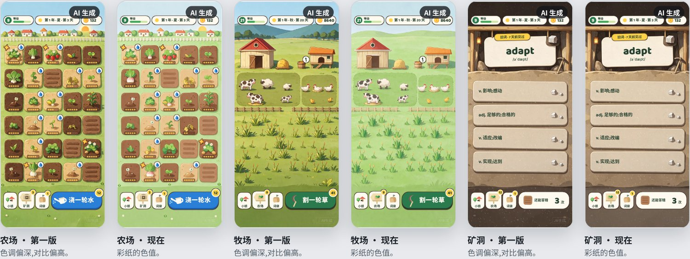
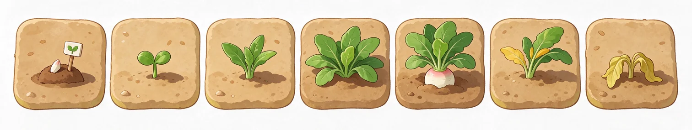

# 新画风的画面:农场、牧场、矿洞

项目负责人 2026-11-22 把产品的画风定为**偏插画的赛璐璐**(线稿加平涂,带一点柔和的处理),并要求把农场、牧场、矿洞按它重新设计。
这里是第一稿。决定的背景和代价见[决策记录 0028](../../decisions/0028-art-direction-illustrated-cel.md),画风是怎么选出来的见[人物画风探索](../character-style/README.md)。

**这是概念稿,不是成品,也不是能直接用的素材。** [美术规范](../07-art-direction.md)还没有按新画风重写。

*农场、牧场、矿洞。场景是 AI 生成的(豆包 `doubao-seedream-5-5-261028`,2026-11-22),顶部信息、按钮、单词、水滴和星带是代码画的。*

**结论先说:**

- **走得通,比预想的便宜。** 把彩纸的画面当参考图,模型重画之后构图几乎原样保住,界面和字按原来的坐标叠回去,一个没有挪。
- **色调用彩纸的。** 负责人看过第一版之后说画风可以,但色调比之前深、对比高,还是之前的色调好。现在这一版把彩纸的色值写进了提示词,量出来和彩纸几乎一样,见[色调](#色调改回彩纸的)。
- **整屏重画管不住状态。** 农场前后出过四张,只有一张干湿全对,其余的错一到三块。整屏的图只能当概念稿。
- **一种作物的全部状态可以一次画成一套。** 只试了萝卜,三张里两张全对。这改了"换画风要重做多少"的算法。
- **没有解决的:** 这是三张拼好的图,不是素材;界面没有重新设计;牧场的草数不出几捆了;没有上真机,没有问过目标用户;
  整个画面现在都是 AI 生成的,能不能上架、版权归谁仍然没有答案。

## 怎么看

用浏览器打开 [`index.html`](index.html),需要联网加载字体。"缩小之后"一节按真实大小显示,请在手机上看。

| 截图 | 内容 |
|---|---|
| [`three-screens.jpg`](shots/three-screens.jpg) | 新画风的三屏 |
| [`vs-paper.jpg`](shots/vs-paper.jpg)、[`vs-paper-zoom.jpg`](shots/vs-paper-zoom.jpg) | 和彩纸并排:三屏各一对(左彩纸,右现在),以及各放大一块 |
| [`tone.jpg`](shots/tone.jpg) | 色调:第一版和现在的,三屏各一对 |
| [`mine-cave.jpg`](shots/mine-cave.jpg) | 矿洞:左边是第一版,右边是现在的(同一张画,只调亮了地面) |
| [`ground.jpg`](shots/ground.jpg) | 底色:农场和牧场各三张,彩纸、调之前、调之后(只有场景,没有界面) |
| [`farm.jpg`](shots/farm.jpg)、[`pasture.jpg`](shots/pasture.jpg)、[`mine.jpg`](shots/mine.jpg) | 每一屏的三联:彩纸的原稿、模型画出来的原样、叠上界面之后 |
| [`small.jpg`](shots/small.jpg) | 农场缩到每块地约 28pt,彩纸和新画风(截图放大了 3 倍) |
| [`phone-farm.jpg`](shots/phone-farm.jpg) | 手机宽度下的农场一屏 |

## 怎么做的

1. **把彩纸的画面去掉文字和界面,只留场景。** [`source.html`](source.html) 做这件事。农场连水滴、四角星和星带也去掉。
2. **当参考图交给图像模型,**要求按新画法重画,构图和每样东西的位置、数量、状态不变,画面里不要有字和界面,并且色调和参考图一致(彩纸色板里的色值一个个写进提示词)。
3. **把界面叠回去。** 顶部信息、底部按钮、单词和释义、水滴、收获标记、星带是代码画的([`cel-screens.js`](cel-screens.js)),用的是彩纸那一屏的坐标。
   界面的图形还是彩纸那一套,只把硬边投影换成了一圈深褐色的线稿加投影。

文字和状态的标记不交给模型,有两个原因:它们必须准确、读得清;而且"蓝色只表示水""黄色表示得到的东西"这样的规矩只有自己画才守得住。

**彩纸的那几屏没有白做。** 它们现在是布局稿:排法、尺寸、状态的表示法都定在那里,模型照着画。要改一屏的排法,先改彩纸的代码,再重画。

## 色调:改回彩纸的

负责人看过第一版之后的意见(原话):

> 我觉得画风 OK,但是整个色调感觉新的色调比之前的稍微深一点,对比度高一点。我还是觉得之前的那个色调比较好。

*每一对左边是第一版,右边是现在的。AI 生成的场景,代码画的界面。*

量出来的(农场):

| | 彩纸 | 第一版 | 现在 |
|---|---|---|---|
| 草地(底部那一条) | `#a9cf7c` | `#9fb756` | `#adce7e` |
| 草地(地块之间) | `#cfe6a6` | `#c0cd6c` | `#c6e09e` |
| 天 | `#dfeff1` | `#c3e3f1` | `#dbebf2` |
| 干土 | `#e7c18c` | `#e8bc79` | `#eac590` |
| 湿土 | `#a36d4a` | `#7c4e31` | `#a5704d` |
| 干土和湿土的明暗对比 | 2.56 | 3.98 | 2.56 |
| 湿土和草地的明暗对比 | 2.46 | 3.14 | 2.37 |
| 整屏的平均明度(0 到 255) | 183 | 157 | 183 |
| 整屏明暗的起伏(标准差) | 40 | 48 | 39 |

颜色是在每张图的同一块位置取的平均值:草地取底部的一条,土取每块地左上角没有作物的一小块、按干土湿土分别平均。
牧场的平均明度是彩纸 201、第一版 159、现在 192;矿洞是 170、140、现在 146(用的是第一版的画,只调亮了地面;写了色值重出的那一版是 157,没有用)。

- **怎么改的:** 提示词里写明"色调和参考图一致,浅、亮、柔和、对比度低",并把彩纸色板里的色值一个个写进去。牧场重出一张就对了。矿洞也重出了一张,色调对了,但负责人更喜欢第一版画的洞和矿壁,最后没有用。
- **农场出了三张,每张都有画错的地方。** 第一张把一块湿土画成了干土,把一株没结棒的玉米画成了结了棒的;第二张整片地往下挪了,界面对不上;第三张错了三块。
  第一版(色调偏深的那张)干湿 30 块全对、作物只错一株,现在看是碰巧。
- **现在这张农场是拼的:** 用第一张,画错的那两块地从第一版里取同一块补上(第一版先整体调了色:拿两张图对应位置的颜色拟合一个整体的颜色换算)。其余的图没有动过。
- **底色又单独调过一次。** 负责人看过和彩纸并排的图之后说:"农场和牧场的底色还是偏黄一点"。量出来彩纸草地的色相是 82 到 87 度,重画出来的是 70 到 79 度。
  这一步没有重出图,是直接调的([`regreen.py`](regreen.py)):只把偏黄的草地色拉向彩纸草地的色相(约 86 度),干土、草垛、穗、蔫了的黄叶和深绿的叶子都不在调的范围里。调完是 82 到 86 度。
  见 [`ground.jpg`](shots/ground.jpg):农场和牧场各三张,彩纸、调之前、调之后。
- **这说明两件事。** 色调管得住:写进提示词就行,也可以事后整体调色。状态管不住:整屏重画,每次都可能错一两块。
- **色调回到彩纸之后,**[美术规范](../07-art-direction.md)里的色板和明暗对比那两章又用得上了。

## 看到了什么

### 农场:30 块地逐块对过

| 查的是 | 结果 | 说明 |
|---|---|---|
| 干土、湿土、空地 | 30 块全对 | 其中 2 块是补的,见上面"色调"一节。干土和湿土的明暗对比是 2.56,和彩纸一样 |
| 蔫了的(2 株) | 都认得出 | 叶子发黄、下垂 |
| 不生长的(3 株) | 都认得出 | 一片叶子发黄。"整株歪向一边"画得很轻 |
| 作物是哪一种、长到哪一步 | 30 块全对 | 其中 1 块是补的(那株玉米) |
| 作物的点睛色 | 对 | 萝卜的根肩是白色带淡粉。第一版里丢了,写进提示词之后回来了 |
| 位置 | 没有挪 | 水滴、收获标记、星带按彩纸的坐标叠上去,都落在该落的地方 |

对的方法是把参考图和结果放大并排,一块一块看。是我自己看的。

### 牧场

- 排法保住了:房子在上,院子在中间,草地在下。牛、羊、鸡的数量和位置都对,卧在干草上的那头牛和抱窝的那只鸡也在。
- **草上的穗数得出来了。** 彩纸的规矩是"几根穗就是几捆"。第一版里穗被画成红褐色的小点,数不清;这一版在提示词里写了穗的颜色和根数,画出来是黄色的、一根一根分开的。
  但每株画了几根没有逐株核对,整屏的图也核对不了。
- 饲料桶见底的感叹号模型没有画,按规则补在原来的位置。

### 矿洞

- 岩层的构图保住了:木梁、提灯、挂着的词牌、探出来的矿石、镐、四条石板、石板右端的矿。
- **这一屏用的是第一版的画。** 负责人看过之后先后说了两点(原话):"第一版插画赛璐璐风格的这个矿洞页的这个单词周围的这一圈矿洞的感觉很好";"矿壁也换成第一版,比较有地层的那种感觉"。
  改色调重出的那一版把洞画平了、灯没了,矿壁成了一块块灰褐色的石头,所以没有再用。
  现在只动了一处:最下面的地面从接近黑色(`#4e3f35`)调亮到色板里的岩石深(`#705f51`)。规范里洞里最深的颜色是岩石深,不是黑。
  **矿壁是沙土的黄褐色,不是色板里偏灰的岩石色。** 规范当初选偏灰的颜色,是因为土色偏橙红时铜和铁的矿石放上去分不出来。这一条在新矿壁上没有验证。
- 词牌和石板要求留白,模型照做了。单词 40pt、释义 17pt 叠上去读得清。
- 答对、运气好、答错三个关键帧没有画。石板裂开、矿石弹出要的是能动的素材。

### 缩小到每块地 28pt

当初选彩纸的第一条理由是它缩小之后状态最好认([决策记录 0015](../../decisions/0015-art-direction-paper-collage.md))。

- 干湿、水滴、收获标记都清楚。干土和湿土的明暗对比现在和彩纸一样(2.56)。水滴和收获标记本来就是代码画的。
- 作物两边差不多:都只剩轮廓和主色,蔫了的两株靠发黄还认得出。
- **这个判断是放大三倍看截图得出的。** 真实大小下线稿会不会糊,要在手机上看。真正的小图标也应该单独画一套简化的,不是把大图缩小。

### 一套作物素材的试验

*AI 生成。种子、发芽、幼苗、成株、成熟、不生长、枯萎。*

游戏里用的是一样一样的素材,不是整屏的图。让模型把萝卜的七个状态画成一排,用上面那张农场对齐画法和色调:这一张七个都对,同一种画法、同一块土、同一个大小,成熟的那个根肩是淡粉的。

**不是每次都对。** 这套素材前后出过三张:色调偏深的那一版一张,七个都对;改成彩纸色调之后两张,第一张"成熟"的那一个没有画出根,第二张(上面这张)全对。素材比整屏好核对:七个一眼看完,不对就重出。

**这改了成本的算法。** 彩纸的做法是"状态靠变换,不靠重画",因为重画贵。现在重画一种作物的全部状态是一次调用、不到一分钟,12 种作物是 12 张。

没有验证的:12 张之间画风和大小统不统一;怎么切成一个个素材;干土和湿土要分开出;生长的动画原来靠纸片的位移和缩放,换成位图之后只能换图。

## 发现的问题

- **界面没有重新设计。** 顶部的药丸、底部的按钮、水滴、星带是彩纸的图形描了一圈线,能看,但不是为这种画风设计的。
- **人物还没有放进这三屏。** 玩家自己的角色、居民在场景里是什么样、多大,没有画。
- **规范里的几条规矩要逐条过:** 色调回到彩纸之后,色板又用得上了。"没有描边和渐变""一切都是纸片"不再适用。"蓝色只表示水"要重新看:天是很浅的蓝,和水滴的蓝差得开,但它确实是蓝的。
- **整屏重画管不住状态。** 农场出过四张,只有一张干湿全对,其余的错一到三块,还有一张整片挪了位置。靠单独的素材加逐项核对能管住。
- **同一屏每次出图都不一样。** 画面要改一处就得整张重出,别的地方也会跟着变。

## 没做的

- 矿洞答题之后、矿洞关门、割草答题、做饲料、买卖、词袋、商店、小镇地图、对话,都没有重做。
- 没有动效。
- 没有按新画风写色板、字体和形状的规定。字体沿用原来的三种。
- 没有上真机;没有问过任何目标用户;没有做色觉模拟,没有重新算明暗对比。
- 没有在引擎里试过位图素材的包体、内存和图集。
- 没有逐张比对画面是否像某个已有游戏的画面。
- 只用了豆包一家的模型,负责人选的是它的味道。

## 用量

一共 11 次调用,都带一张参考图,每张 25 到 60 秒,每张约 15000 个输出 token。第一版 4 次(三屏加一张素材);改色调 7 次(牧场、矿洞各 1 次,农场 3 次,素材 2 次)。价格以账单为准。
每一张的模型、日期、参考图、用量和完整的提示词在 [`generated/manifest.json`](generated/manifest.json),里面没有任何作品、画师的名字,也没有项目和个人的信息。

## 这些画面是怎么来的

- **场景是 AI 生成的。** 豆包的生图模型,2026-11-22。对比页上每一张都带"AI 生成"的标,图的右下角有模型自带的"AI生成"水印。
- **界面和文字是代码绘制的,**代码由 Claude 编写,属于 AI 协助产出的内容。
- 对外发布这些画面时,按[内容策略](../../marketing/01-content-strategy.md#红线)的要求声明。
- **画面不读取游戏数据。** 用的是彩纸参考图的那几份示意存档。
- 没有使用任何第三方图片。提示词里没有任何游戏和画师的名字。

## AI 生成素材登记

| 素材 | 工具和版本 | 日期 | 提示词在哪 | 用在哪 |
|---|---|---|---|---|
| `generated/farm.webp`:农场的场景。**拼过:**两块地取自 `farm-v1.webp` 调色之后的同一块 | 豆包 `doubao-seedream-5-5-261028`,带参考图 | 2026-11-22 | `generated/manifest.json` | 对比页 |
| `generated/pasture.webp`:牧场的场景 | 同上 | 2026-11-22 | 同上 | 对比页 |
| `generated/mine.webp`:矿洞的场景。就是第一版的画,只调亮了地面 | 同上 | 2026-11-22 | 同上 | 对比页 |
| `generated/sprites-turnip.webp`:萝卜的七个状态 | 同上 | 2026-11-22 | 同上 | 对比页"素材的试验" |
| `generated/farm-v1.webp`、`pasture-v1.webp`、`mine-v1.webp`:第一版,色调偏深 | 同上 | 2026-11-22 | 同上 | 对比页"色调"一节,留作对照 |

仓库里存的是缩小后的 WebP(场景 780×1688),原图没有进仓库。

## 文件

| 文件 | 内容 |
|---|---|
| `index.html`、`index.js`、`cel-screens.css` | 画面页 |
| `cel-screens.js` | 把场景和界面拼成一屏:哪些字、哪些标记叠在哪里 |
| `source.html` | 把彩纸的画面去掉文字和界面,渲染成参考图。地址后面加 `?s=farm`、`?s=pasture`、`?s=mine` |
| `regreen.py` | 出图之后调底色用的:只把偏黄的草地色拉向彩纸草地的色相。要装 Pillow 和 NumPy |
| `generated/` | AI 生成的三张场景、一张素材、第一版的三张(`*-v1.webp`),和 `manifest.json` |
| `shots/` | 截图 |

彩纸的画面、界面的图形、示意存档来自 [`../art-exploration/`](../art-exploration/README.md)、[`../mine-screens/`](../mine-screens/README.md) 和 [`../pasture-screens/`](../pasture-screens/README.md),这三个目录的文件都没有改。

## 检查过的

- `index.html` 在 390 像素宽和 1280 像素宽的视口下没有脚本报错,没有横向溢出。
- 农场 30 块地逐块对过;牧场的牲畜逐只数过;矿洞的四条石板和词牌上的字逐条看过。
- 文档里的相对链接都能打开。

## 没检查的

- 没有上过真机。
- 没有问过任何目标用户。
- 没有做色觉模拟,没有算新画面上文字和标记的明暗对比。
