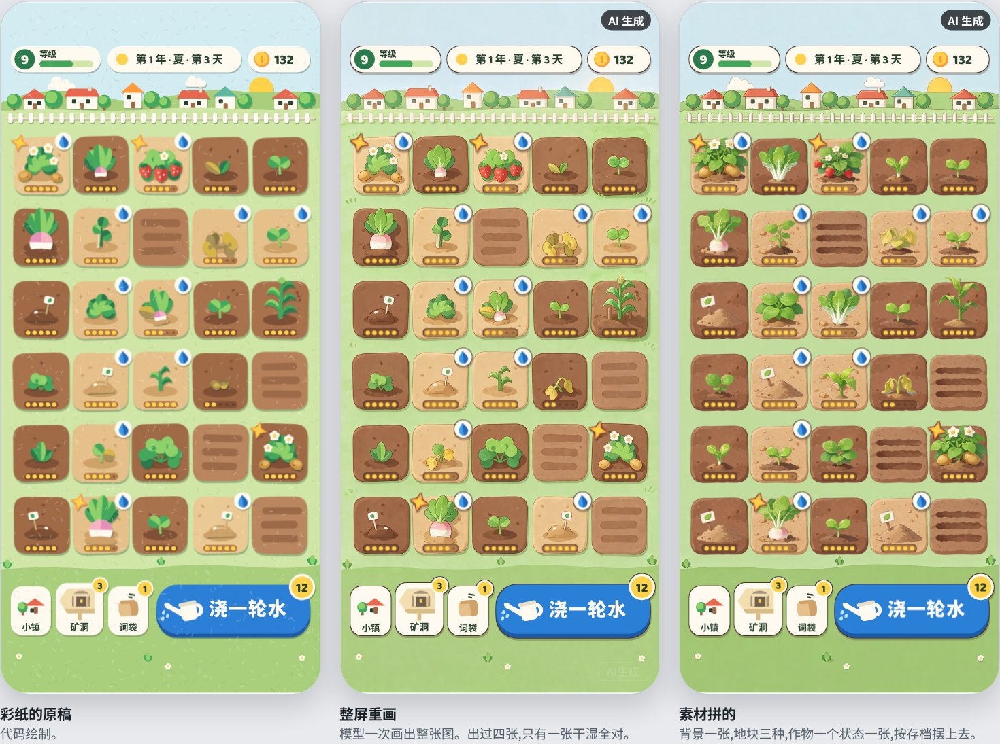
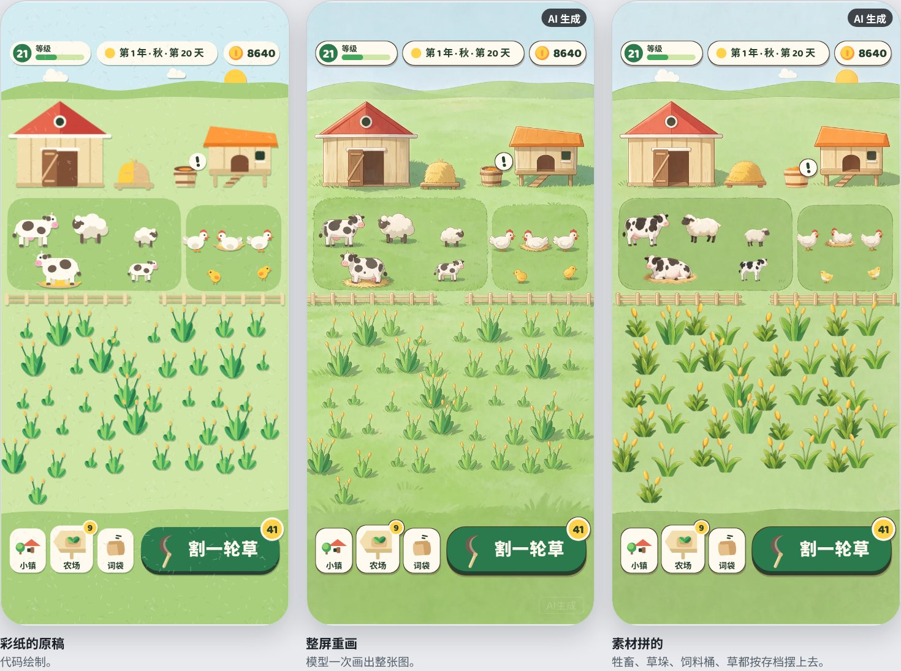
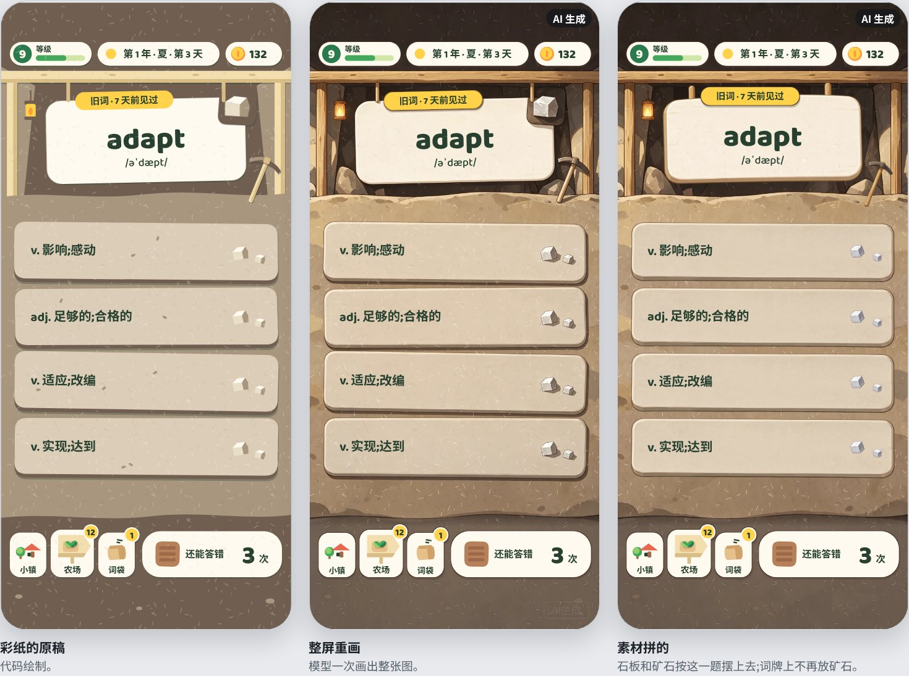
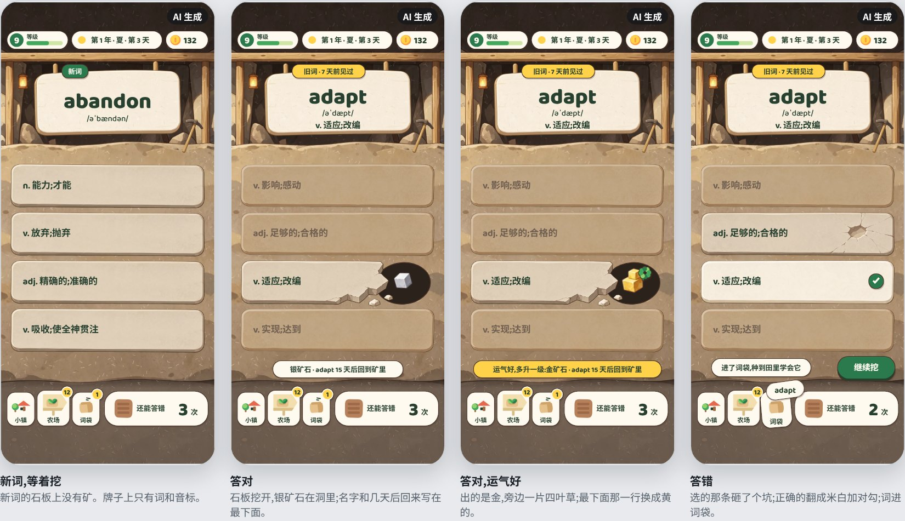
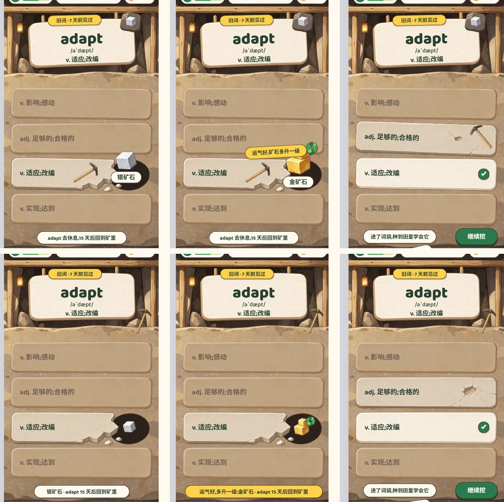
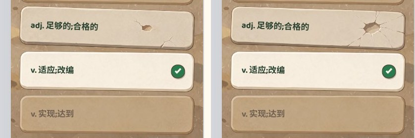
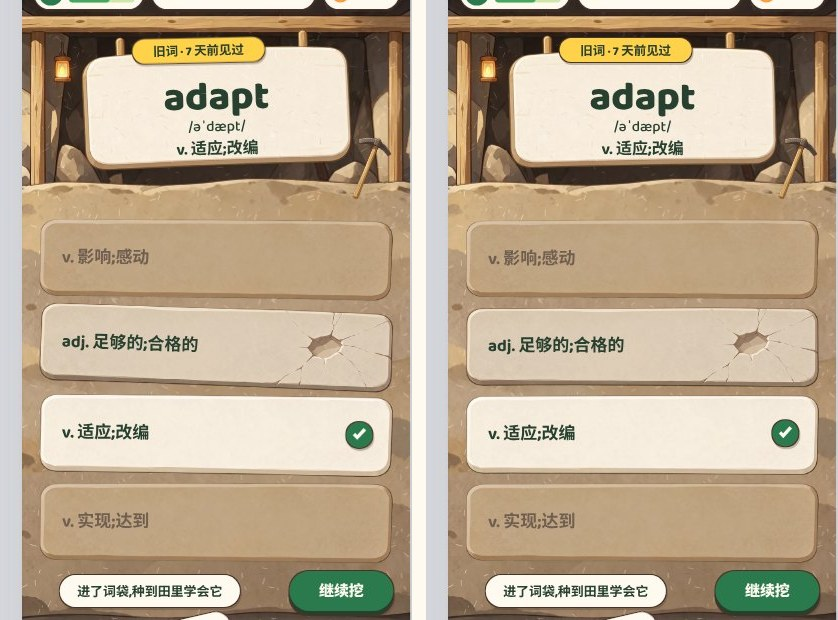

# 新画风的画面:农场、牧场、矿洞

项目负责人 2026-11-22 把产品的画风定为**偏插画的赛璐璐**(线稿加平涂,带一点柔和的处理),并要求把农场、牧场、矿洞按它重新设计。
这里是第一稿。决定的背景和代价见[决策记录 0028](../../decisions/0028-art-direction-illustrated-cel.md),画风是怎么选出来的见[人物画风探索](../character-style/README.md)。

**这是概念稿,不是成品,也不是能直接用的素材。** [美术规范](../07-art-direction.md)还没有按新画风重写。

*农场、牧场、矿洞。场景是 AI 生成的(豆包 `doubao-seedream-5-5-261028`,2026-11-22),顶部信息、按钮、单词、水滴和星带是代码画的。*

**结论先说:**

- **走得通,比预想的便宜。** 把彩纸的画面当参考图,模型重画之后构图几乎原样保住,界面和字按原来的坐标叠回去,一个没有挪。
- **色调用彩纸的。** 负责人看过第一版之后说画风可以,但色调比之前深、对比高,还是之前的色调好。现在这一版把彩纸的色值写进了提示词,量出来和彩纸几乎一样,见[色调](#色调改回彩纸的)。
- **整屏重画管不住状态。** 农场前后出过四张,只有一张干湿全对,其余的错一到三块。整屏的图只能当概念稿。
- **素材这条路三屏都走通了。** 先是农场:背景一张、地块三种、12 种作物的每个状态各一张,状态由数据决定,不会再画错。见[用素材拼出来的农场](#用素材拼出来的农场)。
  现在这一套:作物圆胖了,枯萎调轻了而且只有幼苗和成株两个阶段有;不生长不单独画,死了的是一堆干草。
- **牧场也拆成了素材,**拼回了一屏,并且用四个别的存档各拼了一屏。见[用素材拼出来的牧场](#用素材拼出来的牧场)。
- **矿洞也拆成了素材,**等着挖、答对、运气好、答错四种情况都是同一套素材摆出来的。见[用素材拼出来的矿洞](#用素材拼出来的矿洞)。
- **没有解决的:** 这是三张拼好的图,不是素材;界面没有重新设计;牧场的草数不出几捆了;没有上真机,没有问过目标用户;
  整个画面现在都是 AI 生成的,能不能上架、版权归谁仍然没有答案。

## 怎么看

用浏览器打开 [`index.html`](index.html),需要联网加载字体。"缩小之后"一节按真实大小显示,请在手机上看。

| 截图 | 内容 |
|---|---|
| [`three-screens.jpg`](shots/three-screens.jpg) | 新画风的三屏 |
| [`vs-paper.jpg`](shots/vs-paper.jpg)、[`vs-paper-zoom.jpg`](shots/vs-paper-zoom.jpg) | 和彩纸并排:三屏各一对(左彩纸,右现在),以及各放大一块 |
| [`built.jpg`](shots/built.jpg)、[`built-other.jpg`](shots/built-other.jpg) | 用素材拼出来的农场:和彩纸、整屏重画并排;换一个存档 |
| [`sprites.jpg`](shots/sprites.jpg) | 素材一览:12 种作物各五个,加共用的种子、发芽和干草 |
| [`sprite-redraw.jpg`](shots/sprite-redraw.jpg) | 南瓜、白菜、韭葱:重画之前和之后 |
| [`sprites-v1.jpg`](shots/sprites-v1.jpg)、[`built-v1.jpg`](shots/built-v1.jpg) | 第一套素材的一览,和用它拼出来的农场,留作对照 |
| [`sprite-wilt.jpg`](shots/sprite-wilt.jpg)、[`sprite-dead.jpg`](shots/sprite-dead.jpg) | 枯萎调轻之前和之后;干草的三个候选 |
| [`sprite-misses.jpg`](shots/sprite-misses.jpg)、[`sprite-chunky.jpg`](shots/sprite-chunky.jpg) | 画错的两张;第一套时"圆胖一点"的试验 |
| [`pasture-built.jpg`](shots/pasture-built.jpg)、[`pasture-saves.jpg`](shots/pasture-saves.jpg) | 用素材拼出来的牧场:和彩纸、整屏重画并排;另外四个存档 |
| [`pasture-sprites.jpg`](shots/pasture-sprites.jpg)、[`pasture-misses.jpg`](shots/pasture-misses.jpg) | 牧场的素材一览;第一轮画错重出的两张 |
| [`pasture-redraw.jpg`](shots/pasture-redraw.jpg) | 负责人要求改的:草垛、饲料桶、牧草、母鸡,之前和现在 |
| [`mine-built.jpg`](shots/mine-built.jpg)、[`mine-states.jpg`](shots/mine-states.jpg) | 用素材拼出来的矿洞:和彩纸、整屏重画并排;新词、答对、运气好、答错 |
| [`mine-sprites.jpg`](shots/mine-sprites.jpg)、[`mine-misses.jpg`](shots/mine-misses.jpg) | 矿洞的素材一览;第一轮画错的四处 |
| [`mine-redraw.jpg`](shots/mine-redraw.jpg) | 负责人看过之后改的:答完之后安静下来,之前和现在 |
| [`mine-miss.jpg`](shots/mine-miss.jpg)、[`mine-miss-options.jpg`](shots/mine-miss-options.jpg) | 答错的那条石板:之前和现在;三个候选 |
| [`mine-straight.jpg`](shots/mine-straight.jpg)、[`mine-bag.jpg`](shots/mine-bag.jpg) | 石板和词牌摆正;词袋的按钮和纸签只歪纸片、字和图标是正的。都是之前和现在 |
| [`tone.jpg`](shots/tone.jpg) | 色调:第一版和现在的,三屏各一对 |
| [`mine-cave.jpg`](shots/mine-cave.jpg) | 矿洞:左边是第一版,右边是现在的(同一张画,只调亮了地面) |
| [`ground.jpg`](shots/ground.jpg) | 底色:农场和牧场各三张,彩纸、调之前、调之后(只有场景,没有界面) |
| [`farm.jpg`](shots/farm.jpg)、[`pasture.jpg`](shots/pasture.jpg)、[`mine.jpg`](shots/mine.jpg) | 每一屏的三联:彩纸的原稿、模型画出来的原样、叠上界面之后 |
| [`small.jpg`](shots/small.jpg) | 农场缩到每块地约 28pt,彩纸和新画风(截图放大了 3 倍) |
| [`phone-farm.jpg`](shots/phone-farm.jpg) | 手机宽度下的农场一屏 |

## 怎么做的

1. **把彩纸的画面去掉文字和界面,只留场景。** [`source.html`](source.html) 做这件事。农场连水滴、四角星和星带也去掉。
2. **当参考图交给图像模型,**要求按新画法重画,构图和每样东西的位置、数量、状态不变,画面里不要有字和界面,并且色调和参考图一致(彩纸色板里的色值一个个写进提示词)。
3. **把界面叠回去。** 顶部信息、底部按钮、单词和释义、水滴、收获标记、星带是代码画的([`cel-screens.js`](cel-screens.js)),用的是彩纸那一屏的坐标。
   界面的图形还是彩纸那一套,只把硬边投影换成了一圈深褐色的线稿加投影。

文字和状态的标记不交给模型,有两个原因:它们必须准确、读得清;而且"蓝色只表示水""黄色表示得到的东西"这样的规矩只有自己画才守得住。

**彩纸的那几屏没有白做。** 它们现在是布局稿:排法、尺寸、状态的表示法都定在那里,模型照着画。要改一屏的排法,先改彩纸的代码,再重画。

## 色调:改回彩纸的

负责人看过第一版之后的意见(原话):

> 我觉得画风 OK,但是整个色调感觉新的色调比之前的稍微深一点,对比度高一点。我还是觉得之前的那个色调比较好。

*每一对左边是第一版,右边是现在的。AI 生成的场景,代码画的界面。*

量出来的(农场):

| | 彩纸 | 第一版 | 现在 |
|---|---|---|---|
| 草地(底部那一条) | `#a9cf7c` | `#9fb756` | `#adce7e` |
| 草地(地块之间) | `#cfe6a6` | `#c0cd6c` | `#c6e09e` |
| 天 | `#dfeff1` | `#c3e3f1` | `#dbebf2` |
| 干土 | `#e7c18c` | `#e8bc79` | `#eac590` |
| 湿土 | `#a36d4a` | `#7c4e31` | `#a5704d` |
| 干土和湿土的明暗对比 | 2.56 | 3.98 | 2.56 |
| 湿土和草地的明暗对比 | 2.46 | 3.14 | 2.37 |
| 整屏的平均明度(0 到 255) | 183 | 157 | 183 |
| 整屏明暗的起伏(标准差) | 40 | 48 | 39 |

颜色是在每张图的同一块位置取的平均值:草地取底部的一条,土取每块地左上角没有作物的一小块、按干土湿土分别平均。
牧场的平均明度是彩纸 201、第一版 159、现在 192;矿洞是 170、140、现在 146(用的是第一版的画,只调亮了地面;写了色值重出的那一版是 157,没有用)。

- **怎么改的:** 提示词里写明"色调和参考图一致,浅、亮、柔和、对比度低",并把彩纸色板里的色值一个个写进去。牧场重出一张就对了。矿洞也重出了一张,色调对了,但负责人更喜欢第一版画的洞和矿壁,最后没有用。
- **农场出了三张,每张都有画错的地方。** 第一张把一块湿土画成了干土,把一株没结棒的玉米画成了结了棒的;第二张整片地往下挪了,界面对不上;第三张错了三块。
  第一版(色调偏深的那张)干湿 30 块全对、作物只错一株,现在看是碰巧。
- **现在这张农场是拼的:** 用第一张,画错的那两块地从第一版里取同一块补上(第一版先整体调了色:拿两张图对应位置的颜色拟合一个整体的颜色换算)。其余的图没有动过。
- **底色又单独调过一次。** 负责人看过和彩纸并排的图之后说:"农场和牧场的底色还是偏黄一点"。量出来彩纸草地的色相是 82 到 87 度,重画出来的是 70 到 79 度。
  这一步没有重出图,是直接调的([`regreen.py`](regreen.py)):只把偏黄的草地色拉向彩纸草地的色相(约 86 度),干土、草垛、穗、蔫了的黄叶和深绿的叶子都不在调的范围里。调完是 82 到 86 度。
  见 [`ground.jpg`](shots/ground.jpg):农场和牧场各三张,彩纸、调之前、调之后。
- **这说明两件事。** 色调管得住:写进提示词就行,也可以事后整体调色。状态管不住:整屏重画,每次都可能错一两块。
- **色调回到彩纸之后,**[美术规范](../07-art-direction.md)里的色板和明暗对比那两章又用得上了。

## 看到了什么

### 农场:30 块地逐块对过

| 查的是 | 结果 | 说明 |
|---|---|---|
| 干土、湿土、空地 | 30 块全对 | 其中 2 块是补的,见上面"色调"一节。干土和湿土的明暗对比是 2.56,和彩纸一样 |
| 蔫了的(2 株) | 都认得出 | 叶子发黄、下垂 |
| 不生长的(3 株) | 都认得出 | 一片叶子发黄。"整株歪向一边"画得很轻 |
| 作物是哪一种、长到哪一步 | 30 块全对 | 其中 1 块是补的(那株玉米) |
| 作物的点睛色 | 对 | 萝卜的根肩是白色带淡粉。第一版里丢了,写进提示词之后回来了 |
| 位置 | 没有挪 | 水滴、收获标记、星带按彩纸的坐标叠上去,都落在该落的地方 |

对的方法是把参考图和结果放大并排,一块一块看。是我自己看的。

### 牧场

- 排法保住了:房子在上,院子在中间,草地在下。牛、羊、鸡的数量和位置都对,卧在干草上的那头牛和抱窝的那只鸡也在。
- **草上的穗数得出来了。** 彩纸的规矩是"几根穗就是几捆"。第一版里穗被画成红褐色的小点,数不清;这一版在提示词里写了穗的颜色和根数,画出来是黄色的、一根一根分开的。
  但每株画了几根没有逐株核对,整屏的图也核对不了。
- 饲料桶见底的感叹号模型没有画,按规则补在原来的位置。

### 矿洞

- 岩层的构图保住了:木梁、提灯、挂着的词牌、探出来的矿石、镐、四条石板、石板右端的矿。
- **这一屏用的是第一版的画。** 负责人看过之后先后说了两点(原话):"第一版插画赛璐璐风格的这个矿洞页的这个单词周围的这一圈矿洞的感觉很好";"矿壁也换成第一版,比较有地层的那种感觉"。
  改色调重出的那一版把洞画平了、灯没了,矿壁成了一块块灰褐色的石头,所以没有再用。
  现在只动了一处:最下面的地面从接近黑色(`#4e3f35`)调亮到色板里的岩石深(`#705f51`)。规范里洞里最深的颜色是岩石深,不是黑。
  **矿壁是沙土的黄褐色,不是色板里偏灰的岩石色。** 规范当初选偏灰的颜色,是因为土色偏橙红时铜和铁的矿石放上去分不出来。这一条在新矿壁上没有验证。
- 词牌和石板要求留白,模型照做了。单词 40pt、释义 17pt 叠上去读得清。
- 答对、运气好、答错三个关键帧没有画。石板裂开、矿石弹出要的是能动的素材。

### 缩小到每块地 28pt

当初选彩纸的第一条理由是它缩小之后状态最好认([决策记录 0015](../../decisions/0015-art-direction-paper-collage.md))。

- 干湿、水滴、收获标记都清楚。干土和湿土的明暗对比现在和彩纸一样(2.56)。水滴和收获标记本来就是代码画的。
- 作物两边差不多:都只剩轮廓和主色,蔫了的两株靠发黄还认得出。
- **这个判断是放大三倍看截图得出的。** 真实大小下线稿会不会糊,要在手机上看。真正的小图标也应该单独画一套简化的,不是把大图缩小。

## 用素材拼出来的农场

整屏的图游戏里不能用,而且每次重画都会画错一两块地。这里换成游戏里真正要用的做法:
背景一张,地块三种(干土、湿土、空地),每种作物的每个状态各一张带透明底的小图,按存档一块一块摆上去。

现在这一套改过三轮。负责人看过第一套之后定了:作物要圆胖一点,枯萎调轻;之后定了四种样子怎么画;再之后定了成熟的不画枯萎,并要求南瓜、白菜、韭葱重画(见下文,[决策记录 0029](../../decisions/0029-crop-states-in-sprites.md))。

*同一个存档。左:彩纸的原稿(代码绘制)。中:整屏重画(AI 生成)。右:素材拼的(素材是 AI 生成之后切出来的)。界面都是代码画的。第一套素材拼出来的样子在 [`built-v1.jpg`](shots/built-v1.jpg)。*

### 做到了什么

- **状态不会再画错。** 30 块地的干湿、作物是哪一种、长到哪一步、蔫没蔫,都是按存档摆的,不经过模型。
- **改一处不用重出别的。** 一块地浇了水只是把干土换成湿土;一株长了一截只是换一张小图。
- **换存档不用再出图。** [`built-other.jpg`](shots/built-other.jpg) 是把十二种作物都种上、四种样子随机排的另一屏,没有新出一张图。
- **素材是 67 个加一张背景,**约 0.8MB(3 倍屏,WebP),在 [`sprites/`](sprites/)。清单在 `sprites/atlas.js`。

| 素材 | 数量 | 说明 |
|---|---|---|
| 作物 | 12 种 × 5 = 60 | 健康的:幼苗、成株、成熟;枯萎的:幼苗、成株 |
| 种子 | 1 | 所有作物共用 |
| 发芽 | 2 | 所有作物共用;健康、枯萎 |
| 干草 | 1 | 死了的作物,所有作物共用 |
| 地块 | 3 | 干土、湿土、空地 |
| 背景 | 1 | 天、远处的房子、栅栏、草地 |

*按在屏幕上的真实大小摆(截图放大了 1.5 倍)。AI 生成。第一套的一览在 [`sprites-v1.jpg`](shots/sprites-v1.jpg)。*

### 四种样子怎么画

负责人定的(2026-11-22,原话):

> 不生长的作物为什么要倒要倾斜,我觉得不必这样,不生长不需要单独画,只需要单独画一个枯萎了但是还能救的,然后死亡的就是一坨干草,每种作物一样就可以,不需要单独画

| 规则里的状态 | 现在怎么画 | 彩纸那版怎么画 |
|---|---|---|
| 健康 | 每种作物、每个阶段一张 | 同左 |
| 不生长(上次答错) | **和健康的同一张。** 看得出来的只有星带少一颗星 | 整株歪 9 度,一片叶子换成黄色 |
| 枯萎(连错两次) | 每种作物两张:幼苗和成株。叶子浅黄、垂下来,没有褐色和斑。**成熟的不画枯萎** | 整株下垂,颜色换成芥末黄和卡其 |
| 死亡(连错三次) | **一小堆干枯的茎叶,所有作物共用一张。** 没有星带和标记 | 没有画过。规则是地块清空 |

倾斜和黄叶是从彩纸的规范里照搬过来的,第一套素材和第二轮的头一批都按它出了,负责人看到之后纠正的。

之后负责人又补了一条(原话):

> 枯萎的状态只需要有两种,第三种成熟了的不存在蔫了的状态。然后南瓜、白菜、韭葱重新画一下

- **干草**出了三个,用的是中间那个([`sprite-dead.jpg`](shots/sprite-dead.jpg))。画成灰褐色、倒伏的一小堆,没有画成金黄色的草垛:牧场里的干草是存粮,是好东西,两样不能长得像。
- **要负责人知道的一点:不生长现在只剩星带能看出来。** 规则里"不生长"是上次答错、这次浇水没有长。画面上它和健康的一模一样,只是星带少一颗星。
  所以"哪些词上次答错了"一眼看不出来了,看得出来的是"哪些词连错了两次"(枯萎)。这和设计支柱 2(农场就是记忆的样子)有关,是不是够用要等能玩的时候看。
- **规则里成熟的作物是可以枯萎的。** 作物长到成熟的样子之后还差一次浇水才收获,这时候连着答错两次,按[玩法规则](../02-gameplay.md#品质与健康)它就是枯萎。
  负责人定了成熟的不画枯萎,所以现在这种情况画成健康的样子,和不生长一样只有星带能看出来。要不要把规则改成"成熟的不会枯萎",由负责人定;这里没有改规则。
  按模型这种情况很少(模拟里作物死亡只占 0.3% 到 1%,枯萎的成熟作物是其中更小的一部分),具体多少没有单独算过。
- **干草什么时候出现、留多久,规则里没有。** [玩法规则](../02-gameplay.md#作物死亡)写的是连错三次"地块清空"。
  干草是答错那一下出现一下就变回空地,还是留在地里等玩家点掉,要定;留着的话那块地算不算空地(空地决定还能挖多少新词)也要定。这里只是把它画出来,规则没有改。

### 圆胖,和枯萎调轻

- **圆胖:**提示词里加了一句"形体圆胖、概括、像图标,每株只有很少的几片又大又圆的叶子"。第一套枝叶多、茎细,像植物图鉴;现在和整屏重画那一版接近了,还是比它和彩纸细一点。这是我自己看的。
- **枯萎:**第一套的提示词写的是"枯萎,果实发灰发暗",画出来偏褐、卷曲,果子发灰,像坏了。现在写的是"缺水蔫了,浇了水就能恢复",并且明说不要褐色、不要斑、果子保持原色。
  前后对比见 [`sprite-wilt.jpg`](shots/sprite-wilt.jpg)。
- 成熟的那几株原先蔫得不明显(茄子、葡萄、南瓜)。现在成熟的不画枯萎,这个问题不存在了。

### 重画的三种:南瓜、白菜、韭葱

负责人要求重画,没有说哪里不对。前后对比见 [`sprite-redraw.jpg`](shots/sprite-redraw.jpg)(左边是之前的)。

我看到的毛病,和改的地方:

- **南瓜:**藤画成了一根粗管子。现在藤几乎被叶子盖住,成株多了一朵黄花。
- **白菜:**成株和成熟几乎一样,幼苗像另一种菜。现在是散开的小叶子、半包的、包紧的大菜头。
- **韭葱:**叶子顶端是平的,像被切断的。现在叶尖弯下来,葱白粗了。成熟的那株还有两三片叶子顶端是平的。

**这是我猜的。** 如果负责人指的是别的地方,要再改。

### 怎么出的

1. **健康的:**一种作物出一张图,一行三株(幼苗、成株、成熟),纯色背景,用农场那一屏当参考图对齐画法。
2. **枯萎的:**不重新画,把健康的那张当参考图,只要求改成蔫了的样子。这样两种样子是同一株。只用幼苗和成株两株。
   重画的三种是把健康的那张抹掉成熟的一株再改(`tools/wilt_two.py`);别的九种是第二轮出的三株的图,只取前两株。
3. **切开:**按背景色抠掉,按空隙切成三个,按作物定在屏幕上的大小。
4. **共用的:**种子和发芽、干草、三种地块、背景。种子、发芽、地块和背景是第一轮出的,没有重出。

最开始试过一张图出九宫格(三个阶段乘三种样子):九个之间对不齐,第二行第三行会自己变。所以改成先出健康的、再在它上面改。

出图和切图的脚本在 [`tools/`](tools/),是这次怎么做的记录:`sheets.py` 出作物,`extras.py` 出共用的几张,`slice.py` 抠图和切开,`build.py` 定大小、写清单。
它们要一张参考图(农场那一屏的原图)和火山方舟的密钥(读环境变量,不在文件里)。`wilt_two.py` 是给重画的三种出枯萎用的。`sheets.py` 里还留着"不生长"那一种的提示词,现在不用了。

### 用素材拼出来的牧场

和农场同一种做法:背景一张(天、草地、谷仓、鸡舍、院子、栅栏,这些不变),草垛四档,饲料桶三档,牲畜一种一个样子一张,牧草三种高矮。
草垛多高、哪只饿着病着、草有几株,都按存档摆。排法照搬彩纸那一屏(院子怎么排、标记探在哪),没有改。空碗、药瓶、感叹号仍然是代码画的。

*同一个存档。左:彩纸的原稿(代码绘制)。中:整屏重画(AI 生成)。右:素材拼的(素材是 AI 生成之后切出来的)。*

| 素材 | 数量 | 说明 |
|---|---|---|
| 牲畜 | 21 | 大牛、大羊、母鸡各 4 个(好好的、饿着、病了、怀着或抱窝);小牛、小羊、小鸡各 3 个(好好的、饿着、病了) |
| 草垛 | 4 | 空、矮、半高、高。按"够吃几顿"挑 |
| 饲料桶 | 3 | 空、桶底一层、冒尖 |
| 牧草 | 7 | 矮、中、高各两个样子,加一个草茬 |
| 背景 | 1 | |

一共 35 个加一张背景,约 0.4MB,在 [`sprites-pasture/`](sprites-pasture/)。一览见 [`pasture-sprites.jpg`](shots/pasture-sprites.jpg)。

用彩纸那一版已有的四个示意存档各拼了一屏,没有新出图:存粮吃空、9 天没来、草都割完了、养了很多。见 [`pasture-saves.jpg`](shots/pasture-saves.jpg)。

**负责人看过第一轮之后改了三处**(原话):

> 牧草原型去掉底部黄色的土。草垛和饲料桶重画。他们就是画得太立体了,应该画扁平一点。然后,鸡的睡觉休息的姿势重新画。鸡不是趴着睡觉的。

- **牧草**根部没有土了。
- **草垛和饲料桶**从带透视、俯视的立体画法,改成正侧面平着看:托盘只是一条横板,桶是一个梯形。和旁边的谷仓、鸡舍是同一种看法了。
- **鸡休息的姿势:**病了的母鸡和小鸡原先是侧趴在地上的,现在是蹲坐着:身子直立、圆圆的一团,脖子缩进去,闭着眼。抱窝的那一个也改成蹲坐在窝里。
  牛和羊病了的那一个还是卧着的,没有改。

前后对比见 [`pasture-redraw.jpg`](shots/pasture-redraw.jpg)(左边是之前的)。

**做到了什么:**

- **草垛和饲料桶跟着存粮走了。** 整屏重画的那一版草垛多高是模型画的;现在按"够吃几顿"在四档里挑。
- **草上的穗数得出来,而且是对的:**矮的 1 根、中的 2 根、高的 3 根。每一种是单独画、单独数过的。整屏重画做不到。
- **饿着和病了靠姿态加标记,**和彩纸一样:饿着的低着头,病了的卧着闭着眼。

**发现的问题:**

- 草地原先比彩纸乱(有一种草根部带土,满地是土点),去掉土之后好了。穗在这个大小下还是不如彩纸的黄圆点醒目。这是我自己看的。
- **病了的不都够"灰"。** 彩纸里病了的整只灰一档;这里大牛病了的那一张颜色没怎么变,小羊、母鸡、小鸡的灰了。主要靠姿态和药瓶来认。
- **怀着的和病了的都是卧着,**靠草窝和睁着的眼睛来分,在院子里这么小的时候分得不算清楚。
- **底色比彩纸略深一点。** 背景调过底色之后色相对了(83 到 85 度,彩纸 82 到 87),明度还低一点。
- **11 张里重出了 3 张**([`pasture-misses.jpg`](shots/pasture-misses.jpg)):大羊那张小图之间被画上了分隔线,右下角还照着参考图画了一个"AI生成"的水印(参考图上那个水印后来盖掉了);
  一张草里高的那一丛画了 4 根穗;背景第一张草地偏黄、鸡舍的墙是黄的。

**怎么出的:**牲畜是一种一张图,一行几个样子直接画出来(姿态不同,不能像作物那样在健康的图上改)。
牲畜用绿色的背景:牛、羊、鸡都是白的,身上的暗部偏蓝灰,用浅蓝的背景抠图会把它们一起抠掉。
脚本是 `tools/pasture_sheets.py` 和 `tools/build_pasture.py`。

**没有做的:**

- **羊毛长到哪了没有画。** 规范里羊刚剪过是光溜溜的,每吃饱一顿蓬一圈。现在所有的羊都是蓬的。
- 产出好了的那一下(头上的黄圆片、栅栏上的纸条)没有接进来;标记本身是代码画的,接进来不用新出图。
- 割草答题、做饲料、买卖、小屋和鸡舍那几张纸、牲畜的卡片、几天没来的那张纸,都没有重做。
- 牲畜只有朝右的一张,朝左是镜像。没有走动和吃草的动作。

**用量:**两轮 20 次调用,约 25 万个输出 token(第一轮 14 次,第二轮重出 6 张)。价格以账单为准。提示词在 [`sprites-pasture/manifest.json`](sprites-pasture/manifest.json)。

### 用素材拼出来的矿洞

和农场、牧场同一种做法:背景一张(洞、木梁、提灯、矿壁、地面,这些不变),石板五种状态,矿石七级,词牌和镐各一个。
哪条石板挖开了、出的是哪一级矿石,都按这一题的状态摆。排法照彩纸那一屏([`../mine-screens/screens.js`](../mine-screens/screens.js) 的 `mine`),答完之后的样子负责人看过之后改安静了,见[下面](#负责人看过之后改的答完之后要安静)。
背景是在负责人选的那一张(第一版的洞和矿壁)上把会变的东西去掉得到的,洞和矿壁没有重画。

*同一条旧词矿脉,等着挖。左:彩纸的原稿(代码绘制)。中:整屏重画(AI 生成)。右:素材拼的(素材是 AI 生成之后切出来的);词牌右上角不再放矿石。*

| 素材 | 数量 | 说明 |
|---|---|---|
| 背景 | 1 | 洞、木梁、两根木柱、提灯、矿壁、地面 |
| 石板 | 5 | 等着挖、挖开了、没挖开、正确答案、沉回矿壁 |
| 矿石 | 7 | 铜、铁(圆的),银、金(方的),绿宝石、红宝石、钻石(尖的,晶体 2、2、3 根) |
| 词牌、镐 | 2 | 词牌带两根挂在梁上的木条 |

一共 14 个素材加一张背景,约 0.3MB。还出了一块垫矿石的石片,没有用上,没有存。

*答完之后的几种情况,同一套素材摆出来的,没有另外出图。素材是 AI 生成的,字、对勾、四叶草、最下面的提示条和按钮是代码画的。*

- **整屏重画只有"等着挖"这一个样子,**答对、答错之后石板怎么变,那张图里没有。现在四种情况都能摆。
- **石板上露着的矿是按数据摆的:**旧词的四条石板上各有两小块,是这个词现在那一级的矿石;新词的石板上没有。
- **答对:**那条石板换成断开的一张,右边露出洞,矿石放在洞里;其余三条换成"沉回矿壁"的一张。
  **答错:**选的那条换成砸出一个坑、裂纹散开的一张;正确的那条换成米白的一张,加一个对勾。

#### 负责人看过之后改的:答完之后要安静

负责人 2026-11-22 看过之后前后说了三次:

1. "单词框右上角的矿石预测就不用加了,然后镐子不用在答对答错的选项上显示,还是跟原来一样固定在矿洞的一角就可以"。照做了。
2. "那稿还是放回去吧"。我理解成把镐放回石板上,照做了。这个理解可能是错的。
3. "视觉效果影响了题目选项的文字的显示。这就是游戏效果跟学习目的相违背的地方。游戏效果太强了,会导致学习被 distract。"

现在的样子按第 3 条来,记在[决策记录 0030](../../decisions/0030-quiet-after-answer.md)里:

*上面一排是之前的,下面一排是现在的:答对、运气好、答错。*

- **先量了一下:字其实没有被盖住。** 之前那一版,示意稿用的四条释义一个像素都没有被效果盖住;换成示例卡组里最长的四条,答对时盖住 1.1%(镐的柄压到字的末尾)。
  字和石板的明暗对比是 7.3(彩纸是 7.2)。所以问题不在遮挡,在抢眼:答完之后眼睛先被镐、放大的矿石和纸带拉走。
- **答完的那一刻是看答案的时候,**尤其是答错:这时要看的是词、正确的释义、自己选错的那条。所以石板那一块只留和答案有关的东西。
- **镐一直靠在洞的右边,**不落到石板上。答错时之前它压在选错的那条上,把眼睛引向错的答案。
- **矿石放在挖开的洞里,不出自己那一条石板。** 之前放大 2.4 倍,压到上面一条;现在 1.5 倍。
- **矿石的名字和"运气好"写到最下面那一行,**不再贴在石板之间。
- **字在所有状态下按同一个宽度折行。** 之前答对的那条会变窄,长的释义在答完的一瞬间从一行变成两行。
- **词牌右上角不放矿石**(第 1 条定的),没有变。

| 效果在四条石板那一块里占的面积 | 等着挖 | 答对 | 运气好 | 答错 |
|---|---|---|---|---|
| 之前 | 1.2% | 4.0% | 8.8% | 1.1% |
| 现在 | 1.2% | 0.6% | 1.4% | 0.6% |

- **这个数只是面积,**不是"有多抢眼"的度量,抢不抢眼最后要人看。它是 [`tools/text_cover.mjs`](tools/text_cover.mjs) 量的:同一屏渲染三遍,每遍只留一层(字、效果、石板),数像素。
  答错那一栏现在剩下的 0.6% 是正确答案上的对勾。现在各状态下被盖住的字都是 0。
- **等着挖时剩下的 1.2% 是旧词石板上露着的那点矿。** 它现在是读题时石板上唯一的装饰,也是一种矿石预告。负责人没有提到它,所以没有动。
- **代价:静止的画面比之前平淡。** "点下去的那一下就是那一镐"和"挖到矿石的高兴"现在要靠动效和声音:镐从洞边挥过去再回来,矿石跳一下再落进洞里,
  都只占一瞬间,停下来之后画面是上面这样。动效还没有做,这样够不够有游戏感没有验证。
- **和[美术规范](../07-art-direction.md#矿洞)写的不一样了:**规范里词牌右上角探出会出的矿石,镐停在被点的石板上,矿石的名字贴在矿石下面。规范开头的说明里记了一笔,正文等重写时再改。
  彩纸的那一屏和整屏重画的那一张没有动。
- **割草那一屏是同一种做法,**没有重做,到时候按同一条规矩来。

**答错的那条再明显一点。** 镐不落在石板上之后,选错的那条只剩一个小坑。负责人看过之后的原话:"答错的词板再弄明显一点"。

*左边是之前的,右边是现在的。*

- **靠形状,不靠颜色:**坑大了,裂纹向四周散开,占石板右边的三分之一。[规范](../07-art-direction.md#用色规则)里答错不用红色和叉,这一条没有动。
- **裂纹不进字的地方。** 示例卡组里最长的释义(14 个字)放上去看过,字的末尾离裂纹还有一段。
- **重出了一张图,**一次出了三个轻重不同的候选([`mine-miss-options.jpg`](shots/mine-miss-options.jpg)),用的是最上面的一个。
  另外两个一个像拼起来的石块,不像被砸的;一个裂到了石板中间,会压到字。新的一条按原来那条的大小和颜色对齐过。

**石板和词牌摆正。** 负责人的原话:"我不想要词板或者卡片歪来歪去,影响阅读体验。"

*左边是之前的,右边是现在的。*

- **之前歪的有三处,**都是照彩纸那一屏来的:词牌歪 1.2 度;四条石板各歪不到 1 度,每条不一样;答错的那条再多歪 2.2 度。现在都是 0。
- **答错的那条现在只靠坑和裂纹来认。**
- **答错时落向词袋的小纸签和弹一下的词袋按钮:**纸片可以歪,上面的字和图标是正的。负责人的原话:"答错词袋那个卡片可以歪,但是上面的文字和图标不歪。"
  词袋的按钮纸片放大到 1.1 倍、歪 5 度,图标、"词袋"两个字和角标只放大不转;小纸签的纸片歪 8 度(之前 13 度,字不跟着转之后 13 度时长一点的词会探出纸片),词是正的。
  见 [`mine-bag.jpg`](shots/mine-bag.jpg)(左边之前,右边现在;这一排是代码画的)。
- 彩纸的那几屏没有动。农场、牧场这两屏里没有歪着的带字的板子。割草那一屏到重做时按这一条来。

**动过的地方(不是模型画出来的原样):**

- **石板压扁了 9%,词牌压扁了 6%。** 模型画的石板在 354pt 宽的时候有 90pt 高,而四条石板的间距只有 88pt;词牌的牌面有 124pt 高,彩纸那一屏是 112pt,下沿会压到矿壁。
  为了不改排法,切出来之后把高度压了一下。下次出图应该直接按要的比例要。
- **"沉回矿壁"的那条改过颜色。** 模型画的是偏橙的沙土色(`#d3b48a`),比矿壁(`#b19576`)亮也更鲜,答完之后四条里有三条是它,很抢眼。现在整体往矿壁拉到了 `#bfa381`。
- **石板和道具右边、下边有一道深绿色的影子**(绿色背景上模型自己加的),按颜色去掉了。

**发现的问题:**

- **挖开之后露出的洞是代码画的一个深色椭圆,**不是素材。它边缘太齐,和手绘的石板放在一起看得出来。要好看得单独画一张。
- **银画得比铁小一点**(高 20pt 对 24pt)。七个矿石是同一个比例切的,大小是模型画出来的。靠形状和颜色分得开,但大小上不是严格一级比一级大。
- **矿壁是沙土色的,规范里的岩石是灰的。** 这是负责人选的那一张的颜色。铜和铁(橙、红褐)摆在沙土色上不如摆在灰上分明,没有量过。
- **第一轮四张都有错,全部重出了一次:**背景的梁下面还留着一个小牌子;等着挖的石板上被画了两块矿石;词牌上方被画了一个小纸签;宝石的晶体多画了。
  这几样都是参考图里有的东西:参考图是整屏的矿洞,模型把旁边的东西一起搬了过来。第二轮在提示词里逐条写了"没有什么",四张都对了。见 [`mine-misses.jpg`](shots/mine-misses.jpg)。

**没有做的:**矿洞关门的三种样子;矿车、碎石、矿石飞进背包这些动的东西;词袋、商店、小镇地图。

**用量:**三轮 9 次调用,约 12 万个输出 token(120302;第三轮 1 次,重出答错的那条石板)。价格以账单为准。提示词在 [`sprites-mine/manifest.json`](sprites-mine/manifest.json)。

## 发现的问题

- **模型在"一行三株"里改,常常留一株不动,**多半是成熟的那一株,在提示词里强调也没用。现在成熟的不画枯萎;重画的三种是把成熟的那株抹掉、只让它改两株,这个毛病少了。
- **一句通用的话会在个别作物上出毛病,**出过三次:"每片叶子又大又圆又厚"让韭葱的叶子变成了一根根圆筒;"支架原样不动"让没有支架的白菜和韭葱被添上了木棍;
  "花保持原来的颜色"让没有花的白菜被画上了花。现在这几句都只对用得上的作物说。见 [`sprite-misses.jpg`](shots/sprite-misses.jpg)。
- **出了没有用上的:**12 张"不生长"的(之后定了不单独画);单独改的草莓成熟株,和九种作物枯萎图里的第三株(之后定了成熟的不画枯萎)。
- **种子的土堆是浅色的,**摆在湿土上像一堆干土。**12 块干土一模一样,**石子的位置都相同。这两处这一轮没有动。
- **抠图有残留:**模型在有的土堆旁边画了一点蓝色的影子,比背景深,没有抠干净。
- 每一张都是我一个人逐张看的,有没有漏掉的小毛病不敢保证。

### 没有做的

- 作物在地块上的位置是按一个固定的点摆的,贴地的和高的没有分别调。
- 生长的动画:从一个阶段到下一个只能换图,中间怎么过渡没有做。
- 牧场和矿洞后来也拆了,见下面两节。
- 120 块地的全景要另一套更简化的小图。
- 没有在引擎里试:图集怎么拼、包体多大、内存。

### 这一步的用量

三轮合计 96 次调用,约 117 万个输出 token。价格以账单为准。

| | 调用 | 输出 token | 说明 |
|---|---|---|---|
| 第一轮 | 49 次 | 约 60 万 | 第一套:作物 36 张,共用的 5 张,重出 5 张,试圆胖 2 张,试九宫格 1 张 |
| 第二轮 | 40 次 | 约 48 万 | 圆胖、枯萎调轻:健康 11 张,不生长 12 张(没有用上),枯萎 15 张(含重出 3 张),单独改的草莓 1 张(后来没有用上),干草 1 张 |
| 第三轮 | 7 次 | 约 8 万 | 南瓜、白菜、韭葱重画:健康 3 张,枯萎 4 张(白菜重出 1 张) |

4 张同时出,第 9 张起被限流拒绝;降到 2 张同时出就没有再遇到。每一张的提示词在 [`sprites/manifest.json`](sprites/manifest.json)。

## 发现的问题

- **单独出的素材,画得比整屏那版细。** 整屏重画的作物圆胖、概括,像图标;单独出的枝叶多、茎细,更像植物图鉴,缩到一块地那么大时显得碎。
  **提示词管得住:**加一句"形体圆胖、概括、像图标,每株只有很少的几片又大又圆的叶子",土豆和番茄各试了一张,土豆变化明显,番茄小一些,见 [`sprite-chunky.jpg`](shots/sprite-chunky.jpg)。
  现在这一套没有按它重出(36 张),等负责人看过再定。
- **枯萎的偏褐、偏乱,**有的果子发灰,比彩纸的"蔫了"重。规范的第 5 条原则是"蔫了,不是坏了"。要往轻里调:只发黄、下垂。这是我自己看的。
- **种子的土堆是浅色的,**摆在湿土上像一堆干土。
- **12 块干土一模一样,**上面的几粒石子位置都相同,看得出是同一张图。
- **抠图有残留:**模型在有的土堆旁边画了一点影子(南瓜的是蓝的,白菜的是紫的),比背景深,没有抠干净。
  第一版只从四边往里抠,被枝叶围住的地方(葡萄架中间)留着一块块蓝色,后来改成整张按颜色抠。
- **41 张里第一遍有 3 张不能用,重出了 5 次才都对。** 枯萎的白菜长出了果子;枯萎的韭葱多了花苞;不生长的葡萄架少了一根柱子。见 [`sprite-misses.jpg`](shots/sprite-misses.jpg)。
  其中有我招来的:为了保住葡萄架,我加了一句"支架原样不动",结果没有支架的白菜和韭葱被添上了木棍。现在这句话只对有支架的三种作物说。
- **素材错了看得出来,也好改:**一张图只有三株,错了只重出那一张。但 41 张是我一个人逐张看的,有没有漏掉的小毛病不敢保证。

### 没有做的

- 作物在地块上的位置是按一个固定的点摆的,贴地的和高的没有分别调。
- 生长的动画:从一个阶段到下一个只能换图,中间怎么过渡没有做。
- 当时牧场和矿洞还没有拆成素材,后来都拆了,见[牧场](#用素材拼出来的牧场)和[矿洞](#用素材拼出来的矿洞)。
- 120 块地的全景要另一套更简化的小图。
- 没有在引擎里试:图集怎么拼、包体多大、内存。

### 这一步的用量

49 次调用,约 60 万个输出 token:作物 36 张,共用的 5 张,重出 5 张,试圆胖 2 张,最开始试九宫格 1 张。每张 20 到 140 秒。价格以账单为准。
4 张同时出,第 9 张起被限流拒绝;降到 2 张同时出就没有再遇到。每一张的提示词在 [`sprites/manifest.json`](sprites/manifest.json)。

## 发现的问题

- **界面没有重新设计。** 顶部的药丸、底部的按钮、水滴、星带是彩纸的图形描了一圈线,能看,但不是为这种画风设计的。
- **人物还没有放进这三屏。** 玩家自己的角色、居民在场景里是什么样、多大,没有画。
- **规范里的几条规矩要逐条过:** 色调回到彩纸之后,色板又用得上了。"没有描边和渐变""一切都是纸片"不再适用。"蓝色只表示水"要重新看:天是很浅的蓝,和水滴的蓝差得开,但它确实是蓝的。
- **整屏重画管不住状态。** 农场出过四张,只有一张干湿全对,其余的错一到三块,还有一张整片挪了位置。靠单独的素材加逐项核对能管住。
- **同一屏每次出图都不一样。** 画面要改一处就得整张重出,别的地方也会跟着变。农场、牧场、矿洞都已经换成素材拼的做法,见上文。

## 没做的

- 矿洞关门、割草答题、做饲料、买卖、词袋、商店、小镇地图、对话,都没有重做。
- 没有动效。
- 没有按新画风写色板、字体和形状的规定。字体沿用原来的三种。
- 没有上真机;没有问过任何目标用户;没有做色觉模拟,没有重新算明暗对比。
- 没有在引擎里试过位图素材的包体、内存和图集。
- 没有逐张比对画面是否像某个已有游戏的画面。
- 只用了豆包一家的模型,负责人选的是它的味道。

## 用量

整屏重画这一部分一共 11 次调用(素材那一部分三轮另有 96 次,见上文),都带一张参考图,每张 25 到 60 秒,每张约 15000 个输出 token。第一版 4 次(三屏加一张素材);改色调 7 次(牧场、矿洞各 1 次,农场 3 次,素材 2 次)。价格以账单为准。
每一张的模型、日期、参考图、用量和完整的提示词在 [`generated/manifest.json`](generated/manifest.json),里面没有任何作品、画师的名字,也没有项目和个人的信息。

## 这些画面是怎么来的

- **场景是 AI 生成的。** 豆包的生图模型,2026-11-22。对比页上每一张都带"AI 生成"的标,图的右下角有模型自带的"AI生成"水印。
- **界面和文字是代码绘制的,**代码由 Claude 编写,属于 AI 协助产出的内容。
- 对外发布这些画面时,按[内容策略](../../marketing/01-content-strategy.md#红线)的要求声明。
- **画面不读取游戏数据。** 用的是彩纸参考图的那几份示意存档。
- 没有使用任何第三方图片。提示词里没有任何游戏和画师的名字。

## AI 生成素材登记

| 素材 | 工具和版本 | 日期 | 提示词在哪 | 用在哪 |
|---|---|---|---|---|
| `generated/farm.webp`:农场的场景。**拼过:**两块地取自 `farm-v1.webp` 调色之后的同一块 | 豆包 `doubao-seedream-5-5-261028`,带参考图 | 2026-11-22 | `generated/manifest.json` | 对比页 |
| `generated/pasture.webp`:牧场的场景 | 同上 | 2026-11-22 | 同上 | 对比页 |
| `generated/mine.webp`:矿洞的场景。就是第一版的画,只调亮了地面 | 同上 | 2026-11-22 | 同上 | 对比页 |
| `sprites/*.webp`:拼农场的 67 个素材和一张背景,从 29 张出图里切出来 | 同上,带参考图 | 2026-11-22 | `sprites/manifest.json` | 对比页"用素材拼的农场" |
| `sprites-pasture/*.webp`:拼牧场的 35 个素材和一张背景,从 11 张出图里切出来 | 同上,带参考图 | 2026-11-22 | `sprites-pasture/manifest.json` | 对比页"用素材拼的牧场" |
| `sprites-mine/*.webp`:拼矿洞的 14 个素材和一张背景,从 5 张出图里切出来。**动过:**石板和词牌压扁过,"沉回矿壁"的石板调过颜色 | 同上,带参考图 | 2026-11-22 | `sprites-mine/manifest.json` | 对比页"用素材拼的矿洞" |
| `generated/sprites-turnip.webp`:最早试的萝卜七个状态 | 同上 | 2026-11-22 | `generated/manifest.json` | 没有再用在页面上,留作记录 |
| `generated/farm-v1.webp`、`pasture-v1.webp`、`mine-v1.webp`:第一版,色调偏深 | 同上 | 2026-11-22 | 同上 | 对比页"色调"一节,留作对照 |

仓库里存的是缩小后的 WebP(场景 780×1688),原图没有进仓库。

## 文件

| 文件 | 内容 |
|---|---|
| `index.html`、`index.js`、`cel-screens.css` | 画面页 |
| `cel-screens.js` | 把场景和界面拼成一屏:哪些字、哪些标记叠在哪里 |
| `source.html` | 把彩纸的画面去掉文字和界面,渲染成参考图。地址后面加 `?s=farm`、`?s=pasture`、`?s=mine` |
| `regreen.py` | 出图之后调底色用的:只把偏黄的草地色拉向彩纸草地的色相。要装 Pillow 和 NumPy |
| `generated/` | AI 生成的三张场景、一张素材、第一版的三张(`*-v1.webp`),和 `manifest.json` |
| `sprites/` | 拼农场用的素材:67 个带透明底的小图、一张背景、清单 `atlas.js`、每张出图的提示词 `manifest.json`。AI 生成之后切出来的 |
| `sprites-pasture/` | 拼牧场用的素材:35 个带透明底的小图、一张背景、清单 `atlas.js`、每张出图的提示词 `manifest.json`。AI 生成之后切出来的 |
| `sprites-mine/` | 拼矿洞用的素材:14 个带透明底的小图、一张背景、清单 `atlas.js`、每张出图的提示词 `manifest.json`。AI 生成之后切出来的 |
| `tools/` | 出素材和切素材的脚本,是这次怎么做的记录。要装 Pillow 和 NumPy。`grade.py` 是把一张重画的图整体调回彩纸色调用的,试过,最后没有用在仓库里的图上。`text_cover.mjs` 量矿洞那一屏里选项的字被效果盖住多少、效果占多大面积,要有 Playwright |
| `shots/` | 截图 |

彩纸的画面、界面的图形、示意存档来自 [`../art-exploration/`](../art-exploration/README.md)、[`../mine-screens/`](../mine-screens/README.md) 和 [`../pasture-screens/`](../pasture-screens/README.md),这三个目录的文件都没有改。

## 检查过的

- `index.html` 在 390 像素宽和 1280 像素宽的视口下没有脚本报错,没有横向溢出。
- 农场 30 块地逐块对过;牧场的牲畜逐只数过;矿洞的四条石板和词牌上的字逐条看过;素材拼的矿洞四种情况逐张看过,宝石的晶体根数数过。
- 文档里的相对链接都能打开。

## 没检查的

- 没有上过真机。
- 没有问过任何目标用户。
- 没有做色觉模拟,没有算新画面上文字和标记的明暗对比。
