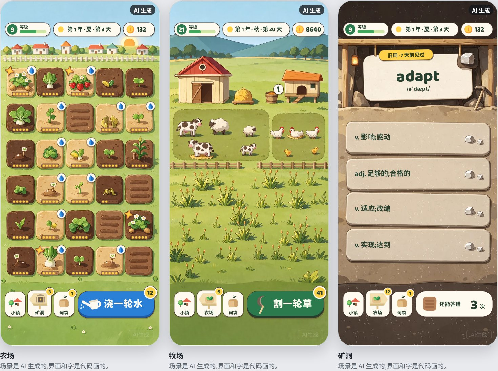

# 新画风的画面:农场、牧场、矿洞

项目负责人 2026-11-22 把产品的画风定为**偏插画的赛璐璐**(线稿加平涂,带一点柔和的处理),并要求把农场、牧场、矿洞按它重新设计。
这里是第一稿。决定的背景和代价见[决策记录 0028](../../decisions/0028-art-direction-illustrated-cel.md),画风是怎么选出来的见[人物画风探索](../character-style/README.md)。

**这是概念稿,不是成品,也不是能直接用的素材。** [美术规范](../07-art-direction.md)还没有按新画风重写。

*农场、牧场、矿洞。场景是 AI 生成的(豆包 `doubao-seedream-5-5-261028`,2026-11-22),顶部信息、按钮、单词、水滴和星带是代码画的。*

**结论先说:**

- **走得通,比预想的便宜。** 把彩纸的画面当参考图,模型重画之后构图几乎原样保住,界面和字按原来的坐标叠回去,一个没有挪。
- **状态基本保住了。** 农场 30 块地的干湿和空地全部对得上,蔫了和不生长的 5 株都认得出,作物的种类 29 块对。
- **一种作物的全部状态可以一次画成一套。** 只试了萝卜。这改了"换画风要重做多少"的算法。
- **没有解决的:** 这是三张拼好的图,不是素材;界面没有重新设计;牧场的草数不出几捆了;没有上真机,没有问过目标用户;
  整个画面现在都是 AI 生成的,能不能上架、版权归谁仍然没有答案。

## 怎么看

用浏览器打开 [`index.html`](index.html),需要联网加载字体。"缩小之后"一节按真实大小显示,请在手机上看。

| 截图 | 内容 |
|---|---|
| [`three-screens.jpg`](shots/three-screens.jpg) | 新画风的三屏 |
| [`farm.jpg`](shots/farm.jpg)、[`pasture.jpg`](shots/pasture.jpg)、[`mine.jpg`](shots/mine.jpg) | 每一屏的三联:彩纸的原稿、模型画出来的原样、叠上界面之后 |
| [`small.jpg`](shots/small.jpg) | 农场缩到每块地约 28pt,彩纸和新画风(截图放大了 3 倍) |
| [`phone-farm.jpg`](shots/phone-farm.jpg) | 手机宽度下的农场一屏 |

## 怎么做的

1. **把彩纸的画面去掉文字和界面,只留场景。** [`source.html`](source.html) 做这件事。农场连水滴、四角星和星带也去掉。
2. **当参考图交给图像模型,**要求按新画法重画,构图和每样东西的位置、数量、状态不变,画面里不要有字和界面。三屏各出了一张,没有挑,没有重出。
3. **把界面叠回去。** 顶部信息、底部按钮、单词和释义、水滴、收获标记、星带是代码画的([`cel-screens.js`](cel-screens.js)),用的是彩纸那一屏的坐标。
   界面的图形还是彩纸那一套,只把硬边投影换成了一圈深褐色的线稿加投影。

文字和状态的标记不交给模型,有两个原因:它们必须准确、读得清;而且"蓝色只表示水""黄色表示得到的东西"这样的规矩只有自己画才守得住。

**彩纸的那几屏没有白做。** 它们现在是布局稿:排法、尺寸、状态的表示法都定在那里,模型照着画。要改一屏的排法,先改彩纸的代码,再重画。

## 看到了什么

### 农场:30 块地逐块对过

| 查的是 | 结果 | 说明 |
|---|---|---|
| 干土、湿土、空地 | 30 块全对 | 干土和湿土的明暗差得比彩纸还开。空地的土色变深了,和湿土接近,只靠三道垄来分 |
| 蔫了的(2 株) | 都认得出 | 叶子发黄、下垂 |
| 不生长的(3 株) | 都认得出 | 一片叶子发黄。"整株歪向一边"画得很轻 |
| 作物是哪一种 | 29 块对,1 块丢了 | 第 4 行的玉米幼苗被画成了一根普通的嫩芽 |
| 作物的点睛色 | 3 块变了 | 萝卜的根肩从淡粉变成了白色。规范里靠这一点认萝卜 |
| 位置 | 没有挪 | 水滴、收获标记、星带按彩纸的坐标叠上去,都落在该落的地方 |

对的方法是把参考图和结果放大并排,一块一块看。是我自己看的。

### 牧场

- 排法保住了:房子在上,院子在中间,草地在下。牛、羊、鸡的数量和位置都对,卧在干草上的那头牛和抱窝的那只鸡也在。
- **草数不出几捆了。** 彩纸的规矩是"几根穗就是几捆"。模型把草画成了自然的草丛,穗变成红褐色的小点,高矮还看得出,根数数不清。
- 饲料桶见底的感叹号模型没有画,按规则补在原来的位置。
- 草的颜色偏黄,和院子、远山的绿分得不如彩纸清楚。

### 矿洞

- 岩层的构图原样保住:木梁、提灯、挂着的词牌、探出来的矿石、镐、四条石板、石板右端的矿。
- 词牌和石板要求留白,模型照做了。单词 40pt、释义 17pt 叠上去读得清。
- 答对、运气好、答错三个关键帧没有画。石板裂开、矿石弹出要的是能动的素材。

### 缩小到每块地 28pt

当初选彩纸的第一条理由是它缩小之后状态最好认([决策记录 0015](../../decisions/0015-art-direction-paper-collage.md))。

- 干湿、水滴、收获标记都清楚,干土和湿土的明暗在新画风里差得更开。水滴和收获标记本来就是代码画的。
- 作物两边差不多:都只剩轮廓和主色,蔫了的两株靠发黄还认得出。新画风没有比彩纸明显更差。
- **这个判断是放大三倍看截图得出的。** 真实大小下线稿会不会糊,要在手机上看。真正的小图标也应该单独画一套简化的,不是把大图缩小。

### 一套作物素材的试验

*AI 生成。种子、发芽、幼苗、成株、成熟、不生长、枯萎。只出了一张,没有挑。*

游戏里用的是一样一样的素材,不是整屏的图。让模型把萝卜的七个状态画成一排,用上面那张农场对齐画法:七个都画对了,同一种画法、同一块土、同一个大小,成熟的那个根肩是淡粉的。

**这改了成本的算法。** 彩纸的做法是"状态靠变换,不靠重画",因为重画贵。现在重画一种作物的全部状态是一次调用、不到一分钟,12 种作物是 12 张。

没有验证的:12 张之间画风和大小统不统一;怎么切成一个个素材;干土和湿土要分开出;生长的动画原来靠纸片的位移和缩放,换成位图之后只能换图。

## 发现的问题

- **界面没有重新设计。** 顶部的药丸、底部的按钮、水滴、星带是彩纸的图形描了一圈线,能看,但不是为这种画风设计的。
- **人物还没有放进这三屏。** 玩家自己的角色、居民在场景里是什么样、多大,没有画。
- **规范里的几条规矩要重写:** "蓝色只表示水"(天是蓝的)、"红色不当警告色"、"没有描边和渐变"、"不用纯黑纯白"。哪些留、哪些改,要逐条过。
- **模型大体照做,细处自己发挥。** 牧草的穗、萝卜的淡粉、那株玉米幼苗都是这样丢的。靠单独的素材加逐项核对能管住,靠整屏重画管不住。
- **同一屏每次出图都不一样。** 这次每屏只出了一张。画面要改一处就得整张重出,别的地方也会跟着变。

## 没做的

- 矿洞答题之后、矿洞关门、割草答题、做饲料、买卖、词袋、商店、小镇地图、对话,都没有重做。
- 没有动效。
- 没有按新画风写色板、字体和形状的规定。字体沿用原来的三种。
- 没有上真机;没有问过任何目标用户;没有做色觉模拟,没有重新算明暗对比。
- 没有在引擎里试过位图素材的包体、内存和图集。
- 没有逐张比对画面是否像某个已有游戏的画面。
- 只用了豆包一家的模型,负责人选的是它的味道。

## 用量

4 次调用:三屏各一次,素材一次,都带一张参考图。每张 40 到 60 秒,每张约 15000 个输出 token。价格以账单为准。
每一张的模型、日期、参考图、用量和完整的提示词在 [`generated/manifest.json`](generated/manifest.json),里面没有任何作品、画师的名字,也没有项目和个人的信息。

## 这些画面是怎么来的

- **场景是 AI 生成的。** 豆包的生图模型,2026-11-22。对比页上每一张都带"AI 生成"的标,图的右下角有模型自带的"AI生成"水印。
- **界面和文字是代码绘制的,**代码由 Claude 编写,属于 AI 协助产出的内容。
- 对外发布这些画面时,按[内容策略](../../marketing/01-content-strategy.md#红线)的要求声明。
- **画面不读取游戏数据。** 用的是彩纸参考图的那几份示意存档。
- 没有使用任何第三方图片。提示词里没有任何游戏和画师的名字。

## AI 生成素材登记

| 素材 | 工具和版本 | 日期 | 提示词在哪 | 用在哪 |
|---|---|---|---|---|
| `generated/farm.webp`:农场的场景 | 豆包 `doubao-seedream-5-5-261028`,带参考图 | 2026-11-22 | `generated/manifest.json` | 对比页 |
| `generated/pasture.webp`:牧场的场景 | 同上 | 2026-11-22 | 同上 | 对比页 |
| `generated/mine.webp`:矿洞的场景 | 同上 | 2026-11-22 | 同上 | 对比页 |
| `generated/sprites-turnip.webp`:萝卜的七个状态 | 同上 | 2026-11-22 | 同上 | 对比页"素材的试验" |

仓库里存的是缩小后的 WebP(场景 780×1688),原图没有进仓库。

## 文件

| 文件 | 内容 |
|---|---|
| `index.html`、`index.js`、`cel-screens.css` | 画面页 |
| `cel-screens.js` | 把场景和界面拼成一屏:哪些字、哪些标记叠在哪里 |
| `source.html` | 把彩纸的画面去掉文字和界面,渲染成参考图。地址后面加 `?s=farm`、`?s=pasture`、`?s=mine` |
| `generated/` | AI 生成的三张场景、一张素材,和 `manifest.json` |
| `shots/` | 截图 |

彩纸的画面、界面的图形、示意存档来自 [`../art-exploration/`](../art-exploration/README.md)、[`../mine-screens/`](../mine-screens/README.md) 和 [`../pasture-screens/`](../pasture-screens/README.md),这三个目录的文件都没有改。

## 检查过的

- `index.html` 在 390 像素宽和 1280 像素宽的视口下没有脚本报错,没有横向溢出。
- 农场 30 块地逐块对过;牧场的牲畜逐只数过;矿洞的四条石板和词牌上的字逐条看过。
- 文档里的相对链接都能打开。

## 没检查的

- 没有上过真机。
- 没有问过任何目标用户。
- 没有做色觉模拟,没有算新画面上文字和标记的明暗对比。
