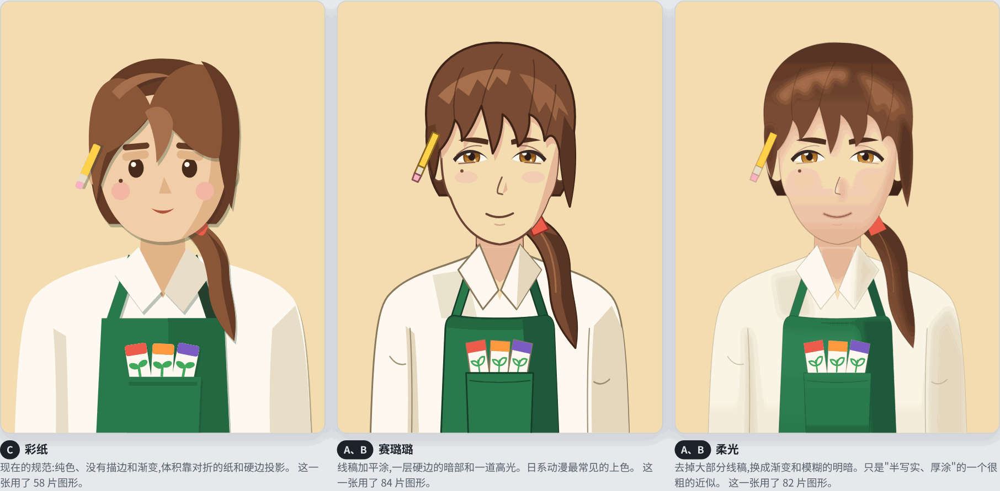
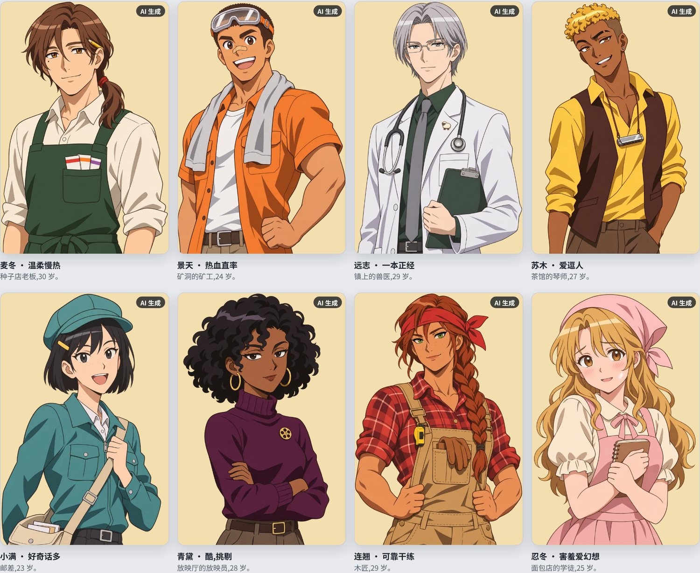
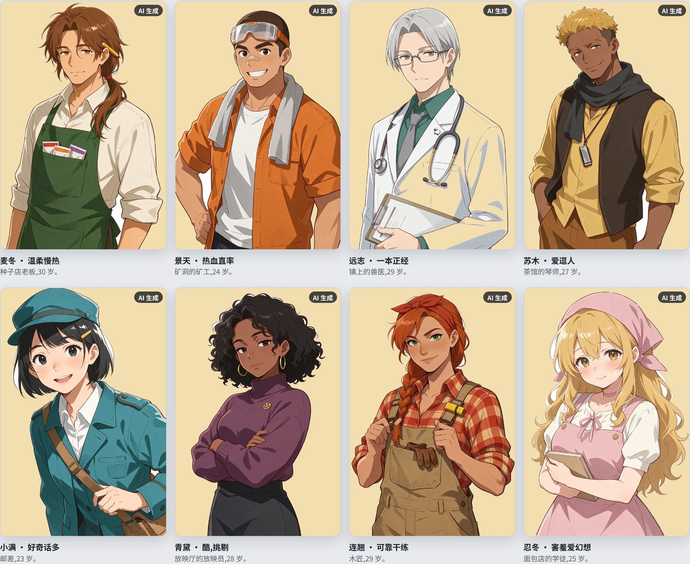
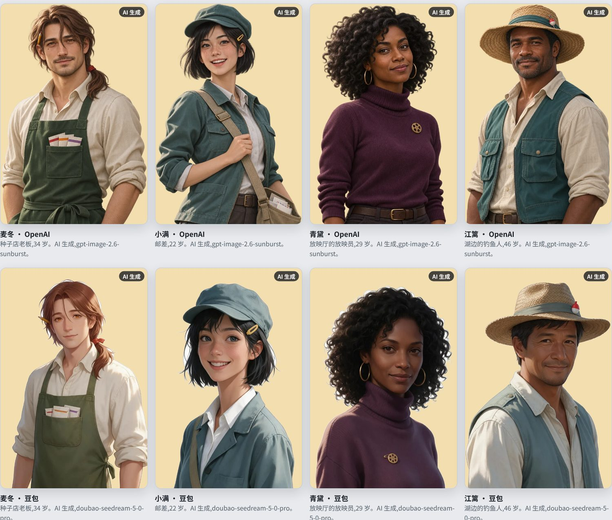
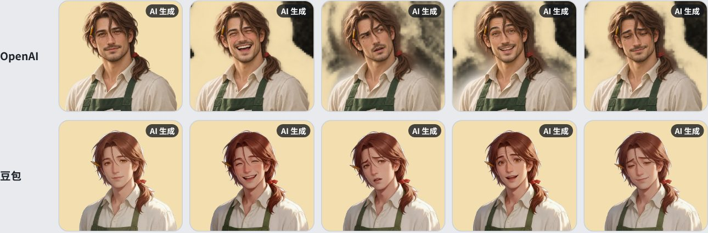
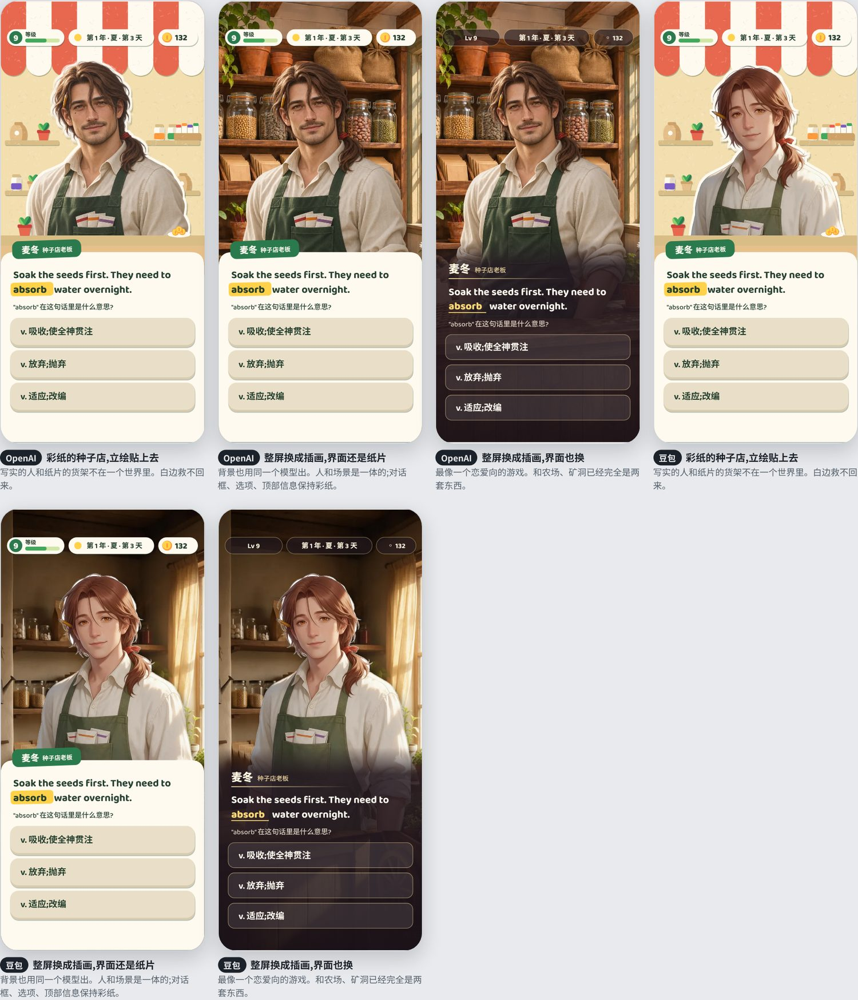

# 人物画风探索:小镇居民用什么画法

一次探索,用来让负责人看图、看代价,再做决定。**不是定稿,不是居民和对话玩法的设计,[美术规范](../07-art-direction.md)没有改。**

背景:美术方向是彩纸拼贴([决策记录 0015](../../decisions/0015-art-direction-paper-collage.md))。负责人的新方向(原话):

> 探索一下更多的写实的画风,因为以后如果要加小镇人物,通过对话学语言,那人物必须特色鲜明,符合大众审美才可以,
> 参考恋与制作人那样的,或者说日本动漫那种风格的。

负责人举的是画风的大类(日系动漫、高完成度的人物立绘),不是要做成某个具体的游戏。这里没有参照任何已有作品里的角色。

**现在的状态(2026-11-22):**

这个目录经过了三轮,负责人每看一轮给一次方向:

1. 第一轮用代码画了三种画法,建议是"世界保持彩纸,人物用线稿加平涂另画,贴进彩纸画面;彩纸人物保底"。
2. 第二轮按负责人的要求多画了几个彩纸人物,共七个。
3. 第三轮负责人的判断(原话):

   > 彩纸风格还是不够用。我觉得如果不把跟人聊天做成攻略他,跟他谈恋爱的话,那没有办法吸引用户持续去跟他聊天,
   > 而且不这么做聊天内容也很局限和乏味。如果要做成攻略类的玩法,那游戏人物必须要足够吸引人。
   > 你能不能不靠自己画,用 openai 或者 doubao 的生图模型生成看看,还是要做得更写实一点

   于是用两家的图像生成模型出了一批立绘,见[下一节](#第一轮生成的立绘半写实)。

4. 第四轮负责人看过生成的图之后(原话):

   > 我觉得线稿加平涂是我看着最舒服的,设计四男四女的年轻人物,你研究一下每个人物要怎么设计,确保每个人物外形和性格各有特色,不重合,
   > 然后把线稿加平涂版本分别用 OpenAI 和豆包最好的模型画出来我看看

   设计稿和两家画出来的结果见[四男四女](#四男四女八个年轻居民的设计)。**画法现在是负责人选定的:线稿加平涂。**

**第三轮出图之后的结论:**

- **好看的程度够了。** 这是代码画不出来的一档。
- **同一个人换表情,还是同一个人。** 两家模型各改四种表情,八张都能用。这是之前最担心的一项。
- **写实的立绘贴不进彩纸画面。** 第一轮建议的"贴进去"不成立了,要改成:**对话整屏换成插画,农场和矿洞保持彩纸。**
- **没有解决、而且更要紧的:** 恋爱向的游戏正是玩家最反感 AI 立绘的地方;只靠提示词生成的人物很可能没有版权;恋爱玩法本身没有设计,和愿景有出入;
  "不做成恋爱就留不住人"这个前提没有数据。这些要负责人在知道代价的情况下定。



*麦冬,种子店老板。从左到右:彩纸、赛璐璐、柔光。代码绘制的示意稿,不是成品;右边两张远低于这类画法的真实水平。*

## 四男四女:八个年轻居民的设计

负责人选了线稿加平涂,要求设计四男四女八个年轻人物,外形和性格各有特色、不重合,用两家最好的模型各画一遍。
**下面的图是 AI 生成的**(2026-11-22)。八个人都是 23 到 30 岁的成年人。恋爱和对话玩法都还没有设计,这是人物设计稿,不代表游戏里已经有这些人。



*OpenAI `gpt-image-2.6-sunburst`。上排:麦冬、景天、远志、苏木;下排:小满、青黛、连翘、忍冬。AI 生成,每人只出了一张,没有挑图。*



*豆包 `doubao-seedream-5-5-261028`。顺序同上。AI 生成,每人只出了一张,没有挑图。*

### 怎么设计的

没有从"别的恋爱游戏有哪几类人"出发,而是从这个项目绕不开的几件事往上推:

- **缩小之后脸分不开人。** 前几轮画出来的结论是:头像那么大时只剩发型的轮廓和一块主色。所以每个人头上都有一样别人没有的东西,主色八个人各用游戏色板里的一种。
- **对话是用来学语言的。** 所以八个人说话的方式要分开:常用的句式不同,聊的话题各管一块。这样换一个人聊就换一类句子。**这一条是设想,对话玩法没有设计。**
- **喜欢哪一类人因人而异。** 八个类型里没有"同一种人的男版和女版"。
- **都是成年人,穿日常的工作服,**每个人在镇上有一份和现有地点对得上的事做。

性格按两条线排开:对人热还是冷,劲头朝外还是朝内。四个格子里男女各放一个,再让同一格的两个人拉开:

| | 朝外 | 朝内 |
|---|---|---|
| **热** | 景天(好胜的行动派)、小满(好奇的话痨) | 麦冬(慢热、照顾人)、忍冬(害羞、爱幻想) |
| **冷** | 苏木(爱逗人、不正经)、连翘(干练、不绕弯子) | 远志(认真到木讷)、青黛(有品味的挑剔) |

连翘放在"冷"是指她对人不黏、不说软话,不是冷淡。

### 设计表

完整的设计(每个人的一段话、交给模型的人物描述)在 [`leads.js`](leads.js)。

| | 身份,聊什么 | 类型 | 说话的方式 | 头发 | 体型、肤色 | 主色 | 标志性的东西 |
|---|---|---|---|---|---|---|---|
| **麦冬** 男,30 | 种子店老板。植物、季节、等待 | 温柔慢热 | 说得慢,句子短,爱拿植物打比方 | 栗色,低马尾搭在肩上 | 中等个子;暖白 | 深叶绿 | 耳后的黄铅笔,三包种子,眼下一颗痣 |
| **景天** 男,24 | 矿工。石头、工具、力气、比赛 | 热血直率 | 短句,感叹句和祈使句多 | 深褐,寸头 | 高大结实;小麦色 | 南瓜橙 | 额头上的护目镜,鼻梁上的创可贴,脖子上的毛巾 |
| **远志** 男,29 | 兽医。动物、身体、健康 | 一本正经 | 完整的长句,爱下定义,会纠正用词 | 银灰,整齐的中分直发 | 高瘦,笔直;偏白 | 纸白配墨绿 | 细框方眼镜,听诊器,小羊徽章 |
| **苏木** 男,27 | 茶馆的琴师。音乐、心情、笑话 | 爱逗人 | 反问、玩笑、双关 | 染成金色,两侧剃短、头顶小卷 | 中等精瘦;深褐 | 玉米黄 | 脖子上的口琴,耳钉,断眉 |
| **小满** 女,23 | 邮差。消息、路和方向 | 好奇话多 | 一连串的问句,爱转述 | 黑,齐下巴的短发 | 瘦高;白,有雀斑 | 蓝绿 | 邮差帽,邮包,黄发夹 |
| **青黛** 女,28 | 放映员。电影、评价、台词 | 酷,挑剔 | 爱下评语,爱比较,引用台词 | 黑,一头大卷发 | 中等,挺拔;深褐 | 茄紫 | 金色大耳环,胶片别针 |
| **连翘** 女,29 | 木匠。房子、家具、尺寸 | 可靠干练 | 干脆,一二三,数字张口就来 | 铜红,一条粗长的麻花辫 | 高,有力;晒过的橄榄色 | 番茄红 | 红头带,卷尺,皮手套 |
| **忍冬** 女,25 | 面包店学徒。吃的、味道、想象 | 害羞爱幻想 | 形容词多,爱说"好像""也许" | 蜂蜜金,披肩的长卷发 | 娇小圆润;白里透红 | 淡粉 | 三角头巾,小本子,脸颊上的面粉 |

**不重合做到了什么程度:** 类型、说话的方式、发型的轮廓、主色、标志性的东西,这五栏八个人各不相同。
发色有一处重合:小满和青黛都是黑发,靠直短发和大卷发分开。体型和肤色没有做到一人一档,各分了四档左右。

麦冬、小满、青黛沿用了前几轮的设计,年龄调小了(麦冬 34 改成 30,青黛 29 改成 28,小满 22 改成 23)。前几轮里年长的几位(铁兰、桑榆、白芷、江篱)不在这八个人里,可以是镇上不参与恋爱的居民。

### 画出来之后看到的

- **八个人分得开。** 两家都是:只看轮廓也不会认错。四个女性比四个男性分得更开,男性的差别主要在头顶。
- **八张像同一部作品里的人。** 没有给参考图,只靠同一段画法描述,两家各自的八张画风是统一的。这是之前没测过的一项。
- **两家的味道不同。** OpenAI 的线条硬、颜色实,像老一点的电视动画;豆包的线条细、颜色柔,像近几年的插画。要哪一种由负责人看图定。
- **豆包的小满看起来像未成年人,不能用。** 设计写的是 23 岁,提示词里也写了"成年人的脸部比例,不是孩子气的长相",画出来还是偏小;忍冬也偏小。
  OpenAI 的八张都看得出是成年人。要用豆包的话,这两个人必须重出,并且每一张都要过"一眼是不是成年人"这一关。
- **OpenAI 的连翘画得太壮,**手臂和脖子接近男性的画法。设计要的是"高、有力",不是这个程度,要调提示词。
- **没照设计画的地方:** 豆包给苏木加了一条围巾;豆包的麦冬没有眼下的痣;OpenAI 把麦冬的铅笔画到了另一只耳朵上。定稿前要逐项对。

### 这一轮的用量

16 次生成,另有 1 次试豆包新模型的测试,共 17 次调用。OpenAI 每张 1372 个输出 token,约 28 秒;豆包每张 12150 个输出 token,约 27 秒。
价格同下文:OpenAI 按第三方资料估每张约 0.04 美元,没有核对官方价格和账单;豆包以账单为准。
每一张的模型、日期、用量和完整的提示词在 [`generated/leads/manifest.json`](generated/leads/manifest.json)。提示词就是 `leads.js` 里的画法那一段加人物那一段,没有任何作品、角色、画师的名字。

### 没有做的

- 每人只有一张,没有挑图,没有重出有毛病的那几张。
- 表情、姿势、换衣服都没有出。第一轮测过"改表情还是同一个人",那是半写实的画法,线稿加平涂没有测。
- **没有逐张比对是否像某个已有作品里的角色。** 日系动画的画法里相似的长相很多,正式使用前必须做。
- 没有问过任何目标用户。"分得开""像成年人""太壮"都是我自己看的。
- 八个人的性格只有一段话,没有写台词。写不写得出八种分得开的说话方式,要写了才知道。
- [下文](#负责人的新方向恋爱和攻略)里恋爱方向的那几条代价没有变。

## 第一轮生成的立绘(半写实)

**这一节的人物和背景都是 AI 生成的。** 负责人要求用 OpenAI 或豆包的生图模型出图,做得更写实。2026-11-22 出图:

| | OpenAI | 豆包(火山方舟) |
|---|---|---|
| 模型 | `gpt-image-2.6-sunburst` | `doubao-seedream-5-0-pro-260628`。更新的 5.5 账号没有开通 |
| 调用次数 | 15 次:1 次测试,10 张图,另有 4 张表情因为漏传透明背景的参数重出 | 11 次:1 次测试,10 张图 |
| 每张用时 | 25 到 33 秒 | 43 到 58 秒 |
| 每张用量(接口返回的) | 1372 个输出 token;带参考图时另有约 1540 个输入 token | 约 16000 到 17000 个输出 token |
| 价格 | 按第三方资料里的单价(每百万输出 token 30 美元)估,每张约 0.04 美元,全部不到 1 美元。**没有核对官方价格和账单** | 没查到单价,以账单为准 |
| 透明背景 | 直接出透明底。改表情时透明底里会带一些深色的残留 | 白底,自己抠的,发丝边缘有一圈白 |
| 画幅 | 指定多大就多大 | 没指定宽高时每张的长宽比都不一样,以后要写死 |

一共 26 次调用,留下 20 张,在 [`generated/`](generated/)。**没有挑图:每个画面只出了一张,出来什么就是什么。**
每一张的模型、日期、参考图和完整的提示词记在 [`generated/manifest.json`](generated/manifest.json)。提示词里没有任何作品、角色、画师的名字,也没有项目和个人的信息。
人物都是成年人,穿日常的工作服。



*上排 OpenAI,下排豆包;从左到右:麦冬、小满、青黛、江篱。AI 生成。两家拿到的是同一段设定。*

### 看到了什么

- **两家的味道不一样。** OpenAI 的偏真人写实,像剧照;豆包的偏日系插画,更接近"日本动漫那种风格"里写实的一路。要哪一种,由负责人看图定。
- **同一段设定,两家画出来是两个人。** 一个角色只能在一家模型里定稿,之后的表情、姿势都得跟着那一张走。
- **设定不是都照做了。** OpenAI 给麦冬加了胡茬(设定里没有)。豆包的麦冬没有眼下的痣,看着比 34 岁年轻得多;豆包的小满看起来年纪偏小。
  **要做恋爱向,每个可攻略的人物都必须一眼看得出是成年人**,这一条要在提示词和挑图时卡住。
- **标志性的东西基本都在:** 发束和红发绳、耳后的铅笔、三包种子、草帽上的浮漂、胶片别针、发夹和雀斑。第一轮得出的"认人靠头上身上的东西"仍然成立。

### 换表情之后还是不是同一个人



*每排第一张是基础立绘,后四张是把它当参考图、只要求改表情得到的:高兴、疑惑、鼓励、答错时。每个表情只出了一次。AI 生成。*

- **是同一个人。** 两家都做到了,八张里没有一张要重出。
- **身体不是一个像素都不动。** 量出来躯干部分和基础立绘的平均差是 2.5 到 7.4(满分 255):肉眼看不出,但直接叠会有接缝。要当差分用,得把脸那一块抠出来贴回原图。
- **只测了一个人、四种表情、每种一次。** 换姿势、换衣服、十个人画风统一,都没有测。

### 放进对话界面



*每家三屏:彩纸的种子店加立绘;整屏换成插画、界面还是纸片;整屏换成插画、界面也换。背景也是同一个模型出的。AI 生成的人物和背景,代码画的界面。*

- **写实的立绘贴不进彩纸画面。** 第一轮画出来的结论是"越写实越难接",现在用真的图验证了:加白边也没用。
- **能成立的是对话整屏换成插画。** 农场、矿洞、地图还是彩纸;一进对话,整屏切到插画(背景加立绘),像换了一个镜头。
  这样不用重做农场和矿洞,比"整个游戏换画风"便宜得多。
- **代价:** 每个对话的地点要一张背景;玩家会在两种画风之间来回切,切得顺不顺要靠转场,静止的图看不出来。

线稿加平涂的版本也各出了一张([`gen-cel.jpg`](shots/gen-cel.jpg)),从彩纸到生成立绘的对比见 [`gen-ladder.jpg`](shots/gen-ladder.jpg)。

### 负责人的新方向:恋爱和攻略

玩法方向由负责人决定。下面是做决定之前应该知道的,分成查到的事实和我的判断。

**查到的事实**(出处见[第 5 条](#5-用图像生成模型画人物绕不开的问题)和[文末](#出处),来自一次联网检索,没有逐条再核对):

- **玩家抵制 AI 立绘的事件,集中在卖角色、卖立绘的游戏上。** 查到的几起都是这一类。有一起的玩家原话是:"一个抽卡卖角色为主的游戏,用AI画原图,我为什么要花钱买?"
  人物就是产品的时候,"是不是 AI 画的"最要紧。恋爱向正好落在这里。
- **只靠提示词生成的人物,被别人照搬时很可能主张不了权利。** 恋爱向游戏最值钱的就是人物。
- **聊天如果是模型实时生成的,应用本身就成了"提供生成合成服务"的一方。** 《标识办法》的标识义务、应用分发平台的核验、Apple 中国区的 AIGC 声明都会落到头上。
  如果是写好的剧本,就没有这一层。两种做法成本和合规差得很远,要先定。

**我的判断**(没有数据支持,供参考):

- **"不做成恋爱就留不住人"是一个没有验证的前提。** 它可能是对的,但现在整个项目连核心循环都还没有验证。
- **恋爱向的工作量主要在写,不在画。** 这次证明了画可以很快;每个可攻略人物的剧情、分支、好感度事件要一句一句写,而且台词要用学习者认得的词。一个人长期做,瓶颈会在这里。
- **它会改变"为谁做"。** [愿景](../01-vision.md)里的对手是背单词应用,目标用户是想背单词、坚持不下来的人。恋爱向会把一部分人吸引来,也会把一部分人挡在外面;
  男女玩家都照顾的话,可攻略的人物要成倍准备。
- **学习的底线不能松。** 掌握度只因为隔了至少一个游戏日的回忆而上升;聊天不能成为绕开复习的捷径(设计支柱 6)。
- **一个值得想的方向,没有设计:** 好感度跟着"隔了几天还记得他教的词"走,而不是跟着聊天的次数走。
  这样它正好对上设计支柱 3(记得越牢,回报越大),恋爱就成了长期记忆的回报,而不是另一套刷次数的系统。

**如果负责人决定往这个方向走,建议先做的便宜验证:**

1. 定一家模型、一种味道,把一个人物做到底:基础立绘、五种表情贴回原图、两个姿势、一张背景。量出真实的时间,看姿势换了之后还是不是同一个人。
2. 写十句这个人物的台词,只用示例卡组里的词,看在这个限制下写不写得出让人想继续聊的话。这一步比画更能回答"做不做得下来"。
3. 把立绘拿给两三个目标用户看,并且**如实告诉他们是 AI 画的**,看反应。
4. 想清楚请画师的可能:用生成的图当设定稿和参考,正式的立绘请画师画或者重画。这样版权和玩家观感两头都稳,代价是钱。


## 怎么看

用浏览器打开 [`index.html`](index.html),需要联网加载字体(Google Fonts)。小尺寸那一节按真实大小显示,请在手机上看。

不方便打开页面时,[`shots/`](shots/) 里是截图:

| 图 | 内容 |
|---|---|
| [`leads-openai.jpg`](shots/leads-openai.jpg)、[`leads-doubao.jpg`](shots/leads-doubao.jpg) | **AI 生成:**四男四女八个人,线稿加平涂,两家模型各一遍 |
| [`gen-cast.jpg`](shots/gen-cast.jpg) | **AI 生成:**第一轮,四个居民的半写实立绘,两家模型 |
| [`gen-expressions.jpg`](shots/gen-expressions.jpg) | **AI 生成:**麦冬的基础立绘和四种表情,两家模型 |
| [`gen-dialogue.jpg`](shots/gen-dialogue.jpg)、[`gen-phone-scene.jpg`](shots/gen-phone-scene.jpg) | **AI 生成的人物和背景:**放进对话界面的三种放法 |
| [`gen-ladder.jpg`](shots/gen-ladder.jpg)、[`gen-cel.jpg`](shots/gen-cel.jpg) | 同一个人从彩纸到生成的立绘;线稿加平涂的生成版本 |
| [`same-person.png`](shots/same-person.png) | 同一个人的三种画法(代码绘制,下同) |
| [`expressions.png`](shots/expressions.png) | 五种表情,三种画法 |
| [`dialogue.png`](shots/dialogue.png) | 对话界面五屏:彩纸的人、赛璐璐的人(带剪贴的白边、不带)、柔光的人、整个游戏换画风 |
| [`phone-talk-cel.png`](shots/phone-talk-cel.png) | 手机宽度下的一屏:彩纸的世界,赛璐璐的人 |
| [`after-miss.png`](shots/after-miss.png) | 答错之后,彩纸和赛璐璐各一屏 |
| [`small-sizes.png`](shots/small-sizes.png) | 96、64、40、28pt 的头像(截图放大了 1.5 倍) |
| [`paper-cast.png`](shots/paper-cast.png)、[`paper-cast-silhouette.png`](shots/paper-cast-silhouette.png) | 彩纸的七个居民和他们的轮廓 |
| [`paper-expressions.png`](shots/paper-expressions.png) | 彩纸的七个居民,各五种表情 |
| [`cast.png`](shots/cast.png)、[`cast-silhouette.png`](shots/cast-silhouette.png) | 赛璐璐的四个居民和他们的轮廓 |

想看更写实的画法真正的样子,用 [`prompts.md`](prompts.md) 里的提示词自己出图。

## 比较了什么

三条路,和三种画法,是两回事:

| 路 | 世界 | 人物 |
|---|---|---|
| **A** | 保持彩纸 | 对话时出现另一套更精细的人物立绘 |
| **B** | 整个游戏换成更写实或动漫的画风 | 同一套画风 |
| **C** | 保持彩纸 | 也用彩纸,画细一些 |

| 画法 | 属于哪条路 | 这次怎么画的 |
|---|---|---|
| 彩纸 | C | 按现在的规范:纯色、没有描边和渐变,体积靠对折的纸和硬边投影 |
| 赛璐璐 | A、B | 线稿加平涂,一层硬边的暗部和一道高光 |
| 柔光 | A、B | 赛璐璐去掉大部分线稿,换成渐变和模糊的明暗。只是"半写实、厚涂"的一个很粗的近似 |

画的东西:

- **同一个居民,三种画法的半身像**,加五种表情(平常、高兴、疑惑、鼓励、答错时)。
- **对话界面的示意,手机竖屏五屏:** 背景是按现有画法画的种子店。彩纸的人;赛璐璐的人(带一圈剪贴的白边、不带);柔光的人;整个游戏换画风之后的一屏。另有答错之后的两屏。
- **缩小到 96、64、40、28pt 的头像。**
- **另外三个居民的草图**,只用赛璐璐画,加轮廓和 40pt 的头像。
- **彩纸的七个居民**(负责人看过第一版之后要求加的,见[下文](#彩纸的七个居民)):每人一张半身像、五种表情、轮廓、40pt 和 28pt 的头像。

居民的设定在 [`cast.js`](cast.js):麦冬(种子店老板,34 岁,男)、铁兰(矿洞的管事,58 岁,女)、小满(邮差,22 岁,女)、桑榆(退休的老师,71 岁,男);
后加的三个只有彩纸版:江篱(湖边的钓鱼人,46 岁,男)、青黛(放映厅的放映员,29 岁,女)、白芷(面包师,52 岁,女)。
名字、身份、台词都是为了比较画风临时写的。都是普通的成年居民,没有恋爱向的设定。

## 彩纸的七个居民

负责人看过第一版之后说:彩纸风格的人物,多做几个看看。于是把原来的四个都画成彩纸,又加了三个,肤色、年龄、轮廓特意拉开。
全部按现在的规范画,没有用 `style-test` 试过的放宽规则。


*代码绘制的示意稿,不是成品。设定是临时写的,不代表游戏里会有这些人。*

画出来看到的:

- **分得开,而且比预想的好。** 七个人只看轮廓不会认错:发束、头巾的结、帽檐、光头加眼镜、宽檐草帽、一头卷发、头顶的发髻。
  28pt 的头像靠轮廓加一块主色也分得开。见 [`paper-cast-silhouette.png`](shots/paper-cast-silhouette.png)。
- **便宜。** 实测每人 41 到 58 片图形,80 到 100 行绘制代码;另有七个人共用的一套约 480 行(五官、表情、脖子、躯干的大形)。
  新画一个人只画头发、衣服和小物件。七个人各五种表情,没有为谁多画一片,见 [`paper-expressions.png`](shots/paper-expressions.png)。
- **年纪和肤色画得出来。** 年纪靠头发的颜色、胡子、眼角和嘴边的几片细纸条。深肤色的人眼睛要垫一片纸白的眼白,不然眼珠立不住。
- **做不到的没有变。** 七张脸其实是同一张脸,差别只在脸的宽窄、眼睛的大小和眼尾的角度。它是"一套讨喜的小人",不是"一个个好看的人"。
  想让玩家记住某一个人,要靠头上身上的东西、性格和台词。
- **新增的颜色:** 每人一组皮肤(两档)、脸颊、头发(两到三档),色板里没有。衣服和小物件都取自色板。
  草帽用了干土色:木色和种子店的墙是同一个颜色,帽子会消失。光头上那片暗面用了剪裁,其余没有用到规范之外的东西。

**这对建议的影响:** 彩纸这条保底的路比第一版看起来更站得住。"特色鲜明"它做得到,而且十个居民的量一个人做得下来,这两点现在是画出来验证过的。
"符合大众审美"要到哪一档仍然没有答案:如果要的是讨喜、有辨识度,彩纸够了;如果要的是日系立绘那种好看,彩纸给不了。
这个问题只能由负责人看图、再问目标用户来回答。建议本身没有改,但 C 和 A 之间的差距,比第一版里看起来的小。

判断"分得开""讨喜"的是画的人自己,不算数。

## 六个问题

每一条都标明是**画出来看到的**、**估计**,还是**没查到**。

### 1. 人物画风有哪几条路

**A:世界保持彩纸,人物另画。**

- 画出来看到的:能放在同一屏上,但要做三件事。人物的衣服用游戏色板里的颜色;人物带一圈纸白的边和一道硬边投影,当成一张从印好的画上剪下来的纸贴进去;对话框、选项、名字都保持纸片。
  做了之后赛璐璐的人像一张贴纸。不加那圈边时,人像浮在另一层上。
- 画出来看到的:平涂比渐变好接。赛璐璐只有两三档纯色,和彩纸是近亲;柔光的渐变在一屏纯色里最显眼。所以在 A 里,越写实越难和彩纸放在一起。
- 画出来看到的:人物比世界精致之后,世界显得朴素。这是主次的问题,要负责人看图判断。
- 缩到 40pt 以下,三种画法剩下的东西差不多(发型的轮廓、几块主色)。所以场景和地图里的小人用纸片画就够了,精细的画法只用在对话的半身像上。

**B:整个游戏换画风。**

- 只画了一屏对话。人和世界是一体的,这是它的好处。
- 代价是重做全部画面:12 种作物乘 5 个形态乘 3 种健康状态、7 个品级的矿石、农场、矿洞、商店、地图、牧场、全部界面;现有的规范和示意稿作废。
- 当初选彩纸的四条理由还剩多少:

  | 理由([决策记录 0015](../../decisions/0015-art-direction-paper-collage.md)) | A | B |
  |---|---|---|
  | 小尺寸下状态最好认 | 保留,世界没变 | 要重新验证。第一次探索里有明暗和笔触的水彩缩小后掉得最快;日系画风没有测过 |
  | 状态靠变换,不靠重画 | 保留。人物的表情如果是手画或生成的,每种一张脸部差分,但人物数量少 | 平涂的矢量画法还能留一部分;厚涂的留不住,每个状态要重画 |
  | 素材由代码或矢量工具直接产出,不会逐张走样 | 在人物上放弃,世界保留 | 全部放弃 |
  | 单词用普通字体,好读 | 保留 | 保留,只要对话框的底保持高对比 |

**C:彩纸人物。**

- 画出来看到的:和世界最协调;五种表情靠同一组纸片挪位置、转角度、换一片得到,只多了三片(眯眼的月牙、张开的嘴、小圆嘴)。
- 画出来看到的:它做得到"有特点、讨喜",做不到眼型、下颌、年纪这些让人觉得"好看"的东西。这是画法的上限。
- 另一条分支上的 [`style-test`](#别的分支上的相关工作) 是这条路的现成证据:放宽规范(花纹纸、亮面纸)之后画得出换装的档次,但小尺寸下档次只能靠轮廓。这次的彩纸人物没有用放宽的规则。

### 2. "特色鲜明、符合大众审美"靠什么

拆成七样。**特色鲜明主要靠发型、配色、服装、体态,三种画法都做得到;好看主要靠脸和眼睛,彩纸做不到。**

| | 彩纸 | 赛璐璐 | 半写实、厚涂(没有画出来,写的是这类画法一般能做到的) |
|---|---|---|---|
| 脸型 | 一片圆角的纸。长短宽窄能变,下颌和颧骨画不出来 | 轮廓线画得出下颌和下巴 | 靠明暗塑造骨相,年龄和气质分得最细 |
| 眼睛 | 一个深色的椭圆加一个高光,眼皮是一片纸。分不出眼型 | 眼型、眼尾、睫毛、瞳色都能定 | 还能画虹膜的层次和眼周的明暗 |
| 发型 | 三四片大纸片,轮廓最清楚 | 轮廓加发丝和一道高光 | 最细,也最费工 |
| 配色 | 衣服和小物件都可以只用游戏色板里的颜色,这次三种画法用的是同一组色值。皮肤和头发要新增 | 同左 | 同左 |
| 服装 | 大色块加一两件标志性的小物件 | 领子、衣褶、扣子都能交代 | 还能画布料的质感 |
| 体态 | 体型的差别三种都画得出。姿势都没有画 | 同左 | 同左 |
| 表情 | 挪动和替换纸片。清楚、夸张,细微的做不了 | 换眉、眼、嘴,每种一张脸部差分 | 每种表情重画脸,还要保持是同一个人 |

- 画出来看到的:三种画法里认出"是同一个人",靠的是发束、铅笔、痣、围裙和种子袋,不是脸。标志性的东西要定在轮廓和小物件上。
- 画出来看到的:四个居民去掉颜色只看轮廓也分得开。
- 代码画的局限:年纪主要靠头发、胡子和几道纹,58 岁和 34 岁的脸其实很像。
- **没有回答的:"大众审美"要到哪一档。** 让人想回来对话的是人物的性格、台词和反应,好看是其中一部分。
  用简单图形画人物、靠性格和轮廓立住的语言学习产品是有的(凭了解,没有查数据)。目标用户要的是哪一档,没有问过任何人。

### 3. 对话学语言需要人物做什么

对话玩法没有设计,这里只估人物素材的量。

一个居民大致需要:

| 素材 | 数量 | 说明 |
|---|---|---|
| 半身像 | 1 | 一个站姿 |
| 表情 | 5 | 平常、高兴、疑惑、鼓励、答错时。答错时不责备,和矿洞里不用红色和叉是同一个基调 |
| 眨眼、口型 | 1 加 2 到 3 | 可以不做:说话时让人物整体弹一下,是纸的动效里已有的做法 |
| 小头像 | 1 | 对话记录、地图名牌 |
| 场景里的小人 | 1 | 用纸片画 |
| 第二个姿势 | 0 到 1 | 没有画 |

每条路上这些素材怎么来:

- **C:** 一组纸片,表情和眨眼是参数。这次实测:七个居民每人 41 到 58 片图形,五种表情共用同一套五官。
- **A、B,手画或生成:** 一张基础立绘,加 5 张只画脸的差分,口型另加。十个居民是 10 张立绘加约 50 张差分。
- **A、B,做骨骼(把立绘拆成几十层再绑定):** 表情也变成参数,成本转到拆分和绑定上。没有评估。
- 画出来看到的:几个居民之间一眼分得开,靠轮廓(发束、头巾的结、帽檐、光头加胡子)和一块主色。
- 不用漫画符号(汗滴、问号)。蓝色的汗滴会撞上"蓝色只表示水"。

### 4. 一个人做不做得下来

| | C 彩纸人物 | A 彩纸世界,人物另画 | B 整个游戏换画风 |
|---|---|---|---|
| 靠什么产出 | 代码或矢量工具,和现在一样 | 请画师;或图像生成加人工修;或创作者自己画。代码画不到够好看的程度 | 同 A,量大得多 |
| 一个居民 | 实测(七个人)41 到 58 片图形,80 到 100 行绘制代码。估计半天左右,含看图调整 | 画师:价格见下文,周期没查到,估计以周计。图像生成:估计一到三天,没有实测 | 同 A |
| 十个居民 | 估计一周左右。这次七个是一次做完的 | 画师:最好是同一位。图像生成:十个人画风统一是主要问题 | A 加上整个世界,估计以月计 |
| 同一个人还是不是同一个人 | 天然一致 | 画师:一致。图像生成:见第 5 条 | 同 A,并且每种作物、每一屏都有这个问题 |
| 主要风险 | 好看的上限低;可能被看成偏低龄 | 两条产线;世界显得朴素;用图像生成时有披露、版权和玩家观感的问题 | 核心循环没验证就重做全部画面;一个人长期做不下来的风险最大 |

这次实测的数:

| | 图形片数 | 绘制代码 |
|---|---|---|
| 彩纸的七个居民 | 每人 41 到 58 | 每人 80 到 100 行,另有共用的五官、表情和身体的大形约 480 行 |
| 赛璐璐的麦冬 | 69 到 87(随表情) | 约 250 行,另有四个人共用的脸和画笔约 790 行 |
| 赛璐璐的另外三个居民 | 71 到 76 | 每人 140 到 180 行 |

行数是按仓库的格式排版之后数的,一行很短,只能看相对的量。这些是 AI 一次写出来、看着截图改了三四轮的结果,没有创作者看着调,审美没有人把过关。
用代码画赛璐璐,片数比彩纸多四成左右(不算四个人共用的那一套),而且画出来只到"认得出是动漫画法",所以它不是 A 的产出方式。

**请画师的价格,只查到零散的公开数字**(人民币,年份不一,只能看量级):

- 约稿平台上非商用的立绘 100 到 2000 元一张,"若是商用则会翻倍"。媒体转述,2023 年。
- 一个公开的立绘企划预算 1000 到 1500 元。平台公开页面,2025 年。
- 手游商用稿 5000 到 8000 元的说法。个人回答。
- 表情差分每个 20 到 270 元不等。画师的价目。
- 商用加价常见的说法是 2 倍,买断 2 到 3 倍。画师的价目。
- 没查到"半身立绘加五个表情、可商用"的打包价,没查到周期。
- 有记录的教训:一位独立开发者在游戏上线后被画师追要商用费。约稿时授权范围要写清楚。

### 5. 用图像生成模型画人物,绕不开的问题

**这一节的事实来自 2026-11-21 的一次联网检索,由 AI 完成。** 每条后面标了依据:【原文】是检索时打开了原始页面;【摘要】是只看到搜索结果里的摘要;【二手】是媒体或律所的转述。
我没有逐条再核对。规则会变,负责人据此做决定之前,请自己核对关键的几条。出处的网址在[文末](#出处)。

**同一人物的一致性**

- 各家工具都有"参考图"一类的功能,官方文档都承认不保证。
  一家的文档写:"the model may occasionally struggle to maintain visual consistency for recurring characters or brand elements across multiple generations."【原文】
  另一家的模型页写:"The model excels at character consistency, but it may not always get it right."【原文】
- 没查到可信的独立评测说明"换表情、换姿势后还是不是同一个人"做到什么程度。能找到的是厂商和论文的自评。
- 能做的(做法,没有实测):定一张基础立绘,表情只重画脸那一小块,身体不动。见 [`prompts.md`](prompts.md)。

**披露**

- 《人工智能生成合成内容标识办法》2025-09-01 施行。义务落在提供生成服务的、传播平台、应用分发平台,和发布内容的用户。【原文】
- **对外发图要声明,这一条明确:** 第十条,用户发布生成合成内容时应当主动声明并使用平台的标识功能。【原文】
  小红书、抖音、B 站、公众号都有声明入口,不声明的由平台识别后代为加标。B 站写明对漏标"补标、打回补标、下架稿件"。【B 站原文;其余是权威媒体转载的公告】
  "不声明具体怎么罚"的数值没查到。
- **把预先生成好的图片打包进游戏(运行时不调用模型),要不要标识:没查到答案。** 条文和官方答记者问都没有提这种情况,没查到解读或处罚案例。
  已有的处罚对象都是生成服务和平台。【原文】
- 应用分发平台的义务是"要求应用说明是否提供生成合成服务"(第七条)。【原文】问的是应用有没有生成功能,不是素材怎么做的。

**能不能用于正式上架**

没有查到禁止的规则,也没有查到明确说可以的官方口径。逐个渠道:

| 渠道 | 查到的 | 依据 |
|---|---|---|
| Steam | 内容调查表要求披露预先生成的 AI 美术("artwork, sound, narrative, localization") | 【原文】 |
| Apple App Store | 审核指南里涉及 AI 的条款只管带生成功能的应用和数据共享,没有"素材用了 AI 要披露"的条款 | 【原文】 |
| Apple 中国区 | 2026-11-16 起要求声明"是否提供 AIGC 服务"。一家上架代理商的解读是:没有任何 AI 功能的单机游戏填否;它没有单独写"用 AI 画素材"的情况 | 【二手】,没找到官方公告 |
| Google Play | AI 生成内容政策的对象是带生成功能的应用,写明不覆盖只是包含 AI 生成内容的应用 | 【原文】 |
| 微信小游戏 | 运营规范里没有针对 AI 生成素材的条款 | 【原文】,未见 |
| 抖音小游戏 | 没查到 | |
| TapTap | 开发者文档的六个页面里没有相关条款。后台有没有声明项,没查到 | 【原文】,未见 |
| 版号 | 没查到公开的官方要求 | |

**版权归属**

- 美国版权局 2025 年 1 月的报告:只有提示词不足以让使用者成为输出的作者;人的修改和编排可以受保护,但只及于人做的那部分,不及于 AI 生成的部分;按个案判断。【原文】
  相关的案子(主张 AI 是作者)最高法院 2026 年 3 月拒绝受理。【摘要和二手】
- 中国没有成文规定,法院按个案看"人的独创性智力投入"。2023 年北京互联网法院的案子认定一张生成的图构成作品。【二手】
  2025 年有两起案子,原告拿不出创作过程的原始记录,法院认定不构成作品;举证责任在主张权利的一方。【原文,官方媒体报道;没有读判决书】
  最高人民法院 2026 年 9 月关于人工智能纠纷的意见没有规定生成内容是否构成作品。【原文】
- "改多少才够"两边都没有量化标准。
- 对人物的含义:**只靠提示词生成的人物,被别人照搬时很可能主张不了权利。** 要用的话,从第一张图起保留提示词、参数和每一步修改的记录;人工重画得越多越稳。
- 没查到关于"AI 生成的角色形象被他人照搬"的判决。

**像了别人的角色**

- 最高人民法院上述意见第十二条:使用者知道或者应当知道在先作品存在,利用人工智能生成与在先作品实质相似的作品且无合理抗辩理由的,权利人请求其承担侵权责任,法院应予支持。【原文】
- 国内已有生成服务平台因为生成的图与已有角色实质相似被判担责的生效判决。【摘要和二手】
- 所以提示词里不写作品、角色、画师的名字只是第一步,出图之后还要自己比对。

**工具的条款**

- 多数把输出的权利归用户,但都不保证输出不侵权;赔偿承诺只见于企业档。
- 有的档不许商用:可灵的协议写明商用是会员权益;通义万相的协议把服务限于"个人学习、研究、体验"。【原文】
- 条款经常改,用之前读当时的版本。几家国外工具的条款页检索时没能直接打开,只有二手来源。

**玩家的观感**

- 2023 到 2026 年有多起动漫画风的游戏因为立绘、皮肤或贺图疑似用了 AI 被玩家质疑或抵制的报道。【媒体原文和摘要】
  其中一起,玩家要求官方承诺付费皮肤和贺图不用 AI,并相约停止付费。
- 两份海外调查结论相反:一份 1799 人的调查里 85% 持负面态度,用于美术时最强烈;另一份约 3800 名 Steam 玩家的调查里约 31% 负面。样本和问法都不同,都不是随机抽样。【二手】
- 没查到针对中国玩家或动漫画风游戏玩家的量化调查。
- 人物立绘正是这类争议集中的地方。负责人要人物"符合大众审美",这一条是直接相关的风险。

### 6. 建议

1. **不建议 B。** 负责人要的是人物好看,A 用小得多的代价就能拿到。B 要在核心循环还没验证的时候重做全部画面,并且放弃当初选彩纸的主要理由。
2. **建议 A,而且在 A 里选线稿加平涂这一类,不选厚涂。** 三条理由,前两条是这次画出来看到的,第三条是判断:
   平涂和彩纸同屏最好接;表情只要换脸部差分;平涂的图更容易靠人工修到一致。
3. **接法:** 人物当成一张剪下来的画贴进彩纸画面(纸白的边加硬边投影),衣服用游戏色板,对话框和选项保持纸片。场景和地图里的小人用纸片画。
4. **C 留作保底。** 它随时能做,成本最低,天然一致。A 的产出方式走不通,或者图像生成的披露和版权风险负责人不接受,就用 C。
5. **现在不投入制作,只做三件便宜的事:**
   - 负责人用 [`prompts.md`](prompts.md) 出几张图,看 A 的上限值不值得。
   - 把彩纸版和出的图拿给两三个目标用户,只问"你更想和哪个人说话"。
   - 如果倾向请画师,先约一个人物加五个表情,量出真实的价格和周期。

**这个建议成立的前提:**

- **核心循环还没有验证。** 没有界面、没有工程、没有正式词库,30 天自测还没开始。人物画风是为一个还没有设计的玩法选的。
  自测结果如果要求大改,这里的结论要重看。
- **对话玩法还没有设计。** 要几种表情、要不要口型、一屏几个选项、一共几个居民,都取决于它。
  它还要回答[愿景第 6 条](../01-vision.md#6-每种玩法都是一条完整的学习路):怎么见新词、怎么学会、怎么复习,怎么守住三条共用的规矩。
- **和愿景有出入,没有改愿景。** [愿景](../01-vision.md#不做什么)写着"没有自由走动的角色、没有复杂的地图探索。范围只够支撑学习循环";
  [路线图](../06-roadmap.md)把居民和剧情列在原型不做的事里。负责人已经定了玩家有自己的角色(见下文的 `style-test`),现在又想加居民和对话。
  站着说话的半身像字面上不是"自由走动的角色",但居民加对话明显扩大了范围。要不要改愿景,由负责人定。
- **"A 更好看"没有被证明。** 见下一节。

## 这次探索的局限

**低估了更写实的画法(真做出来会比这里好看得多):**

- 代码能画赛璐璐式的矢量人物,画不出厚涂和高完成度立绘的质感。赛璐璐那一栏只是下限;柔光那一栏离真正的厚涂更远,它只是给平涂加了渐变。
- 没有画手、姿势和侧脸。立绘的魅力有很大一部分在这些地方。
- B 只画了一屏对话。

**所以:** 比"放在一起协不协调""表情要多少素材""几个人分不分得开"相对公平;比"好不好看"不公平,偏向彩纸。
[决策记录 0015](../../decisions/0015-art-direction-paper-collage.md) 对第一次探索写过同样的话。

**对彩纸不利的地方:** 彩纸人物按现在的严格规范画,没有用 `style-test` 试过的放宽规则。

**没做的:**

- 图像生成只出了一轮:每个画面一张,没有挑图,没有调提示词,没有测姿势和十个人的统一。两家模型各只用了一个版本。
- 没有动效:说话、眨眼、换表情的过渡。
- 没有问过任何目标用户。判断"协调""分得开"的是画的人自己,不算数。
- 没有上真机,只在浏览器里按手机宽度看过。
- 没有做色觉模拟。
- 没有在引擎里试过。立绘是位图,包体和内存没有估。
- 赛璐璐的四个居民都是浅肤色。彩纸的七个里有两个深肤色的,但七张脸用的是同一套五官。
- 对话界面的版式、台词和题目只是为了看排版。"absorb"那道题沿用已有的看词选义,不是对话玩法的设计。

## 别的分支上的相关工作

动手之前看了远程的各个分支和全部合并请求(2026-11-21):

| 说明里提到的 | 看到了吗 |
|---|---|
| `docs/design/style-test/` | 看到了,在分支 `claude/vigilant-ramanujan-c71grr` 上,没有合并。它测的是放宽规则的彩纸撑不撑得住"升级"和"换装",结论是走得通,并且画过一个纸娃娃形的角色。上面引用的是它的 README |
| `docs/design/pasture-screens/` | 看到了,在分支 `claude/gracious-cerf-3ei3e6` 上,没有合并。和人物无关,没有引用 |
| `docs/design/home-screens/` | 没看到。任何分支和合并请求里都没有。`style-test` 的 README 也写着没找到 |
| `docs/design/town-map/` | 没看到。小镇地图现有的一稿在 [`../mine-screens/`](../mine-screens/README.md) 里 |

这个目录基于 `main`,没有依赖上面两个没合并的分支。它们合并之后,[选题库](../../marketing/02-content-backlog.md)的编号会撞(`pasture-screens` 那个分支也加了第 19 条),合并时要改一个。

## 这些画面是怎么来的

- **两种来源,分开标明。**
  - "图像生成模型出的立绘"一节和 [`generated/`](generated/) 里的图是 **AI 生成**的(2026-11-22,OpenAI 和豆包的生图模型),对比页上每一张都带"AI 生成"的标。
  - 其余全部用代码绘制:JavaScript 运行时生成 SVG,没有使用图像生成模型。
  - 没有使用任何第三方图片。
- 代码由 Claude 编写,属于 AI 协助产出的内容。对外发布这些画面时,按[内容策略](../../marketing/01-content-strategy.md#红线)的要求声明。
- **它们是画风探索稿,不是成品,也不代表游戏里会有这些人物。** 居民和对话玩法都没有设计。
- **画面不读取游戏数据。** 顶部的等级、日期、金币沿用农场参考图的示意存档;词和释义取自 30 词的示例卡组。
- 不模仿任何具体的已有游戏、动画、漫画的画面、角色、服装和配色。人物的长相、发型、服装是这次自己定的。

## AI 生成素材登记

图像生成工具出的图放在 [`generated/`](generated/) 目录下,在这里登记;对比页上标明是 AI 生成的;**对外发布时按平台规定声明。**
每一张的完整提示词、模型、日期和参考图在 [`generated/manifest.json`](generated/manifest.json)。留这份记录也是为了以后主张权利时拿得出创作过程。

仓库里存的是缩小后的 WebP(人物高 1024 像素)。原图没有进仓库。豆包的图是白底的,抠成了透明底,并且统一裁成了 2:3:
**裁的时候有几张右下角的"AI生成"水印被裁掉了**,所以这些图离开这个页面使用时,必须另外标明是 AI 生成的。

| 素材 | 工具和版本 | 日期 | 提示词在哪 | 用在哪 |
|---|---|---|---|---|
| `leads/oa-*`:四男四女八个人的线稿加平涂立绘,8 张 | OpenAI `gpt-image-2.6-sunburst` | 2026-11-22 | `leads/manifest.json`,出处是 `leads.js` | 对比页"四男四女"一节 |
| `leads/ark-*`:同上,8 张 | 豆包 `doubao-seedream-5-5-261028` | 2026-11-22 | 同上 | 同上 |
| `oa-maidong`、`oa-xiaoman`、`oa-qingdai`、`oa-jiangli`:四个居民的半写实立绘 | OpenAI `gpt-image-2.6-sunburst` | 2026-11-22 | `manifest.json` | 对比页"生成的立绘"一节 |
| `oa-maidong-happy`、`-puzzled`、`-cheer`、`-oops`:麦冬的四种表情,以 `oa-maidong` 为参考图 | 同上,图像编辑接口 | 2026-11-22 | `manifest.json` | 同上 |
| `oa-maidong-cel`:麦冬的线稿加平涂版本 | 同上 | 2026-11-22 | `manifest.json` | 同上 |
| `oa-shop`:种子店的背景 | 同上 | 2026-11-22 | `manifest.json` | 对话界面的示意 |
| `ark-maidong`、`ark-xiaoman`、`ark-qingdai`、`ark-jiangli`:四个居民的半写实立绘 | 豆包 `doubao-seedream-5-0-pro-260628` | 2026-11-22 | `manifest.json` | 对比页"生成的立绘"一节 |
| `ark-maidong-happy`、`-puzzled`、`-cheer`、`-oops`:麦冬的四种表情,以 `ark-maidong` 为参考图 | 同上 | 2026-11-22 | `manifest.json` | 同上 |
| `ark-maidong-cel`:麦冬的线稿加平涂版本 | 同上 | 2026-11-22 | `manifest.json` | 同上 |
| `ark-shop`:种子店的背景 | 同上 | 2026-11-22 | `manifest.json` | 对话界面的示意 |

## 文件

| 文件 | 内容 |
|---|---|
| `index.html`、`index.js`、`character-style.css` | 对比页 |
| `leads.js` | 四男四女八个人的设计稿:性格、说话方式、外形,和交给模型的人物描述、画法描述 |
| `cast.js` | 前几轮的七个居民的设定、五种表情的参数、对话示意里的台词 |
| `char-paper.js` | 彩纸的七个居民:共用的五官、表情和身体的大形,加每个人自己的头发、衣服和小物件 |
| `char-anime.js` | 赛璐璐和柔光:共用的脸和画笔,加四个居民各自的头发、身体和小物件 |
| `dialogue.js` | 对话界面:彩纸的种子店、对话框和选项,以及"整个游戏换画风"的那一屏 |
| `prompts.md` | 给负责人自己出图用的提示词模板。这次实际用的提示词在 `generated/manifest.json` |
| `generated/` | 第一轮图像生成模型出的 20 张图(WebP)和 `manifest.json`。AI 生成 |
| `generated/leads/` | 四男四女的 16 张线稿加平涂立绘和 `manifest.json`。AI 生成。豆包的图右下角带"AI生成"水印 |
| `shots/` | 截图 |

色板、基础图形、顶部信息来自 [`../art-exploration/style-paper.js`](../art-exploration/style-paper.js) 末尾的 `kit`,
对勾和图层来自 [`../mine-screens/mine-paper.js`](../mine-screens/mine-paper.js),看稿台的样式沿用 [`../mine-screens/page.css`](../mine-screens/page.css)。这三个文件都没有改。

三种画法共用 `cast.js` 里的一份表情参数。`char-anime.js` 里每个画图的函数都经过一支"画笔":`cel` 出线稿和硬边的暗部,`soft` 把同一组形状换成渐变和模糊。

`shots/` 里的图是用 Playwright 截的:视口 1280 像素宽、像素比 1.5,对每个区块单独截图;`phone-talk-cel.png` 是 390 像素宽、像素比 2。
截完量化成 256 色的 PNG,柔光那几张的渐变因此有一点色带。改了绘制代码之后要重新截。

```js
const page = await browser.newPage({ viewport: { width: 1280, height: 900 }, deviceScaleFactor: 1.5 });
await page.goto('file://…/docs/design/character-style/index.html', { waitUntil: 'networkidle' });
await page.evaluate(() => document.fonts.ready);
const map = { 'same-busts': 'same-person', faces: 'expressions', 'talk-shots': 'dialogue', 'miss-shots': 'after-miss',
  'cast-busts': 'cast', 'cast-sil': 'cast-silhouette', sizes: 'small-sizes',
  'paper-busts': 'paper-cast', 'paper-sil': 'paper-cast-silhouette', 'paper-faces': 'paper-expressions' };
for (const id in map) await page.locator('#' + id).screenshot({ path: 'shots/' + map[id] + '.png' });
```

## 检查过的

- `index.html` 在 390 像素宽和 1280 像素宽的视口下没有脚本报错,没有横向溢出。
- 对话界面在 390 像素宽下逐屏看过:人物、两行 20pt 的英文、一行提问、三个选项放得下,底部留出了安全区。
- 五种表情、三种画法逐张看过;彩纸的七个居民各五种表情逐张看过。
- 文档里的相对链接都能打开。

## 没检查的

- 没有上过真机。
- 没有问过任何目标用户。
- 没有做色觉模拟,没有算人物身上的明暗对比。
- 第 5 条的事实没有逐条再核对。
- 生成的图只看了这一轮出的这 20 张,没有重复出图看稳定性;OpenAI 的价格是按第三方资料估的。
- 没有逐张比对生成的人物是否像某个已有作品里的角色。我没有看出来,但这不等于核对过;正式使用前要做。

## 出处

第 5 条和第 4 条价格部分的出处。检索日期 2026-11-21。

**标识和平台**

- 《人工智能生成合成内容标识办法》,国信办通字〔2025〕2号,2025-09-01 施行:<https://www.cac.gov.cn/2025-03/14/c_1743654684782215.htm>
- 国家网信办有关负责人就该办法答记者问,2025-03-14:<https://www.cac.gov.cn/2025-03/14/c_1743654685896173.htm>
- 国家网信办通报几款应用未落实标识要求,2026-04-28:<https://www.cac.gov.cn/2026-04/28/c_1779119736411711.htm>
- B 站关于 AI 生成合成内容标识的公告,2026-05-15:<https://www.bilibili.com/opus/1202507670848798745>
- 抖音、微信升级 AI 内容标识功能的报道,新华网转人民邮电报,2025-09-09:<http://www.news.cn/tech/20250909/fb164c6d092146aa8e13ddc283fe416a/c.html>
- 小红书 AI 内容治理规则的报道,IT之家,2026-04-27:<https://www.ithome.com/0/944/156.htm>

**上架渠道**

- Steamworks 文档 Content Survey:<https://partner.steamgames.com/doc/gettingstarted/contentsurvey>
- Apple App Review Guidelines:<https://developer.apple.com/app-store/review/guidelines/>
- Apple 中国区新增 AIGC 声明的报道,TechNode,2026-11-17:<https://technode.com/2026/11/17/apple-adds-generative-ai-compliance-filings-to-app-store-connect-in-china/>;
  上架代理商的解读,2026-11-18:<https://appinchina.co/blog/apple-adds-ai-and-security-assessment-declarations-for-apps-in-china/>
- Google Play AI-Generated Content 政策:<https://support.google.com/googleplay/android-developer/answer/14094294>
- 微信小游戏运营规范:<https://developers.weixin.qq.com/minigame/product/>
- TapTap 开发者文档:<https://developer.taptap.cn/docs/store/release/publish/agree/>

**版权和侵权**

- 美国版权局,Copyright and Artificial Intelligence, Part 2: Copyrightability,2025-01-29:
  <https://www.copyright.gov/ai/Copyright-and-Artificial-Intelligence-Part-2-Copyrightability-Report.pdf>
- Thaler v. Perlmutter,最高法院案卷 No. 25-449:<https://www.supremecourt.gov/docket/docketfiles/html/public/25-449.html>
- 张家港法院的案子,光明网,2025-04-23:<https://legal.gmw.cn/2025-04/23/content_37983896.htm>
- 北京互联网法院的案子,北京日报客户端,2025-09-16:<https://xinwen.bjd.com.cn/content/s68c92899e4b0221b9becf24a.html>
- 最高人民法院《关于依法审理涉人工智能纠纷案件的意见》,法发〔2026〕10号,2026-09-07:<https://www.court.gov.cn/zixun/xiangqing/511101.html>
- 杭州互联网法院的平台侵权案,光明网,2025-02-12:<https://legal.gmw.cn/2025-02/12/content_37846089.htm>

**工具的条款和一致性**

- OpenAI 图像生成文档(Limitations 一节):<https://platform.openai.com/docs/guides/image-generation>
- Google 的图像模型页(Limitations 一节):<https://deepmind.google/models/gemini-image/pro/>
- 可灵用户服务协议:<https://ppg.viviv.com/doodle/oarzodFE.html>;付费服务协议:<https://ppg.viviv.com/doodle/kLmGpQFM.html>
- 万相服务协议:<https://terms.alicdn.com/legal-agreement/terms/common_product_agreement/20230829115805343/20230829115805343.html>

**玩家的观感**

- 一款手游的周年庆皮肤被指用 AI、玩家相约停止付费的报道,经济观察网,2026-04-17:<https://www.eeo.com.cn/2026/0417/842331.shtml>
- 一款手游因贺图疑似 AI 致歉的报道,扬子晚报,2023 年:<https://wap.yzwb.net/wap/news/2737687.html>
- 1799 人调查的转述,GameLook,2026-01-09:<http://www.gamelook.com.cn/2026/01/585700/>
- Steam 玩家调查的报道,GamesRadar:<https://www.gamesradar.com/games/survey-finds-only-31-percent-of-steam-users-have-a-problem-with-ai-in-games-with-43-percent-totally-fine-with-it/>

**约稿价格**

- 触乐关于约稿和商用授权的报道,经 IT之家,2023-02:<https://game.ithome.com/archiver/675/749.htm>
- 米画师上一个公开的立绘企划:<https://www.mihuashi.com/projects/7470886>
