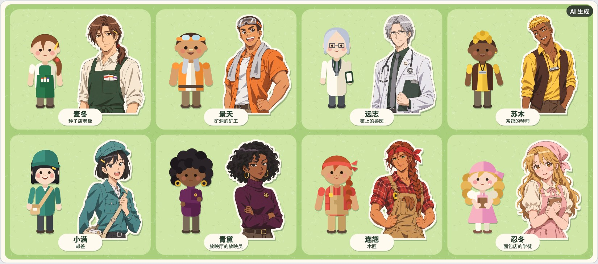
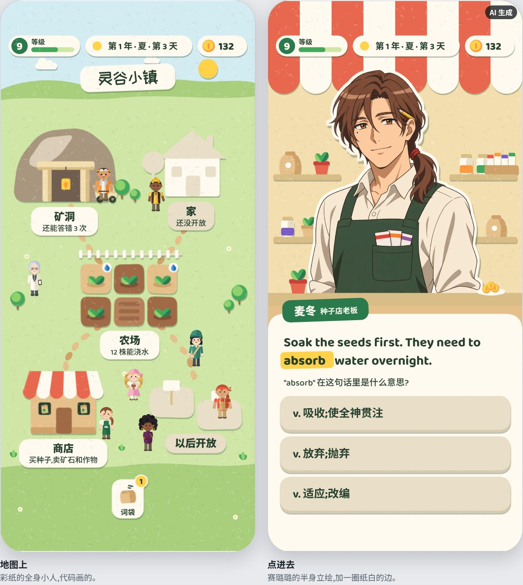
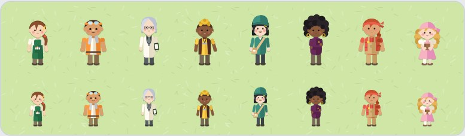
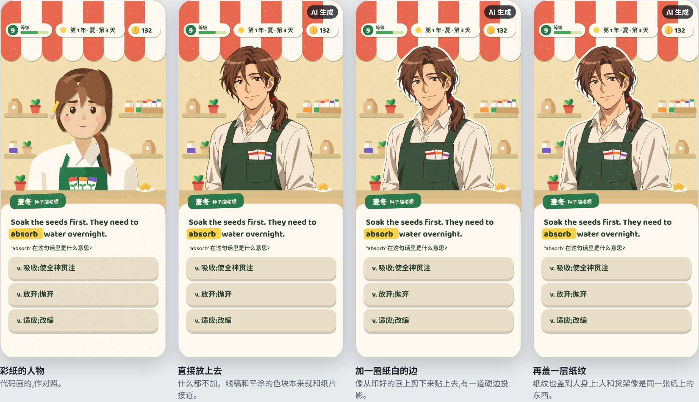
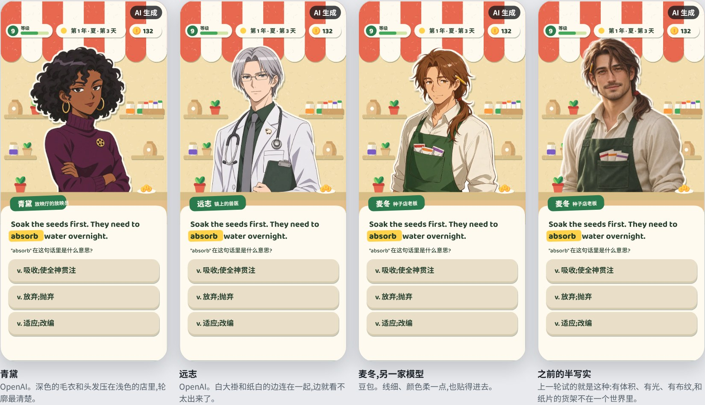
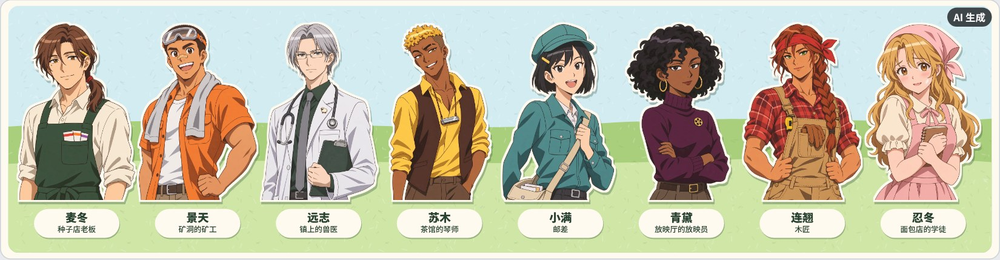
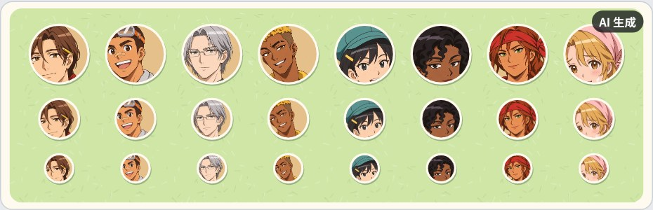
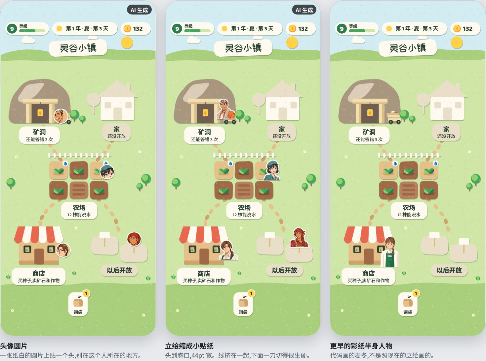

# 彩纸的世界,赛璐璐的人物:贴得进去吗

项目负责人 2026-11-22 的问题(原话):

> 我其实有点喜欢那个彩纸的风格。现在的这个赛璐璐的画风有点不够吸引我,我们能不能探索一下彩纸的风格,加上赛璐璐的人物的画风?这个可行吗?

看过第一版之后负责人又补了一条(原话):

> 我觉得每个人物可以有两种风格,都 coexist。比如说,在地图上看的话,那就用彩纸风的全身人物。如果要说在对话的时候的话,就画成赛璐璐的风格的半身人物画像。

这是一份探索稿,回答"这样搭配看起来行不行"。**它不是决定**:现在生效的仍然是[决策记录 0028](../../decisions/0028-art-direction-illustrated-cel.md)(整个产品用偏插画的赛璐璐),要不要改由负责人定。

**立绘是 AI 生成的,世界、界面和彩纸的全身小人是代码画的。** 立绘是上一轮出的([人物画风探索](../character-style/README.md#四男四女八个年轻居民的设计),OpenAI 和豆包,2026-11-22),这次没有新出图。
居民和对话的玩法都还没有设计,画面里的对话是示意。

## 结论

- **看起来可行。** 线稿加平涂的立绘加一圈纸白的边,放进彩纸的种子店里像拼贴里的一张贴纸。
- **之前没有试过这一种。** 上一轮贴不进去的是半写实的立绘;决定换整个画风的时候,线稿加平涂的立绘还没有往彩纸画面里放过(0028 的"理由"一节记着这一句)。
- **两种画法并存画出来了。** 八个人各有一个彩纸的全身小人(代码画的),放在地图上;点进去是赛璐璐的半身立绘。两边靠同样的发型、头上的东西、衣服颜色和小物件认成同一个人。见[一个人,两种画法](#一个人两种画法)。
- **能成立的搭配是两层:**世界里(地图、农场、矿洞、牧场)只有纸片,人在场景里是彩纸的小人;对话里是大的立绘,要用头像的地方是头像圆片。场景里不放缩小的立绘。
- **没有验证的:**立绘只看了静止的半身像,换表情之后还是不是同一个人没有试;小人只有站着的一个样子。"贴得进去""认得出是同一个人"都是我自己看的,没有问过目标用户。

## 怎么看

用浏览器打开 [`index.html`](index.html),需要联网加载字体。

| 截图 | 内容 |
|---|---|
| [`pairs.jpg`](shots/pairs.jpg) | 一个人,两种画法:八个人的彩纸全身小人和立绘并排 |
| [`two-flow.jpg`](shots/two-flow.jpg) | 地图上的八个小人,和点了麦冬之后的对话 |
| [`mini-rows.jpg`](shots/mini-rows.jpg) | 小人的真实大小:54pt 和 42pt(截图放大了 1.5 倍) |
| [`talk-ways.jpg`](shots/talk-ways.jpg) | 对话里同一个麦冬的四种放法:彩纸人物、直接放、加纸白的边、再盖纸纹 |
| [`talk-more.jpg`](shots/talk-more.jpg) | 换人(青黛、远志)、换模型(豆包的麦冬),和上一轮的半写实 |
| [`lineup.jpg`](shots/lineup.jpg) | 八个人贴在一条彩纸上 |
| [`chips.jpg`](shots/chips.jpg) | 头像圆片:64、44、32pt |
| [`town.jpg`](shots/town.jpg) | 小镇地图上的人:头像圆片、缩小的立绘、彩纸的小人 |

## 一个人,两种画法

负责人的想法:地图上用彩纸的全身小人,对话里用赛璐璐的半身立绘,两种并存。

*每一格左边是彩纸的小人(代码画的),右边是立绘(AI 生成)。*

- **认人靠四样东西,两边画成一样的:**头发的形状和颜色、头上戴的、上衣的颜色、随身的小物件。

| | 头发 | 头上戴的 | 上衣 | 小物件 |
|---|---|---|---|---|
| 麦冬 | 栗色,低马尾搭在肩上 | 耳后的黄铅笔 | 米白衬衫,深绿围裙 | 口袋里三包种子 |
| 景天 | 深褐的寸头 | 护目镜推在额头上 | 敞着的橙衬衫,白 T 恤 | 脖子上的毛巾,鼻梁上的创可贴 |
| 远志 | 银灰,中分到耳下 | 方眼镜 | 白大褂,墨绿衬衫,灰领带 | 听诊器,写字板 |
| 苏木 | 两侧剃短,头顶金色的小卷 | 一只耳钉 | 玉米黄衬衫,深褐马甲 | 挂在脖子上的口琴 |
| 小满 | 齐下巴的黑短发 | 蓝绿的软帽,黄发夹 | 蓝绿的外套 | 斜挎的邮包 |
| 青黛 | 蓬松的黑卷发 | 一对金色的大圆耳环 | 茄紫的高领毛衣 | 金别针;手臂抱在胸前 |
| 连翘 | 铜红,一条粗麻花辫 | 番茄红的头带 | 红格子衬衫,卡其背带工装 | 背带上的卷尺 |
| 忍冬 | 蜂蜜金的长卷发 | 淡粉的三角头巾 | 米白泡泡袖,淡粉围裙裙子 | 抱在胸前的小本子 |

- **当初设计八个人的时候就是按"只看头顶和颜色也分得开"来的,**所以缩成小人之后特征还在。
- **小人头大身子小**(头约占三分之一),和立绘的比例不一样。地图上只有五十多 pt 高,头小了认不出人。
- **最弱的一个是远志。** 银灰的头发加眼镜,配上这么简单的脸,容易看成一位老人;立绘里他是 29 岁。发色调成了偏冷的浅蓝灰,好了一些,没有完全解决。
- **小人的脸都是同一张**(两个点、一片嘴、两片脸颊),立绘里各人的眼神和神情在小人上没有。地图上这么小,我觉得可以接受。
- **青黛的毛衣颜色不在色板里。** 立绘画出来是偏红的深紫,色板里的茄紫偏蓝。为了两边一样,小人照立绘的颜色画了。皮肤和头发的颜色色板里本来就没有。

*左:小镇地图,小人是代码画的。右:点了麦冬之后的对话,立绘是 AI 生成的。地图、种子店和界面都是彩纸原来的代码。*

- **小人在地图上是原生的:**和房子、树、矿车是同一种纸片,同一种硬边投影。
- **从小人到立绘是一次放大,**两种画法不在同一屏里挨着出现。
- **八个人里只有三个有地方站:**景天在矿洞口,麦冬在商店门口,连翘在"以后开放"的空地上(她是木匠)。放映厅、茶馆、面包店、兽医站地图上还没有,另外五个人只是先站在路边。
- **八个人同时站在地图上有点挤。** 谁在什么时候出现是玩法的事,没有设计。

- **54pt 高时八个人分得开,**小物件(铅笔、口琴、别针)看不清了,靠的是头发、帽子和衣服的颜色。**42pt 时还分得开,**只剩颜色和大形。

**代价:每个人要维护两套画。** 改一个人的设计两边都要改,还要对着看是不是还像同一个人。小人是代码画的,改起来便宜;立绘要重出图。

## 看到了什么

### 对话里

*彩纸的种子店、柜台、对话的那张纸、顶部信息都是原来的代码,只换了柜台后面站着的人。左边第一张是代码画的彩纸人物,其余三张的人物是 AI 生成的。*

- **直接放上去就不算突兀。** 立绘是平涂的色块加一圈褐色的线,没有渐变和纹理;衣服的颜色(米白、深绿、栗色)是照色板的颜色名写进提示词的。
- **加一圈纸白的边之后最像这个世界里的东西。** 拼贴里本来就可以有一张从别处剪下来的印刷品;硬边投影和货架、花盆的投影是同一种。
- **再盖一层纸纹,差别很小。** 人身上和脸上多了细碎的纸屑纹。我觉得脸上不该有,倾向不盖。
- **和彩纸人物比:**彩纸的麦冬是这个世界原生的,但五官只有两个点和一条线;立绘有眼神、发丝、衣褶。

*都加了一圈纸白的边。前三张是线稿加平涂,最后一张是上一轮的半写实。人物都是 AI 生成的。*

- **深色的人物贴得最好,浅色的边会化掉。** 青黛的深色毛衣和头发轮廓很清楚;远志的白大褂和纸白的边连成一片。穿浅色衣服的人可能要换一种边,没有试。
- **两家模型都行。** OpenAI 的线硬、色块实,更像纸片;豆包的线细、有一点柔和的过渡,略微"浮"一点。这是我自己看的。
- **半写实的还是不行,**和上一轮的结论一样:脸上有体积和光,衬衫有布纹,旁边的货架是一张张平的纸。
- 这一屏的背景是麦冬的种子店。青黛、远志站在这里只是为了看贴不贴得进去,他们各自的地方没有画。

### 八个人

*OpenAI 画的那一套。人物是 AI 生成的,草地、天和名牌是代码画的。*

- 八个人放在一起像一套贴纸,没有哪一个特别跳出来。
- **豆包那一套里有两个不能用:**小满看起来像未成年人,忍冬也偏小(上一轮就记了)。这里用的是 OpenAI 的八张。
- 上一轮留下的毛病没有改:OpenAI 的连翘偏壮,麦冬的铅笔在另一只耳朵上。

### 小尺寸

- **64 和 44pt 认得出是谁,**靠的是发型和头上的东西(护目镜、报童帽、头巾)。
- **32pt 只剩颜色和大形,**五官糊了。要用这么小的,得单独画简化的头像。

*左:头像圆片。中:立绘缩成小贴纸。右:更早一轮的彩纸半身人物(代码画的)。前两张的人物是 AI 生成的。这三张是画全身小人之前试的。*

- **头像圆片别在地图上可以:**和地点的名牌、角标是同一种纸白的圆片。
- **把立绘直接缩小放进场景不好:**44pt 宽的时候线挤在一起,细节看不清,半身像下面一刀切得很生硬。场景里要站着的小人得另画。
- **右边那个彩纸的麦冬是更早一轮画的,**不是照现在的立绘画的。照立绘画的全身小人见[一个人,两种画法](#一个人两种画法)。

## 为什么这一种贴得进去

| | 彩纸的世界 | 线稿加平涂的人 | 半写实的人 |
|---|---|---|---|
| 颜色怎么铺 | 平涂,每块一个颜色 | 平涂,每种颜色加一层硬边的暗部 | 连续的明暗过渡 |
| 渐变和纹理 | 没有渐变,只有纸纹 | 没有 | 有:皮肤、布纹、发丝 |
| 光 | 没有光源,只有硬边投影 | 没有明显的光源 | 有一盏主光 |
| 边 | 没有线,靠色块的边 | **有一圈褐色的线** | 几乎没有线 |
| 配色 | 色板 | 提示词里按色板的颜色名写的 | 同左,但被光和材质改了 |

差别只剩一处:线。纸白的边正好把这一处接上,线在贴纸里面,贴纸本身还是一块有硬边的纸片。这张表是我对着画面写的,不是量出来的。

## 没做的、没验证的

- **换表情。** 对话里人物要有高兴、疑惑、答错时的表情。上一轮用半写实的图试过"只改脸",线稿加平涂的没有试。
- **小人只有站着的一个样子。** 走路、干活、打招呼都没有画;居民要不要在农场、小镇上走动,是玩法的事,没有设计。
- **每个人自己的地方。** 只有种子店一处彩纸的室内。
- **恋爱向的玩法需要的画面**(更近的镜头、特别的时刻)彩纸的世界接不接得住,没有试。
- 浅色衣服的人用什么边,没有试。
- 没有上真机,没有问过任何目标用户。"贴得进去""吸引人"都是我自己看的。
- 没有逐张比对立绘是否像某个已有作品里的角色。

## 如果改成这样

这一节是给负责人做决定用的,不是已经定了的事。

- **要一条新的决策记录取代 0028。** [美术规范](../07-art-direction.md)写的就是彩纸,大部分重新生效,不用重写,只要加人物这一章。
- **赛璐璐的那三屏素材搁下:**农场 67 个、牧场 35 个、矿洞 14 个,加三张背景([新画风的画面](../cel-screens/README.md))。花掉的是出图的用量和这两天的时间。
- **这两天定的规矩要搬回彩纸的画面:**作物的四种样子([0029](../../decisions/0029-crop-states-in-sprites.md))、答完之后要安静和板子不歪([0030](../../decisions/0030-quiet-after-answer.md))。
  彩纸那几屏现在还是旧的画法。改的是代码,不用出图。
- **世界回到代码画的,**状态由数据决定,不会画错;不用为每个状态出图、切图、逐张核对。
- **AI 生成的只剩人物。** "AI 生成的美术能不能上架、版权归谁"这个问题还在([路线图](../06-roadmap.md)的未决问题),范围从整个画面缩到了立绘。
- **负责人当初说彩纸"不够用",**说的是人物不够吸引人。这个搭配保住了人物;彩纸的世界本身够不够吸引人,这次没有新的证据。

## 文件

| 文件 | 内容 |
|---|---|
| `index.html`、`index.js`、`paper-cel.css` | 画面页 |
| `mix.js` | 把立绘放进彩纸画面的几种放法:对话、一排人、头像圆片、地图上的人、两种画法并排 |
| `minis.js` | 八个居民的彩纸全身小人(代码画的),照立绘和 `../character-style/leads.js` 的设计画 |
| `shots/` | 截图 |

彩纸的画面来自 [`../art-exploration/`](../art-exploration/README.md)、[`../mine-screens/`](../mine-screens/README.md) 和 [`../character-style/`](../character-style/README.md) 的种子店;
立绘是 `../character-style/generated/leads/` 里的 16 张,提示词和登记在那边的 README 和 `manifest.json` 里。这几个目录的文件都没有改,这次没有新的 AI 生成素材。

## 检查过的

- `index.html` 在 390 像素宽和 1280 像素宽的视口下没有脚本报错,没有横向溢出。
- 文档里的相对链接都能打开。
