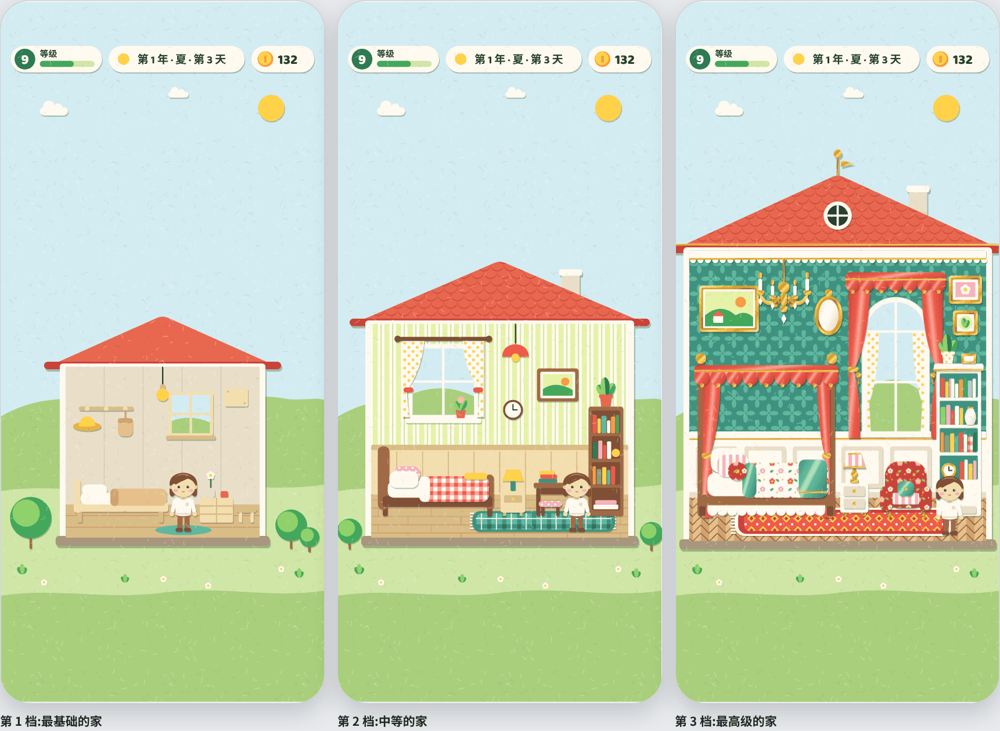

# 画风测试:彩纸拼贴撑不撑得住"升级"和"换装"

一次测试,用来让负责人看图做决定。不是家和角色的设计稿。

背景:负责人定了三个新方向(玩家有自己的角色、可以换装;家可以升级;家里可以摆家具),看过方案稿之后的判断是
"就这个屋子和人物没有办法展示高级,升级换装体现不出来区别",在考虑舍弃这些功能或者换画风。
这里验证第三条路:**不换画风,只在家和角色上放宽[美术规范](../07-art-direction.md)。**

结论先说:**走得通,建议保留彩纸。** 但排得出档次主要靠"画得更多"(大小、件数、轮廓),放宽规范带来的是"看起来贵",
而且只在大图和家里看得见。依据和代价在下面。规范怎么改等负责人看过之后决定,本目录不改规范。

*放宽之后的三档房间。代码绘制的示意稿,不是成品。*

## 怎么看

用浏览器打开 [`index.html`](index.html),需要联网加载字体(Google Fonts)。

- 每一排三张的顺序是打乱的,只标 A、B、C。**先自己排一排谁高谁低,再点"揭晓等级"。**
- 每一组都画了两遍:**放宽之后的**,和**按现在的严格规范的**。两遍用的是同一批纸片、同一个轮廓,
  只把花纹纸换回纯色、金箔换回玉米黄、亮面纸换回纯色、投影只留整层的一道。所以两排之间的差别就是放宽规则带来的差别。
- 小尺寸按真实大小显示(1pt 是屏幕上的 1 个点),请在手机上看。手机上点一张图可以放大。

不方便打开页面时,[`shots/`](shots/) 里是揭晓之后的截图:

| 图 | 内容 |
|---|---|
| [`rooms-relaxed.png`](shots/rooms-relaxed.png)、[`rooms-strict.png`](shots/rooms-strict.png) | 房间三档,放宽和严格 |
| [`corner-relaxed.png`](shots/corner-relaxed.png)、[`corner-strict.png`](shots/corner-strict.png) | 三档裁成同样大的一角,去掉"房间大小"这条线索 |
| [`outfits-relaxed.png`](shots/outfits-relaxed.png)、[`outfits-strict.png`](shots/outfits-strict.png) | 三身衣服的大图 |
| [`sizes-3x.png`](shots/sizes-3x.png) | 72pt、40pt、32pt 的角色,按 3 倍屏截的(放大了 3 倍,手机上实际只有这么大的三分之一) |
| [`context.png`](shots/context.png) | 角色放进农场,房子和角色放进小镇地图 |
| [`houses-relaxed.png`](shots/houses-relaxed.png)、[`houses-strict.png`](shots/houses-strict.png) | 房子外形三档,地图上的大小 |

## 画了什么

- **第一组:同一个房间的三个等级。** 手机竖屏,房子从正面切开。屋里站着同一个角色、同一身默认的衣服(72pt),好让差别只来自房间。
- **第二组:同一个角色的三身衣服。** 衣帽间里的大图(身高 400pt),和 72pt、40pt、32pt 三个小尺寸。
- **房子外形的三个等级**,按小镇地图上的大小。
- **放进已有的画面:** 三身衣服站在农场的空地上;房子和角色放在地图上"家"那块地。农场和地图是已有的画面,一笔没改。

**视角和长相是这次自己定的。** 任务说明里提到的 `home-screens/` 和角色方案稿(家用"剖面"、角色用"纸娃娃形")在仓库的各个分支和合并请求里都没有找到,
所以这里画的是最简单的剖面房间和纸娃娃形角色。它们不是提案,正式的方案出来之后以那边为准。

放宽的四项里用了三项:

| 放宽的内容 | 用了吗 | 说明 |
|---|---|---|
| 花纹纸 | 用了,16 种 | 条纹、方格、格子、圆点、碎花、暗纹墙纸、木地板、人字拼、鱼鳞瓦、草编、地毯。全部由色板里已有的颜色拼出来 |
| 金箔纸、亮面纸 | 用了 | 只给第 3 档。金箔是一条明暗相间的斜向渐变;亮面纸是纯色上一道斜的高光(蓝绿、红、墨绿、纸白四种) |
| 更多层和投影 | 用了 | 高档的东西每贴一层加一道硬边投影;第 1 档只有整层的一道,和现在的规范一样 |
| 模糊的投影 | **试了,去掉了** | 给第 3 档的大件加过一层模糊的投影,放大到两倍对着看也几乎没有差别。所以画面里的投影仍然全部是硬边的 |

没有新增色相。皮肤借用了木色,头发借用了湿土色。

## 五个问题

### 1. 分不分得出档次?

**大图里分得出,而且严格规范的那一排同样分得出。**

- 房间三档、衣服三身,两种规则下都能排出顺序。靠的是房间大小、家具的数量、角色的轮廓(光头、草帽、大檐帽和裙摆)。
  这些和规范无关。也就是说,之前"体现不出区别",主要是那几张稿子画得太省(角色 72pt、7 到 13 片纸、家具没上色),其次才是规范。
- **放宽带来的是"贵",不是顺序。** 看[裁成同样大的一角](shots/corner-relaxed.png):严格规范的第 3 档读成"另一张更大的床",
  放宽之后读成"更好的床"。暗纹墙纸、亮面的帷幔、碎花被子和金箔,是严格规范下拿不到的。
  负责人说的"高级"如果指的是质感,那确实需要放宽;如果指的是"看得出升了级",不放宽也做得到。

**小尺寸里:**

| 大小 | 分得出三身吗 | 放宽和严格的差别 |
|---|---|---|
| 72pt(家里) | 分得出 | 看得出一点:方格和碎花读成细密的纹理,金箔和玉米黄已经很接近 |
| 40pt(场景里) | 分得出,靠轮廓和大色块 | 几乎没有。碎花读成一片杂色,比纯色版略显脏 |
| 32pt(地图上) | 分得出,只靠轮廓和大色块 | 没有 |

- 花纹缩小之后有多大,是算出来的:方格每格在 72pt 的角色上是 1.8pt,40pt 上是 1pt,32pt 上是 0.8pt;
  一朵碎花是 2.7pt、1.5pt、1.2pt;一颗金扣子是 2.1pt、1.2pt、0.9pt。1pt 上下的东西眼睛分不开。
- **缩小之后就没了的:** 所有花纹、金箔的光泽、亮面纸的高光、层与层之间的投影、蕾丝的圆齿、扣子和胸针。
- **留得下来的:** 帽子和发型的形状、裙摆的宽度、身上最大的两三块颜色。
  页面上"只看轮廓"那一排把颜色全拿掉,三身仍然排得出来。
- 所以小尺寸下的档次只能靠轮廓。这是一条限制:一身剪裁简单但料子好的衣服,在场景里和地图上会被看成普通的衣服。
  这一条换任何画风都一样,32pt 高的角色里放不下质感。
- 房子外形在地图上的大小:三档排得出来,放宽和严格几乎一样,只有鱼鳞瓦看得出一点。

### 2. 代价是什么?

页面打开时从图形里现数的,一个 path、rect、circle 或 ellipse 算一片纸。严格规范那一栏片数相同。

| 画的是 | 纸片数 | 花纹纸的种类 | 金箔的纸片 | 亮面纸的纸片 | 单独加投影的层 | 绘制代码 |
|---|---|---|---|---|---|---|
| 房间 第 1 档 | 58 | 0 | 0 | 0 | 0 | 27 行 |
| 房间 第 2 档 | 129 | 7 | 0 | 0 | 7 | 52 行 |
| 房间 第 3 档 | 316 | 9 | 80 | 27 | 37 | 111 行 |
| 衣服 第 1 身 | 29 | 0 | 0 | 0 | 0 | 11 行 |
| 衣服 第 2 身 | 57 | 3 | 0 | 0 | 4 | 25 行 |
| 衣服 第 3 身 | 117 | 2 | 22 | 13 | 13 | 49 行 |
| 房子外形 第 1 档 | 12 | 0 | 0 | 0 | 0 | |
| 房子外形 第 2 档 | 38 | 1 | 0 | 0 | 1 | 三档共 45 行 |
| 房子外形 第 3 档 | 56 | 2 | 6 | 0 | 10 | |

房间的片数含屋顶和墙。单看一张床:第 1 档 8 片,第 2 档 11 片,第 3 档 55 片。
16 种花纹、两种金箔、四种亮面纸的定义一共 87 行,定义一次,所有家具和衣服共用。

**一件东西大概多少工作量(估计,没有实测):**

- 这次的全部画面(三档房间、三身衣服、三档房子,两种规则)是 AI 一次写出来、再看着截图改了三四轮做完的,绘制代码约 700 行。
  没有创作者看着调,审美没有人把过关。
- 按片数推:第 1 档的家具一件 5 到 10 片,估计看一两轮就能定;第 3 档的一件 30 到 60 片,估计要三四轮。
  第 3 档的一身衣服 100 片以上,还要在四个大小下各看一遍、保证轮廓和别的衣服分得开,估计是第 1 身的四五倍。
- 花纹和金箔本身不贵:写一次到处用。贵的是高档的东西层数多。

**"一个人能长期做下去"还成不成立:有条件地成立。**

- 当初这条理由说的是作物:12 种作物、5 个形态、3 种健康状态,靠同一组纸片变换得到,不用重画。这一点没有变,放宽不碰农场。
- 家具和衣服没有"状态",每一件都是新画的,变换帮不上忙。所以它们的成本是**件数乘以每件的片数**。
  放宽让高档的东西每件贵了几倍;但决定总量的是目录有多大(多少件家具、多少身衣服、几档房子),这和画风无关,换画风也省不掉。
- 所以真正要先定的是目录的大小。几十件做得下来;几百件、每件还分档,一个人做不下来,什么画风都一样。
- 没有算进去的成本:角色如果要走动、转身或者有表情,每身衣服要多画几套;发型和衣服如果能自由搭配,要保证每种组合都不穿帮。
  这次的角色只有正面站着的一个姿势。

### 3. 和核心画面还协调吗?

**协调,放在一起像同一个游戏。** 见 [`shots/context.png`](shots/context.png)。

- 角色放进农场是 40pt,放上地图是 32pt。这个大小下花纹和金箔已经看不见了,放宽和严格两版放上去几乎一样。
- 没有变的东西还在撑着:同一套色板、圆胖的形状、没有描边、纸纹、硬边投影。
- 房子放上地图:第 3 档带鱼鳞瓦和金箔的风向标,和旁边纯色的矿洞、商店放在一起不突兀。

要注意的三点:

- **第 3 档的家比农场华丽得多。** 农场和矿洞才是每天要看的地方,家一旦比它们好看一大截,核心画面会显得朴素。
  这不是不协调,是主次的问题,要负责人看图判断。
- **金箔和"黄色表示得到的东西"挨得很近。** 家里没有要认的状态,所以这次没有冲突。金箔不应该进农场、矿洞和牧场。
- **窗外用了天空色。** 规范里蓝色只表示水,天空色只用在远景的天上。窗户里露出来的是窗外的天,我认为不算违反,
  但农场远景里的房子窗户是墨绿的,两处不一样,要统一。

没有验证的:家如果以后要显示学习状态(比如家具跟着记忆变化),在花纹上还认不认得出状态,这次没有测。
花纹纸换色很难用简单的变换做,所以**花纹纸不应该用在带状态的东西上**(作物、牲畜、矿石)。

### 4. 这次测试的局限

**偏保守的地方(真做出来可能比这里好看):**

- 代码画的花纹是规则的几何重复,金箔只是一条渐变。用矢量工具手剪的花纹、扫描的真纸和真金箔的质感,会比这里好。
- 没有动效。金箔如果在引擎里做一点反光的变化,会比静止的渐变更像金箔。

**偏乐观的地方(真做出来可能没有这里好):**

- **每一档只画了一套,而且是成套调过的。** 墙纸、帷幔、地毯的颜色是一起配的。真的家具系统里玩家会把第 1 档的床和第 3 档的吊灯摆在一起,
  混搭之后还好不好看、档次还清不清楚,没有测。
- **三档之间同时变了大小、件数和材质。** 顺序主要是前两样撑起来的。如果升级不改变房间大小,差别会小很多,见裁成一角的那一排。
- **排顺序的人不对。** 我是画的人,知道答案,我说"分得出"不算数。页面上的打乱是给负责人用的;目标玩家一个都没有问过。
- **没有上真机。** 只在桌面浏览器里按手机宽度和 3 倍屏截图看过。72pt 下花纹"看得出一点"这个判断在真机上可能更弱。
- **引擎里怎么做没有试。** 花纹要用平铺的贴图或遮罩,金箔要一张渐变图。Cocos 里的做法、包体和性能都没有验证。
  规范里"源文件是矢量的、每种作物是一组挂在骨架上的纸片"对家具和衣服同样适用,但多了贴图这一种素材。
- **对照栏对严格规范略微不利。** 严格规范并不禁止用纸条拼条纹(西瓜就是这样画的),这里的对照栏一律退回了纯色。
  认真按严格规范画,条纹和格子能补回一部分,碎花、暗纹和金箔补不回来。

**其他没做的:** 没有做色觉模拟;角色只有一种长相、一个姿势;没有和别的发型、肤色搭配;家具、换装、房屋升级的规则都没有设计。
[愿景](../01-vision.md)里写着"没有自由走动的角色",这次画的也是一个站着不动的角色。

### 5. 建议

**保留彩纸,在限定的范围里放宽。不建议换画风;要不要做家和换装,不是画风能回答的问题。**

理由:

1. 档次画得出来。最大的一块差别(大小、件数、轮廓)在现在的规范下就拿得到,之前是稿子画得太省。
2. 放宽补上的是质感,在大图和家里看得见,成本主要是层数,花纹和金箔可以共用。
3. 换画风解决不了小尺寸:32pt 的角色里什么画风都放不下质感。换画风还要重做农场和矿洞,并且丢掉"状态靠变换"这条当初选彩纸的理由。
4. 要不要做家和换装,取决于目录多大、一个人做不做得下来,以及它们怎样让玩家更想打开、让学习更有效
   (比如金币和矿石终于有地方花,见[路线图](../06-roadmap.md#未决问题))。这些这次没有评估。

如果负责人同意放宽,[美术规范](../07-art-direction.md)里要改的是这几条:

| 规范里的位置 | 现在 | 建议 |
|---|---|---|
| 五条原则第 3 条"一切都是纸片" | 纯色、没有描边、没有渐变、没有模糊 | 加一句范围:家的内部、角色的衣服、衣帽间,以及商店里卖这些东西的地方,可以用花纹纸、金箔纸、亮面纸。农场、矿洞、牧场、地图、界面和一切带状态的东西不变 |
| "形状"一节:没有描边、渐变、模糊、发光 | 全部禁止 | 渐变只以金箔纸和亮面纸这两种"纸"的形式出现,不用来画明暗。描边、模糊、发光照旧禁止(模糊的投影试过,没有用) |
| "形状"一节:硬边投影只加在主要层级上 | 一片叶子、一个果实不单独加 | 在家里和角色身上,层数表示档次:最低一档只有整件的一道,高档的可以每贴一层加一道硬边投影 |
| "配色":色板 | 新增颜色要先说明 | 新增"金箔"一组(亮面和暗面各一条渐变)。花纹纸只用色板里已有的颜色拼。皮肤和头发的颜色要定,这次借用了木色和湿土 |
| "配色":用色规则 | 黄色表示得到的东西;每种颜色最多三档明度 | 金箔只留给最高一档,不进农场、矿洞、牧场。亮面纸的高光是三档明度之外的例外 |
| 新增一节"家和角色" | 没有 | 档次按这个顺序表达:先轮廓和大小,再层数,最后材质。每一档衣服必须有轮廓上的差别。40pt 以下用纯色版,不用花纹。花纹纸不用在带状态的东西上 |
| "素材怎么做" | 源文件是矢量的 | 加上花纹纸和金箔这两种可以平铺的素材,引擎里的做法在建工程时定 |
| "还没定的" | | 加上:家具混搭后的效果、引擎里的花纹和金箔、角色的姿势和搭配、家的华丽程度和农场的主次、窗户的颜色统一 |

不用改的:原则 1(先认得出)、原则 2(状态靠变换)、蓝色只表示水、没有描边、没有模糊、不出现修仙和国风的元素。
第 3 档的配色是红、蓝绿、金加纸白,避开了规范点名的紫金。

**在决定之前,建议先做一件事:** 把页面发给两三个目标玩家,只问"哪个最高级",看他们排的顺序和负责人的是不是一样。

## 这些画面是怎么来的

- **全部用代码绘制。** JavaScript 运行时生成 SVG。花纹用 SVG 的图案填充,金箔和亮面纸用渐变,投影用不带模糊的偏移滤镜。
  没有使用图像生成模型,没有使用任何第三方图片。
- 代码由 Claude 编写,属于 AI 协助产出的内容。对外发布这些画面时,按[内容策略](../../marketing/01-content-strategy.md#红线)的要求声明。
- **它们是示意稿,不是成品。** 用途只有一个:比较档次。
- **画面不读取游戏数据。** 顶部的等级、日期、金币沿用农场参考图的示意存档。家具、换装、房屋升级没有规则,画面上的东西不代表会有。
- 不模仿任何具体的已有游戏的画面、角色、服装和配色。

## 文件

| 文件 | 内容 |
|---|---|
| `index.html`、`index.js` | 对比页:打乱和揭晓、数片数、绘制者的判断 |
| `test-paper.js` | 图形:花纹、金箔、亮面纸和投影的定义;纸娃娃形的角色和三身衣服;三档的剖面房间;三档房子的外形;放进农场和地图 |
| `style-test.css` | 对比页自己的样式 |
| `shots/` | 揭晓之后的截图 |

色板和基础图形来自 [`../art-exploration/style-paper.js`](../art-exploration/style-paper.js) 末尾的 `kit`;
农场和地图来自 [`../mine-screens/screens.js`](../mine-screens/screens.js);看稿台的样式沿用 [`../mine-screens/page.css`](../mine-screens/page.css)。
这三个文件都没有改。

`test-paper.js` 里每个画图的函数都有一个 `rich` 参数:`true` 是放宽之后的,`false` 是严格规范的。
花纹纸、金箔、亮面纸和单独的投影各有一个函数(`P`、`foil`、`gloss`、`lift`),严格规范下它们退回纯色和不加投影,其余的纸片完全相同。

`shots/` 里的图是用 Playwright 从 `index.html?reveal` 截的:视口 1180 像素宽、像素比 1.5,`sizes-3x.png` 是像素比 3;
截完量化成 256 色的 PNG。改了绘制代码之后要重新截。

## 检查过的

- `index.html` 在 390 像素宽和 1280 像素宽的视口下没有脚本报错,没有横向溢出。
- 三档房间、三身衣服、三档房子,放宽和严格两版都逐张放大看过。
- 小尺寸按 3 倍屏截图看过。
- 模糊的投影和硬边投影对着比过,结论是去掉。

## 没检查的

- 没有上过真机。
- 没有问过任何目标玩家,也没有让不知道答案的人排过顺序。
- 没有做色觉模拟。
- 没有在引擎里试过花纹和金箔。
